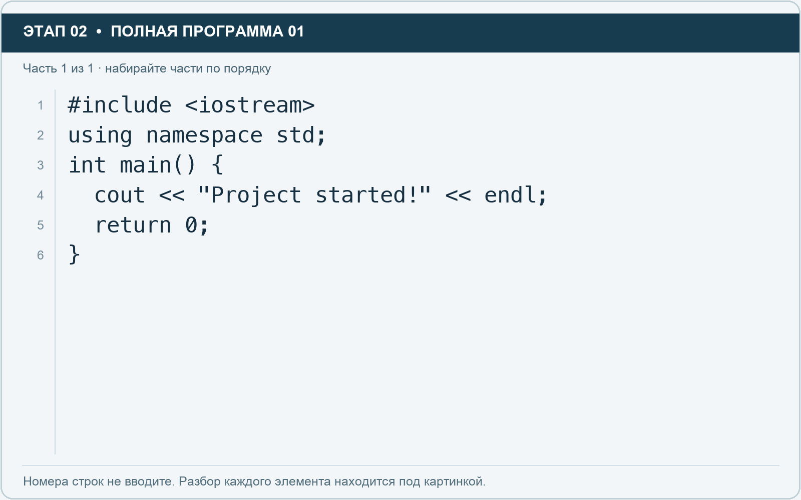

# Этап 2. Наберите первую программу

[← Этап 1](01.md) · [Оглавление](../README.md) · [Этап 3 →](03.md)

Щёлкните внутри редактора `main.cpp`. Выделите исходный пример целиком и удалите его. Наберите **полную программу**:

**Полная программа 1.** Очистите редактор и наберите все 1 части по порядку. После последней части нажмите Run.

**Разбор всех элементов на этой картинке**

- `#include <iostream>` — директива подключения заголовка. # обозначает директиву препроцессора; include означает подключение; < и > ограничивают имя iostream. Заголовок предоставляет стандартные потоки ввода/вывода: cin, cout, endl и настройки потока.
- `using` — вводит директиву использования имён; здесь работает вместе с namespace std.
- `namespace` — обозначает пространство имён; в строке using namespace std разрешает искать имена стандартной библиотеки без префикса std::.
- `std` — пространство имён стандартной библиотеки C++.
- `;` — точка с запятой: завершает объявление или выражение-команду; в заголовке обычного for разделяет начало, условие и шаг.
- `int` — целочисленный тип. В int main задаёт тип возвращаемого кода завершения; в объявлении переменной задаёт её тип.
- `main` — главная функция: выполнение этой программы начинается с неё.
- `(` — открывающая круглая скобка: начинает список параметров/аргументов, условие, заголовок цикла или группировку выражения.
- `)` — закрывающая круглая скобка: завершает соответствующий список, условие или выражение.
- `{` — открывающая фигурная скобка: начинает тело функции/ветки/цикла либо список начальных элементов.
- `cout` — стандартный поток вывода. Вместе с << печатает значения и текст.
- `<<` — оператор передачи значения в поток вывода. Несколько << позволяют последовательно вывести подпись и значения.
- `"Project started!"` — строковый литерал. Двойные кавычки ограничивают текст и сами не печатаются; содержимое используется как сообщение, название или искомый текст.
- `endl` — манипулятор потока: переводит строку и очищает буфер вывода. Точка с запятой после него завершает всю команду вывода.
- `return` — возвращает значение из функции и завершает её выполнение. return 0 в main обозначает успешное завершение.
- `0` — целочисленный литерал — конкретное число. Его роль видна в строке: начальное значение, граница, номер команды, индекс, аргумент или код возврата.
- `}` — закрывающая фигурная скобка: завершает соответствующее тело или список. Ей нужна парная открывающая скобка.

**Что делает каждая строка**

- Строка 1: подключает указанный заголовок до компиляции программы.
- Строка 2: разрешает обращаться к именам стандартной библиотеки без префикса std::.
- Строка 3: открывает главную функцию, с которой начинается выполнение программы.
- Строка 4: начинает вывод: последовательно передаёт в поток текст, значения или настройки после <<.
- Строка 5: завершает текущую функцию и возвращает указанное значение.
- Строка 6: закрывает ближайший открытый блок; соотнесите её с парной открывающей скобкой.

Нажмите **Run**. В области результата должно появиться:

Ожидаемое сообщение:

> Project started!

Служебное сообщение сайта о завершении процесса может находиться ниже. Это не часть вашего вывода.

Разберём написанное:

- `#include <iostream>` подключает средства стандартного ввода и вывода.
- `using namespace std;` позволяет писать `cout`, `cin`, `endl` без префикса `std::`.
- `int main()` — начало главной функции, с которой начинается выполнение этой программы.
- `{` и `}` ограничивают тело функции.
- `cout` направляет данные в стандартный вывод.
- `<<` передаёт очередное значение в поток вывода.
- `"Project started!"` — текстовая строка.
- `endl` переводит строку и очищает буфер вывода. Для обычного переноса строки также подходит `\n`.
- `return 0;` завершает `main`, сообщая об успешном завершении.

**Самостоятельно:** измените сообщение на название своей команды и запустите снова.

**Проверьте написание:** правильно `using namespace std;` — три отдельных слова. Запись `usingnamespace std` не подходит.

---

[← Этап 1](01.md) · [Оглавление](../README.md) · [Этап 3 →](03.md)
