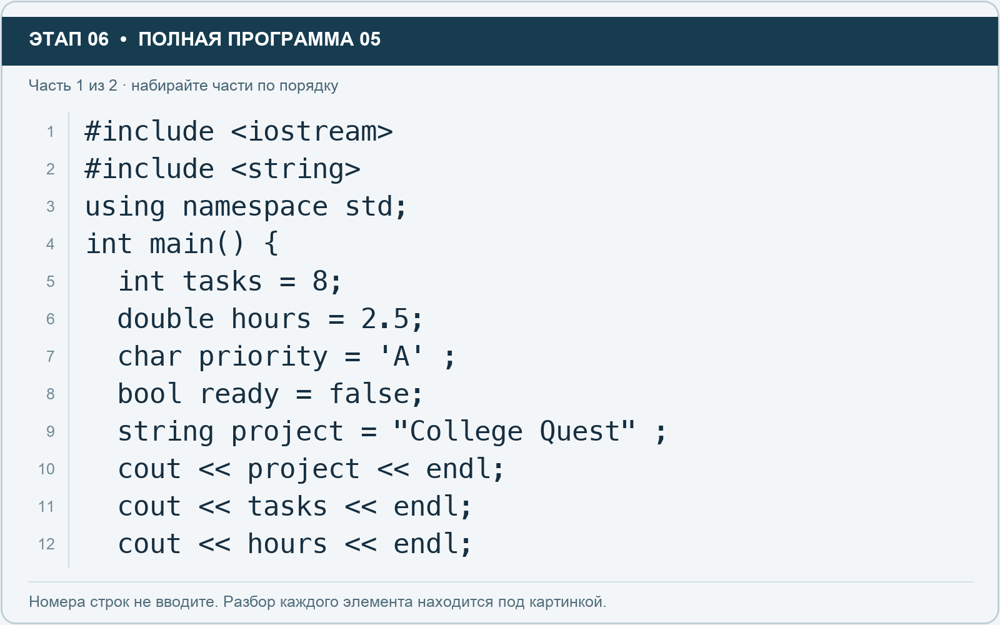
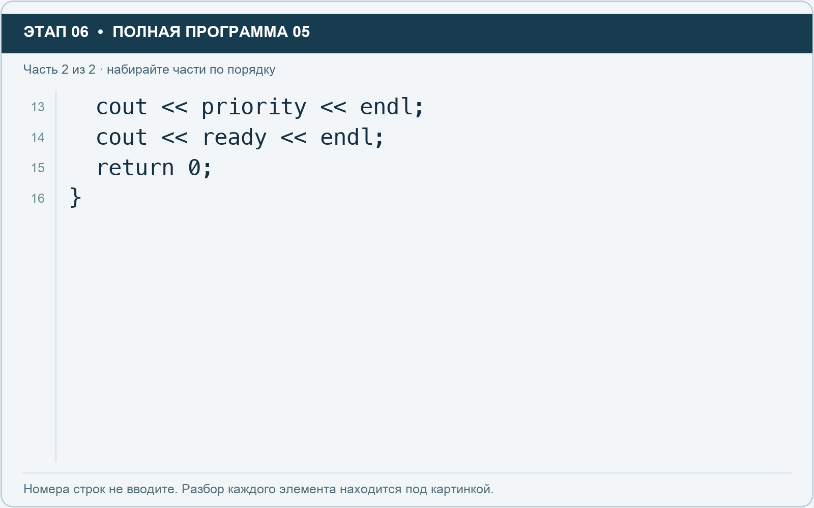

# Этап 6. Познакомьтесь с типами данных

[← Этап 5](05.md) · [Оглавление](../README.md) · [Этап 7 →](07.md)

Добавьте **над** строкой `using namespace std;` ещё одно подключение:

Нужное подключение уже включено в следующую полную программу.

Не удаляйте подключение `iostream`. Теперь замените рабочую область:

**Полная программа 5.** Очистите редактор и наберите все 2 части по порядку. После последней части нажмите Run.

**Разбор всех элементов на этой картинке**

- `#include <iostream>` — директива подключения заголовка. # обозначает директиву препроцессора; include означает подключение; < и > ограничивают имя iostream. Заголовок предоставляет стандартные потоки ввода/вывода: cin, cout, endl и настройки потока.
- `#include <string>` — директива подключения заголовка. # обозначает директиву препроцессора; include означает подключение; < и > ограничивают имя string. Заголовок предоставляет тип string и средства чтения/обработки строк.
- `using` — вводит директиву использования имён; здесь работает вместе с namespace std.
- `namespace` — обозначает пространство имён; в строке using namespace std разрешает искать имена стандартной библиотеки без префикса std::.
- `std` — пространство имён стандартной библиотеки C++.
- `;` — точка с запятой: завершает объявление или выражение-команду; в заголовке обычного for разделяет начало, условие и шаг.
- `int` — целочисленный тип. В int main задаёт тип возвращаемого кода завершения; в объявлении переменной задаёт её тип.
- `main` — главная функция: выполнение этой программы начинается с неё.
- `(` — открывающая круглая скобка: начинает список параметров/аргументов, условие, заголовок цикла или группировку выражения.
- `)` — закрывающая круглая скобка: завершает соответствующий список, условие или выражение.
- `{` — открывающая фигурная скобка: начинает тело функции/ветки/цикла либо список начальных элементов.
- `tasks` — имя переменной/параметра; в этом примере объявлено с типом int. Назначение: количество задач.
- `=` — присваивание: вычислить правую часть и записать результат слева; при объявлении задаёт начальное значение.
- `8` — целочисленный литерал — конкретное число. Его роль видна в строке: начальное значение, граница, номер команды, индекс, аргумент или код возврата.
- `double` — тип числа с плавающей точкой, обычно более точный, чем float. Дробный литерал без суффикса обычно имеет тип double.
- `hours` — имя переменной/параметра; в этом примере объявлено с типом double. Назначение: оценка времени либо коллекция оценок времени.
- `2.5` — дробный числовой литерал типа double без специального суффикса. Точка отделяет дробную часть.
- `char` — тип для одного узкого символа или кодовой единицы; здесь используются латинские символы и специальные символы вроде перевода строки.
- `priority` — имя переменной/параметра; в этом примере объявлено с типом char. Назначение: символьный приоритет.
- `'A'` — символьный литерал в одинарных кавычках. Кавычки задают один char; \n внутри обозначает символ перевода строки, обычный пробел — символ пробела.
- `bool` — логический тип с двумя значениями: true и false.
- `ready` — имя переменной/параметра; в этом примере объявлено с типом bool. Назначение: признак готовности.
- `false` — логическая константа «ложь». Без boolalpha обычно выводится числом 0.
- `string` — стандартная строка: хранит последовательность символов, поддерживает чтение и методы обработки.
- `project` — имя переменной/параметра; в этом примере объявлено с типом string. Назначение: название проекта.
- `"College Quest"` — строковый литерал. Двойные кавычки ограничивают текст и сами не печатаются; содержимое используется как сообщение, название или искомый текст.
- `cout` — стандартный поток вывода. Вместе с << печатает значения и текст.
- `<<` — оператор передачи значения в поток вывода. Несколько << позволяют последовательно вывести подпись и значения.
- `endl` — манипулятор потока: переводит строку и очищает буфер вывода. Точка с запятой после него завершает всю команду вывода.

**Что делает каждая строка**

- Строка 1: подключает указанный заголовок до компиляции программы.
- Строка 2: подключает указанный заголовок до компиляции программы.
- Строка 3: разрешает обращаться к именам стандартной библиотеки без префикса std::.
- Строка 4: открывает главную функцию, с которой начинается выполнение программы.
- Строка 5: создаёт tasks с типом int. Начальное значение берётся из выражения справа от =. Назначение: число задач либо вектор их названий — точный тип указан в объявлении.
- Строка 6: начинает тело do while, выполняемое до проверки условия.
- Строка 7: создаёт priority с типом char. Начальное значение берётся из выражения справа от =. Назначение: символьный приоритет.
- Строка 8: создаёт ready с типом bool. Начальное значение берётся из выражения справа от =. Назначение: признак готовности.
- Строка 9: создаёт project с типом string. Начальное значение берётся из выражения справа от =. Назначение: название проекта.
- Строка 10: начинает вывод: последовательно передаёт в поток текст, значения или настройки после <<.
- Строка 11: начинает вывод: последовательно передаёт в поток текст, значения или настройки после <<.
- Строка 12: начинает вывод: последовательно передаёт в поток текст, значения или настройки после <<.

**Разбор всех элементов на этой картинке**

- `cout` — стандартный поток вывода. Вместе с << печатает значения и текст.
- `<<` — оператор передачи значения в поток вывода. Несколько << позволяют последовательно вывести подпись и значения.
- `priority` — имя переменной/параметра; в этом примере объявлено с типом char. Назначение: символьный приоритет.
- `endl` — манипулятор потока: переводит строку и очищает буфер вывода. Точка с запятой после него завершает всю команду вывода.
- `;` — точка с запятой: завершает объявление или выражение-команду; в заголовке обычного for разделяет начало, условие и шаг.
- `ready` — имя переменной/параметра; в этом примере объявлено с типом bool. Назначение: признак готовности.
- `return` — возвращает значение из функции и завершает её выполнение. return 0 в main обозначает успешное завершение.
- `0` — целочисленный литерал — конкретное число. Его роль видна в строке: начальное значение, граница, номер команды, индекс, аргумент или код возврата.
- `}` — закрывающая фигурная скобка: завершает соответствующее тело или список. Ей нужна парная открывающая скобка.

**Что делает каждая строка**

- Строка 13: начинает вывод: последовательно передаёт в поток текст, значения или настройки после <<.
- Строка 14: начинает вывод: последовательно передаёт в поток текст, значения или настройки после <<.
- Строка 15: завершает текущую функцию и возвращает указанное значение.
- Строка 16: закрывает ближайший открытый блок; соотнесите её с парной открывающей скобкой.

- `int` — целое число: количество задач, людей, дней.
- `double` — число с дробной частью: время или учебная оценка стоимости. Дробную часть записывают через точку.
- `char` — один символ. Здесь используем латинскую букву в одинарных кавычках: `'A'`.
- `bool` — логическое значение `true` или `false`.
- `string` — текстовая строка в двойных кавычках.

При обычном выводе `false` отображается как 0, а `true` как 1.

1. Запустите программу.
2. Измените `ready` на `true`.
3. Измените время на 3.75.
4. Измените приоритет на `'B'`.
5. Запустите снова.

**Самостоятельно:** добавьте `string manager` и `int deadlineDays`, задайте значения и выведите их с подписями.

---

[← Этап 5](05.md) · [Оглавление](../README.md) · [Этап 7 →](07.md)
