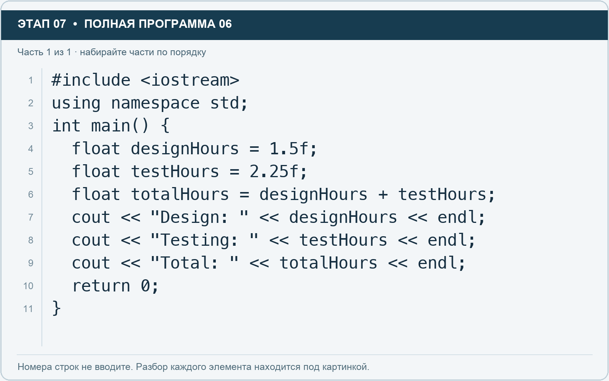

# Этап 7. float: дробные часы работы

[← Этап 6](06.md) · [Оглавление](../README.md) · [Этап 8 →](08.md)

Очистите весь редактор перед новой полной программой. Наберите образец с картинки:

**Полная программа 6.** Очистите редактор и наберите все 1 части по порядку. После последней части нажмите Run.

**Разбор всех элементов на этой картинке**

- `#include <iostream>` — директива подключения заголовка. # обозначает директиву препроцессора; include означает подключение; < и > ограничивают имя iostream. Заголовок предоставляет стандартные потоки ввода/вывода: cin, cout, endl и настройки потока.
- `using` — вводит директиву использования имён; здесь работает вместе с namespace std.
- `namespace` — обозначает пространство имён; в строке using namespace std разрешает искать имена стандартной библиотеки без префикса std::.
- `std` — пространство имён стандартной библиотеки C++.
- `;` — точка с запятой: завершает объявление или выражение-команду; в заголовке обычного for разделяет начало, условие и шаг.
- `int` — целочисленный тип. В int main задаёт тип возвращаемого кода завершения; в объявлении переменной задаёт её тип.
- `main` — главная функция: выполнение этой программы начинается с неё.
- `(` — открывающая круглая скобка: начинает список параметров/аргументов, условие, заголовок цикла или группировку выражения.
- `)` — закрывающая круглая скобка: завершает соответствующий список, условие или выражение.
- `{` — открывающая фигурная скобка: начинает тело функции/ветки/цикла либо список начальных элементов.
- `float` — тип числа с плавающей точкой. Литералы с суффиксом f имеют этот тип; возможна погрешность представления дробей.
- `designHours` — имя переменной/параметра; в этом примере объявлено с типом float. Назначение: оценка часов на проектирование.
- `=` — присваивание: вычислить правую часть и записать результат слева; при объявлении задаёт начальное значение.
- `1.5f` — числовой литерал типа float: точка задаёт дробную часть, суффикс f указывает тип. При вводе пользователем суффикс не печатают.
- `testHours` — имя переменной/параметра; в этом примере объявлено с типом float. Назначение: оценка часов на тестирование.
- `2.25f` — числовой литерал типа float: точка задаёт дробную часть, суффикс f указывает тип. При вводе пользователем суффикс не печатают.
- `totalHours` — имя переменной/параметра; в этом примере объявлено с типом float. Назначение: суммарная оценка времени.
- `+` — сложение чисел или объединение строки с другой строкой/строковым литералом. В i + 1 переводит индекс в привычный номер.
- `cout` — стандартный поток вывода. Вместе с << печатает значения и текст.
- `<<` — оператор передачи значения в поток вывода. Несколько << позволяют последовательно вывести подпись и значения.
- `"Design: "` — строковый литерал. Двойные кавычки ограничивают текст и сами не печатаются; содержимое используется как сообщение, название или искомый текст. Пробел внутри кавычек является частью текста и сохраняется.
- `endl` — манипулятор потока: переводит строку и очищает буфер вывода. Точка с запятой после него завершает всю команду вывода.
- `"Testing: "` — строковый литерал. Двойные кавычки ограничивают текст и сами не печатаются; содержимое используется как сообщение, название или искомый текст. Пробел внутри кавычек является частью текста и сохраняется.
- `"Total: "` — строковый литерал. Двойные кавычки ограничивают текст и сами не печатаются; содержимое используется как сообщение, название или искомый текст. Пробел внутри кавычек является частью текста и сохраняется.
- `return` — возвращает значение из функции и завершает её выполнение. return 0 в main обозначает успешное завершение.
- `0` — целочисленный литерал — конкретное число. Его роль видна в строке: начальное значение, граница, номер команды, индекс, аргумент или код возврата.
- `}` — закрывающая фигурная скобка: завершает соответствующее тело или список. Ей нужна парная открывающая скобка.

**Что делает каждая строка**

- Строка 1: подключает указанный заголовок до компиляции программы.
- Строка 2: разрешает обращаться к именам стандартной библиотеки без префикса std::.
- Строка 3: открывает главную функцию, с которой начинается выполнение программы.
- Строка 4: создаёт designHours с типом float. Начальное значение берётся из выражения справа от =. Назначение: оценка часов на проектирование.
- Строка 5: создаёт testHours с типом float. Начальное значение берётся из выражения справа от =. Назначение: оценка часов на тестирование.
- Строка 6: создаёт totalHours с типом float. Начальное значение берётся из выражения справа от =. Назначение: суммарная оценка времени.
- Строка 7: начинает вывод: последовательно передаёт в поток текст, значения или настройки после <<.
- Строка 8: начинает вывод: последовательно передаёт в поток текст, значения или настройки после <<.
- Строка 9: начинает вывод: последовательно передаёт в поток текст, значения или настройки после <<.
- Строка 10: завершает текущую функцию и возвращает указанное значение.
- Строка 11: закрывает ближайший открытый блок; соотнесите её с парной открывающей скобкой.

Ожидаемая сумма — 3.75. Тип `float` хранит число с плавающей точкой, поэтому позволяет работать с дробными значениями. Суффикс `f` у литерала означает, что записанная константа имеет тип float. Без суффикса дробный литерал обычно имеет тип double и при присваивании float преобразуется.

1. Измените проектирование на 1.75 часа.
2. Измените тестирование на 0.5 часа.
3. До запуска посчитайте сумму самостоятельно.
4. Добавьте третью переменную `demoHours` для подготовки показа.
5. Включите её в общую сумму и выведите отдельной строкой.

Пишите дробь через точку. Число `1.5f` является одной записью; между цифрами, точкой и суффиксом пробелы не нужны.

---

[← Этап 6](06.md) · [Оглавление](../README.md) · [Этап 8 →](08.md)
