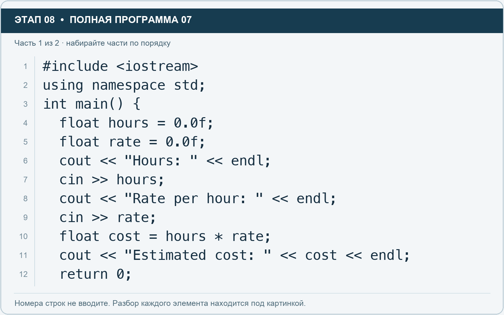
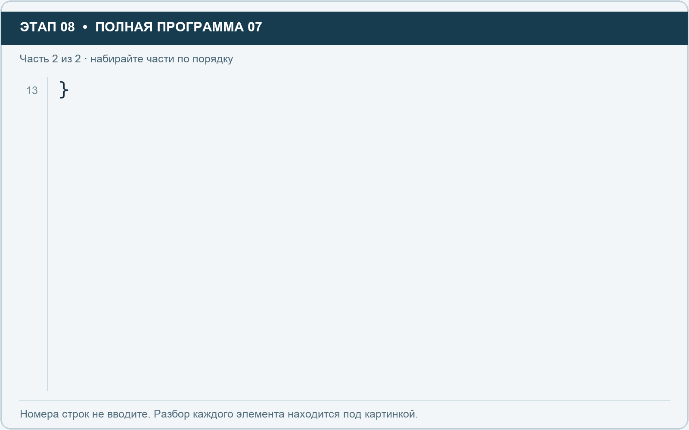

# Этап 8. Считайте float с клавиатуры

[← Этап 7](07.md) · [Оглавление](../README.md) · [Этап 9 →](09.md)

Очистите весь редактор и наберите полную программу:

**Полная программа 7.** Очистите редактор и наберите все 2 части по порядку. После последней части нажмите Run.

**Разбор всех элементов на этой картинке**

- `#include <iostream>` — директива подключения заголовка. # обозначает директиву препроцессора; include означает подключение; < и > ограничивают имя iostream. Заголовок предоставляет стандартные потоки ввода/вывода: cin, cout, endl и настройки потока.
- `using` — вводит директиву использования имён; здесь работает вместе с namespace std.
- `namespace` — обозначает пространство имён; в строке using namespace std разрешает искать имена стандартной библиотеки без префикса std::.
- `std` — пространство имён стандартной библиотеки C++.
- `;` — точка с запятой: завершает объявление или выражение-команду; в заголовке обычного for разделяет начало, условие и шаг.
- `int` — целочисленный тип. В int main задаёт тип возвращаемого кода завершения; в объявлении переменной задаёт её тип.
- `main` — главная функция: выполнение этой программы начинается с неё.
- `(` — открывающая круглая скобка: начинает список параметров/аргументов, условие, заголовок цикла или группировку выражения.
- `)` — закрывающая круглая скобка: завершает соответствующий список, условие или выражение.
- `{` — открывающая фигурная скобка: начинает тело функции/ветки/цикла либо список начальных элементов.
- `float` — тип числа с плавающей точкой. Литералы с суффиксом f имеют этот тип; возможна погрешность представления дробей.
- `hours` — имя переменной/параметра; в этом примере объявлено с типом float. Назначение: оценка времени либо коллекция оценок времени.
- `=` — присваивание: вычислить правую часть и записать результат слева; при объявлении задаёт начальное значение.
- `0.0f` — числовой литерал типа float: точка задаёт дробную часть, суффикс f указывает тип. При вводе пользователем суффикс не печатают.
- `rate` — имя переменной/параметра; в этом примере объявлено с типом float. Назначение: ставка или коэффициент.
- `cout` — стандартный поток вывода. Вместе с << печатает значения и текст.
- `<<` — оператор передачи значения в поток вывода. Несколько << позволяют последовательно вывести подпись и значения.
- `"Hours: "` — строковый литерал. Двойные кавычки ограничивают текст и сами не печатаются; содержимое используется как сообщение, название или искомый текст. Пробел внутри кавычек является частью текста и сохраняется.
- `endl` — манипулятор потока: переводит строку и очищает буфер вывода. Точка с запятой после него завершает всю команду вывода.
- `cin` — стандартный поток ввода. Вместе с >> читает значения; результат чтения можно проверить как логическое условие.
- `>>` — оператор чтения из потока ввода в указанную переменную; в cin >> ws применяется манипулятор потока.
- `"Rate per hour: "` — строковый литерал. Двойные кавычки ограничивают текст и сами не печатаются; содержимое используется как сообщение, название или искомый текст. Пробел внутри кавычек является частью текста и сохраняется.
- `cost` — имя переменной/параметра; в этом примере объявлено с типом float. Назначение: рассчитанная стоимость.
- `*` — умножение; например часы умножаются на ставку.
- `"Estimated cost: "` — строковый литерал. Двойные кавычки ограничивают текст и сами не печатаются; содержимое используется как сообщение, название или искомый текст. Пробел внутри кавычек является частью текста и сохраняется.
- `return` — возвращает значение из функции и завершает её выполнение. return 0 в main обозначает успешное завершение.
- `0` — целочисленный литерал — конкретное число. Его роль видна в строке: начальное значение, граница, номер команды, индекс, аргумент или код возврата.

**Что делает каждая строка**

- Строка 1: подключает указанный заголовок до компиляции программы.
- Строка 2: разрешает обращаться к именам стандартной библиотеки без префикса std::.
- Строка 3: открывает главную функцию, с которой начинается выполнение программы.
- Строка 4: создаёт hours с типом float. Начальное значение берётся из выражения справа от =. Назначение: оценка времени либо коллекция оценок времени.
- Строка 5: создаёт rate с типом float. Начальное значение берётся из выражения справа от =. Назначение: ставка или коэффициент.
- Строка 6: начинает вывод: последовательно передаёт в поток текст, значения или настройки после <<.
- Строка 7: считывает пользовательские данные в указанную переменную.
- Строка 8: начинает вывод: последовательно передаёт в поток текст, значения или настройки после <<.
- Строка 9: считывает пользовательские данные в указанную переменную.
- Строка 10: создаёт cost с типом float. Начальное значение берётся из выражения справа от =. Назначение: рассчитанная стоимость.
- Строка 11: начинает вывод: последовательно передаёт в поток текст, значения или настройки после <<.
- Строка 12: завершает текущую функцию и возвращает указанное значение.

**Разбор всех элементов на этой картинке**

- `}` — закрывающая фигурная скобка: завершает соответствующее тело или список. Ей нужна парная открывающая скобка.

**Что делает каждая строка**

- Строка 13: закрывает ближайший открытый блок; соотнесите её с парной открывающей скобкой.

1. Нажмите Run.
2. В области Output введите 2.5 и Enter.
3. Затем введите 120 и Enter.
4. Проверьте результат: 300.
5. Запустите заново с 1.25 часа и ставкой 80: результат 100.

При вводе через консоль суффикс f не печатают: пользователь вводит `2.5`, а не `2.5f`. Суффикс относится к числовому литералу в исходном коде.

**Самостоятельно:** добавьте вопрос о времени проверки и включите его в оплачиваемые часы. Для первого теста используйте неотрицательные значения.

---

[← Этап 7](07.md) · [Оглавление](../README.md) · [Этап 9 →](09.md)
