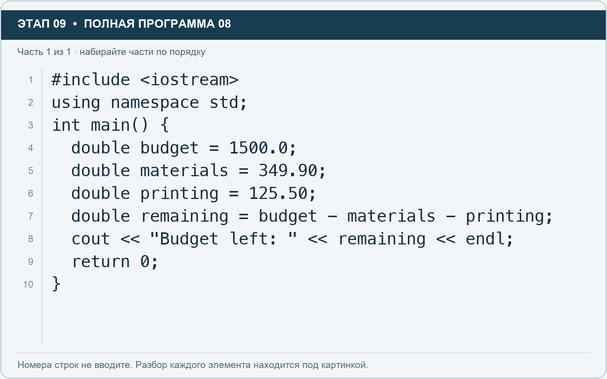

# Этап 9. double: расчёт бюджета

[← Этап 8](08.md) · [Оглавление](../README.md) · [Этап 10 →](10.md)

Очистите весь редактор и наберите полную программу:

**Полная программа 8.** Очистите редактор и наберите все 1 части по порядку. После последней части нажмите Run.

**Разбор всех элементов на этой картинке**

- `#include <iostream>` — директива подключения заголовка. # обозначает директиву препроцессора; include означает подключение; < и > ограничивают имя iostream. Заголовок предоставляет стандартные потоки ввода/вывода: cin, cout, endl и настройки потока.
- `using` — вводит директиву использования имён; здесь работает вместе с namespace std.
- `namespace` — обозначает пространство имён; в строке using namespace std разрешает искать имена стандартной библиотеки без префикса std::.
- `std` — пространство имён стандартной библиотеки C++.
- `;` — точка с запятой: завершает объявление или выражение-команду; в заголовке обычного for разделяет начало, условие и шаг.
- `int` — целочисленный тип. В int main задаёт тип возвращаемого кода завершения; в объявлении переменной задаёт её тип.
- `main` — главная функция: выполнение этой программы начинается с неё.
- `(` — открывающая круглая скобка: начинает список параметров/аргументов, условие, заголовок цикла или группировку выражения.
- `)` — закрывающая круглая скобка: завершает соответствующий список, условие или выражение.
- `{` — открывающая фигурная скобка: начинает тело функции/ветки/цикла либо список начальных элементов.
- `double` — тип числа с плавающей точкой, обычно более точный, чем float. Дробный литерал без суффикса обычно имеет тип double.
- `budget` — имя переменной/параметра; в этом примере объявлено с типом double. Назначение: доступный бюджет.
- `=` — присваивание: вычислить правую часть и записать результат слева; при объявлении задаёт начальное значение.
- `1500.0` — дробный числовой литерал типа double без специального суффикса. Точка отделяет дробную часть.
- `materials` — имя переменной/параметра; в этом примере объявлено с типом double. Назначение: расходы на материалы.
- `349.90` — дробный числовой литерал типа double без специального суффикса. Точка отделяет дробную часть.
- `printing` — имя переменной/параметра; в этом примере объявлено с типом double. Назначение: расходы на печать.
- `125.50` — дробный числовой литерал типа double без специального суффикса. Точка отделяет дробную часть.
- `remaining` — имя переменной/параметра; в этом примере объявлено с типом double. Назначение: оставшееся количество или остаток бюджета.
- `-` — вычитание или знак отрицательного числа. В count - 1 получает последний индекс.
- `cout` — стандартный поток вывода. Вместе с << печатает значения и текст.
- `<<` — оператор передачи значения в поток вывода. Несколько << позволяют последовательно вывести подпись и значения.
- `"Budget left: "` — строковый литерал. Двойные кавычки ограничивают текст и сами не печатаются; содержимое используется как сообщение, название или искомый текст. Пробел внутри кавычек является частью текста и сохраняется.
- `endl` — манипулятор потока: переводит строку и очищает буфер вывода. Точка с запятой после него завершает всю команду вывода.
- `return` — возвращает значение из функции и завершает её выполнение. return 0 в main обозначает успешное завершение.
- `0` — целочисленный литерал — конкретное число. Его роль видна в строке: начальное значение, граница, номер команды, индекс, аргумент или код возврата.
- `}` — закрывающая фигурная скобка: завершает соответствующее тело или список. Ей нужна парная открывающая скобка.

**Что делает каждая строка**

- Строка 1: подключает указанный заголовок до компиляции программы.
- Строка 2: разрешает обращаться к именам стандартной библиотеки без префикса std::.
- Строка 3: открывает главную функцию, с которой начинается выполнение программы.
- Строка 4: начинает тело do while, выполняемое до проверки условия.
- Строка 5: начинает тело do while, выполняемое до проверки условия.
- Строка 6: начинает тело do while, выполняемое до проверки условия.
- Строка 7: начинает тело do while, выполняемое до проверки условия.
- Строка 8: начинает вывод: последовательно передаёт в поток текст, значения или настройки после <<.
- Строка 9: завершает текущую функцию и возвращает указанное значение.
- Строка 10: закрывает ближайший открытый блок; соотнесите её с парной открывающей скобкой.

Должно остаться 1024.6. Double обычно обеспечивает большую точность, чем float; конкретные свойства зависят от реализации. Для обычных учебных дробных вычислений часто выбирают double.

1. Измените бюджет на 2000.
2. Добавьте расходы на оформление 275.25.
3. Пересчитайте остаток.
4. Выведите общие расходы и остаток отдельно.

Это учебная оценка. Для точных денежных расчётов удобно хранить целое количество копеек, поскольку многие десятичные дроби не представляются точно в обычных двоичных float и double.

---

[← Этап 8](08.md) · [Оглавление](../README.md) · [Этап 10 →](10.md)
