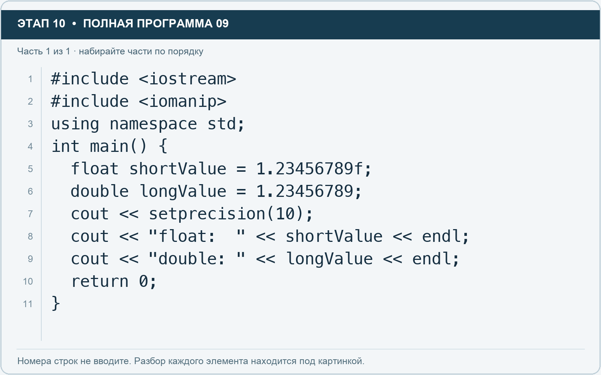

# Этап 10. Сравните точность float и double

[← Этап 9](09.md) · [Оглавление](../README.md) · [Этап 11 →](11.md)

Добавьте подключение `#include <iomanip>` перед using namespace std. Затем замените рабочую область:

**Полная программа 9.** Очистите редактор и наберите все 1 части по порядку. После последней части нажмите Run.

**Разбор всех элементов на этой картинке**

- `#include <iostream>` — директива подключения заголовка. # обозначает директиву препроцессора; include означает подключение; < и > ограничивают имя iostream. Заголовок предоставляет стандартные потоки ввода/вывода: cin, cout, endl и настройки потока.
- `#include <iomanip>` — директива подключения заголовка. # обозначает директиву препроцессора; include означает подключение; < и > ограничивают имя iomanip. Заголовок предоставляет манипулятор setprecision для точности вывода.
- `using` — вводит директиву использования имён; здесь работает вместе с namespace std.
- `namespace` — обозначает пространство имён; в строке using namespace std разрешает искать имена стандартной библиотеки без префикса std::.
- `std` — пространство имён стандартной библиотеки C++.
- `;` — точка с запятой: завершает объявление или выражение-команду; в заголовке обычного for разделяет начало, условие и шаг.
- `int` — целочисленный тип. В int main задаёт тип возвращаемого кода завершения; в объявлении переменной задаёт её тип.
- `main` — главная функция: выполнение этой программы начинается с неё.
- `(` — открывающая круглая скобка: начинает список параметров/аргументов, условие, заголовок цикла или группировку выражения.
- `)` — закрывающая круглая скобка: завершает соответствующий список, условие или выражение.
- `{` — открывающая фигурная скобка: начинает тело функции/ветки/цикла либо список начальных элементов.
- `float` — тип числа с плавающей точкой. Литералы с суффиксом f имеют этот тип; возможна погрешность представления дробей.
- `shortValue` — имя переменной/параметра; в этом примере объявлено с типом float. Назначение: число, сохранённое в float для сравнения точности.
- `=` — присваивание: вычислить правую часть и записать результат слева; при объявлении задаёт начальное значение.
- `1.23456789f` — числовой литерал типа float: точка задаёт дробную часть, суффикс f указывает тип. При вводе пользователем суффикс не печатают.
- `double` — тип числа с плавающей точкой, обычно более точный, чем float. Дробный литерал без суффикса обычно имеет тип double.
- `longValue` — имя переменной/параметра; в этом примере объявлено с типом double. Назначение: аналогичное число, сохранённое в double для сравнения точности.
- `1.23456789` — дробный числовой литерал типа double без специального суффикса. Точка отделяет дробную часть.
- `cout` — стандартный поток вывода. Вместе с << печатает значения и текст.
- `<<` — оператор передачи значения в поток вывода. Несколько << позволяют последовательно вывести подпись и значения.
- `setprecision` — настраивает точность вывода. С fixed — число знаков после точки; без fixed — число значащих цифр.
- `10` — целочисленный литерал — конкретное число. Его роль видна в строке: начальное значение, граница, номер команды, индекс, аргумент или код возврата.
- `"float:  "` — строковый литерал. Двойные кавычки ограничивают текст и сами не печатаются; содержимое используется как сообщение, название или искомый текст. Пробел внутри кавычек является частью текста и сохраняется.
- `endl` — манипулятор потока: переводит строку и очищает буфер вывода. Точка с запятой после него завершает всю команду вывода.
- `"double: "` — строковый литерал. Двойные кавычки ограничивают текст и сами не печатаются; содержимое используется как сообщение, название или искомый текст. Пробел внутри кавычек является частью текста и сохраняется.
- `return` — возвращает значение из функции и завершает её выполнение. return 0 в main обозначает успешное завершение.
- `0` — целочисленный литерал — конкретное число. Его роль видна в строке: начальное значение, граница, номер команды, индекс, аргумент или код возврата.
- `}` — закрывающая фигурная скобка: завершает соответствующее тело или список. Ей нужна парная открывающая скобка.

**Что делает каждая строка**

- Строка 1: подключает указанный заголовок до компиляции программы.
- Строка 2: подключает указанный заголовок до компиляции программы.
- Строка 3: разрешает обращаться к именам стандартной библиотеки без префикса std::.
- Строка 4: открывает главную функцию, с которой начинается выполнение программы.
- Строка 5: создаёт shortValue с типом float. Начальное значение берётся из выражения справа от =. Назначение: число, сохранённое в float для сравнения точности.
- Строка 6: начинает тело do while, выполняемое до проверки условия.
- Строка 7: начинает вывод: последовательно передаёт в поток текст, значения или настройки после <<.
- Строка 8: начинает вывод: последовательно передаёт в поток текст, значения или настройки после <<.
- Строка 9: начинает вывод: последовательно передаёт в поток текст, значения или настройки после <<.
- Строка 10: завершает текущую функцию и возвращает указанное значение.
- Строка 11: закрывает ближайший открытый блок; соотнесите её с парной открывающей скобкой.

1. Запустите и сравните цифры после точки.
2. Замените оба исходных числа на 9.87654321, сохранив f только у float.
3. Повторите запуск.
4. Запишите, в какой строке заметнее отличие от набранного десятичного числа.

Setprecision меняет оформление вывода, но не добавляет числу точности. Без fixed здесь задаётся число значащих цифр. Точный вид последних цифр зависит от используемой реализации.

---

[← Этап 9](09.md) · [Оглавление](../README.md) · [Этап 11 →](11.md)
