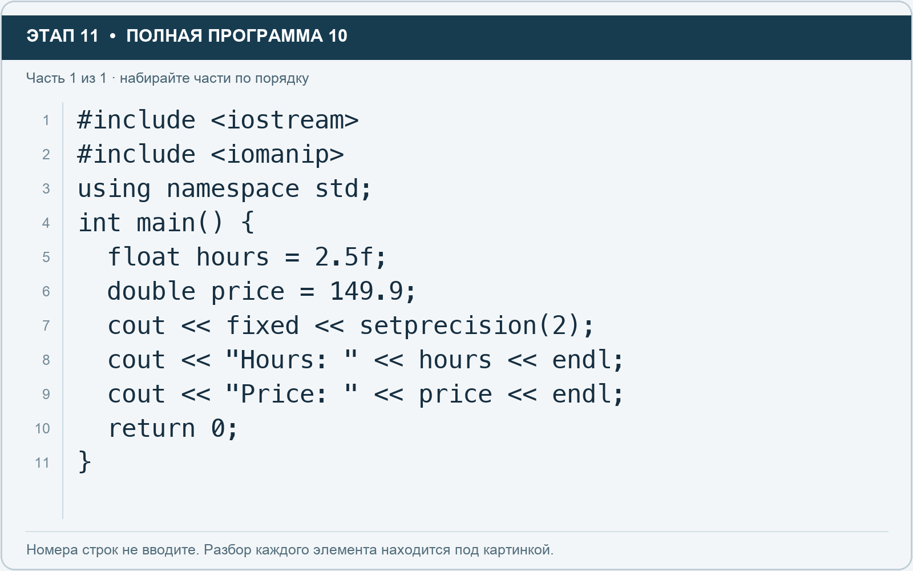

# Этап 11. fixed и setprecision: аккуратный отчёт

[← Этап 10](10.md) · [Оглавление](../README.md) · [Этап 12 →](12.md)

Подключение iomanip уже должно находиться сверху. Очистите весь редактор и наберите полную программу:

**Полная программа 10.** Очистите редактор и наберите все 1 части по порядку. После последней части нажмите Run.

**Разбор всех элементов на этой картинке**

- `#include <iostream>` — директива подключения заголовка. # обозначает директиву препроцессора; include означает подключение; < и > ограничивают имя iostream. Заголовок предоставляет стандартные потоки ввода/вывода: cin, cout, endl и настройки потока.
- `#include <iomanip>` — директива подключения заголовка. # обозначает директиву препроцессора; include означает подключение; < и > ограничивают имя iomanip. Заголовок предоставляет манипулятор setprecision для точности вывода.
- `using` — вводит директиву использования имён; здесь работает вместе с namespace std.
- `namespace` — обозначает пространство имён; в строке using namespace std разрешает искать имена стандартной библиотеки без префикса std::.
- `std` — пространство имён стандартной библиотеки C++.
- `;` — точка с запятой: завершает объявление или выражение-команду; в заголовке обычного for разделяет начало, условие и шаг.
- `int` — целочисленный тип. В int main задаёт тип возвращаемого кода завершения; в объявлении переменной задаёт её тип.
- `main` — главная функция: выполнение этой программы начинается с неё.
- `(` — открывающая круглая скобка: начинает список параметров/аргументов, условие, заголовок цикла или группировку выражения.
- `)` — закрывающая круглая скобка: завершает соответствующий список, условие или выражение.
- `{` — открывающая фигурная скобка: начинает тело функции/ветки/цикла либо список начальных элементов.
- `float` — тип числа с плавающей точкой. Литералы с суффиксом f имеют этот тип; возможна погрешность представления дробей.
- `hours` — имя переменной/параметра; в этом примере объявлено с типом float. Назначение: оценка времени либо коллекция оценок времени.
- `=` — присваивание: вычислить правую часть и записать результат слева; при объявлении задаёт начальное значение.
- `2.5f` — числовой литерал типа float: точка задаёт дробную часть, суффикс f указывает тип. При вводе пользователем суффикс не печатают.
- `double` — тип числа с плавающей точкой, обычно более точный, чем float. Дробный литерал без суффикса обычно имеет тип double.
- `price` — имя переменной/параметра; в этом примере объявлено с типом double. Назначение: оценочная цена.
- `149.9` — дробный числовой литерал типа double без специального суффикса. Точка отделяет дробную часть.
- `cout` — стандартный поток вывода. Вместе с << печатает значения и текст.
- `<<` — оператор передачи значения в поток вывода. Несколько << позволяют последовательно вывести подпись и значения.
- `fixed` — включает фиксированную запись дробных чисел. Вместе с setprecision задаёт число знаков после точки.
- `setprecision` — настраивает точность вывода. С fixed — число знаков после точки; без fixed — число значащих цифр.
- `2` — целочисленный литерал — конкретное число. Его роль видна в строке: начальное значение, граница, номер команды, индекс, аргумент или код возврата.
- `"Hours: "` — строковый литерал. Двойные кавычки ограничивают текст и сами не печатаются; содержимое используется как сообщение, название или искомый текст. Пробел внутри кавычек является частью текста и сохраняется.
- `endl` — манипулятор потока: переводит строку и очищает буфер вывода. Точка с запятой после него завершает всю команду вывода.
- `"Price: "` — строковый литерал. Двойные кавычки ограничивают текст и сами не печатаются; содержимое используется как сообщение, название или искомый текст. Пробел внутри кавычек является частью текста и сохраняется.
- `return` — возвращает значение из функции и завершает её выполнение. return 0 в main обозначает успешное завершение.
- `0` — целочисленный литерал — конкретное число. Его роль видна в строке: начальное значение, граница, номер команды, индекс, аргумент или код возврата.
- `}` — закрывающая фигурная скобка: завершает соответствующее тело или список. Ей нужна парная открывающая скобка.

**Что делает каждая строка**

- Строка 1: подключает указанный заголовок до компиляции программы.
- Строка 2: подключает указанный заголовок до компиляции программы.
- Строка 3: разрешает обращаться к именам стандартной библиотеки без префикса std::.
- Строка 4: открывает главную функцию, с которой начинается выполнение программы.
- Строка 5: создаёт hours с типом float. Начальное значение берётся из выражения справа от =. Назначение: оценка времени либо коллекция оценок времени.
- Строка 6: начинает тело do while, выполняемое до проверки условия.
- Строка 7: начинает вывод: последовательно передаёт в поток текст, значения или настройки после <<.
- Строка 8: начинает вывод: последовательно передаёт в поток текст, значения или настройки после <<.
- Строка 9: начинает вывод: последовательно передаёт в поток текст, значения или настройки после <<.
- Строка 10: завершает текущую функцию и возвращает указанное значение.
- Строка 11: закрывает ближайший открытый блок; соотнесите её с парной открывающей скобкой.

Ожидаемый вывод: 2.50 и 149.90. Вместе с fixed параметр setprecision задаёт количество знаков после десятичной точки.

1. Измените точность с 2 на 3 и сравните.
2. Установите цену 149.956 и точность 2.
3. Посмотрите, как округлился вывод.
4. Убедитесь, что меняли оформление вывода, а не присваивали переменной округлённое значение.

Настройки потока действуют и на последующие выводы до их изменения. В начале каждого запуска поток создаётся заново.

---

[← Этап 10](10.md) · [Оглавление](../README.md) · [Этап 12 →](12.md)
