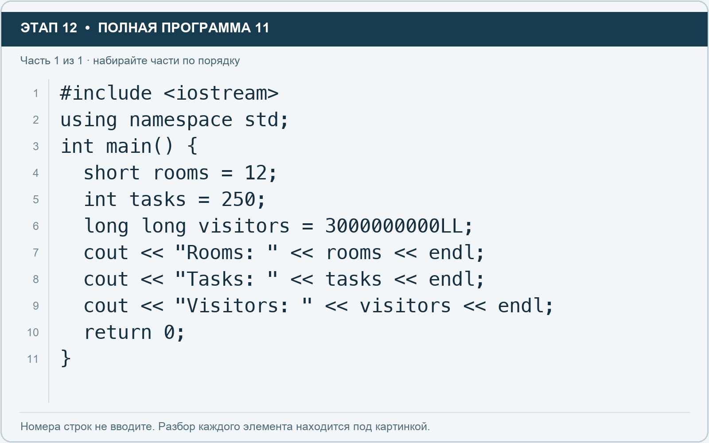

# Этап 12. short, int, long long: целые числа разного диапазона

[← Этап 11](11.md) · [Оглавление](../README.md) · [Этап 13 →](13.md)

Очистите весь редактор и наберите полную программу:

**Полная программа 11.** Очистите редактор и наберите все 1 части по порядку. После последней части нажмите Run.

**Разбор всех элементов на этой картинке**

- `long long` — два слова вместе образуют один целочисленный тип; это не две отдельные переменные.
- `#include <iostream>` — директива подключения заголовка. # обозначает директиву препроцессора; include означает подключение; < и > ограничивают имя iostream. Заголовок предоставляет стандартные потоки ввода/вывода: cin, cout, endl и настройки потока.
- `using` — вводит директиву использования имён; здесь работает вместе с namespace std.
- `namespace` — обозначает пространство имён; в строке using namespace std разрешает искать имена стандартной библиотеки без префикса std::.
- `std` — пространство имён стандартной библиотеки C++.
- `;` — точка с запятой: завершает объявление или выражение-команду; в заголовке обычного for разделяет начало, условие и шаг.
- `int` — целочисленный тип. В int main задаёт тип возвращаемого кода завершения; в объявлении переменной задаёт её тип.
- `main` — главная функция: выполнение этой программы начинается с неё.
- `(` — открывающая круглая скобка: начинает список параметров/аргументов, условие, заголовок цикла или группировку выражения.
- `)` — закрывающая круглая скобка: завершает соответствующий список, условие или выражение.
- `{` — открывающая фигурная скобка: начинает тело функции/ветки/цикла либо список начальных элементов.
- `short` — целочисленный тип с диапазоном не шире int. Конкретный размер проверяют через sizeof, а не предполагают заранее.
- `rooms` — имя переменной/параметра; в этом примере объявлено с типом short. Назначение: количество доступных помещений.
- `=` — присваивание: вычислить правую часть и записать результат слева; при объявлении задаёт начальное значение.
- `12` — целочисленный литерал — конкретное число. Его роль видна в строке: начальное значение, граница, номер команды, индекс, аргумент или код возврата.
- `tasks` — имя переменной/параметра; в этом примере объявлено с типом int. Назначение: количество задач.
- `250` — целочисленный литерал — конкретное число. Его роль видна в строке: начальное значение, граница, номер команды, индекс, аргумент или код возврата.
- `long` — часть записи long long: два слова вместе задают целый тип с диапазоном не уже 64 бит. Это не имя переменной.
- `visitors` — имя переменной/параметра; в этом примере объявлено с типом long long. Назначение: количество посетителей.
- `3000000000LL` — целочисленный литерал типа long long; суффикс LL задаёт этот тип.
- `cout` — стандартный поток вывода. Вместе с << печатает значения и текст.
- `<<` — оператор передачи значения в поток вывода. Несколько << позволяют последовательно вывести подпись и значения.
- `"Rooms: "` — строковый литерал. Двойные кавычки ограничивают текст и сами не печатаются; содержимое используется как сообщение, название или искомый текст. Пробел внутри кавычек является частью текста и сохраняется.
- `endl` — манипулятор потока: переводит строку и очищает буфер вывода. Точка с запятой после него завершает всю команду вывода.
- `"Tasks: "` — строковый литерал. Двойные кавычки ограничивают текст и сами не печатаются; содержимое используется как сообщение, название или искомый текст. Пробел внутри кавычек является частью текста и сохраняется.
- `"Visitors: "` — строковый литерал. Двойные кавычки ограничивают текст и сами не печатаются; содержимое используется как сообщение, название или искомый текст. Пробел внутри кавычек является частью текста и сохраняется.
- `return` — возвращает значение из функции и завершает её выполнение. return 0 в main обозначает успешное завершение.
- `0` — целочисленный литерал — конкретное число. Его роль видна в строке: начальное значение, граница, номер команды, индекс, аргумент или код возврата.
- `}` — закрывающая фигурная скобка: завершает соответствующее тело или список. Ей нужна парная открывающая скобка.

**Что делает каждая строка**

- Строка 1: подключает указанный заголовок до компиляции программы.
- Строка 2: разрешает обращаться к именам стандартной библиотеки без префикса std::.
- Строка 3: открывает главную функцию, с которой начинается выполнение программы.
- Строка 4: создаёт rooms с типом short. Начальное значение берётся из выражения справа от =. Назначение: количество доступных помещений.
- Строка 5: создаёт tasks с типом int. Начальное значение берётся из выражения справа от =. Назначение: число задач либо вектор их названий — точный тип указан в объявлении.
- Строка 6: создаёт visitors с типом long long. Начальное значение берётся из выражения справа от =. Назначение: количество посетителей.
- Строка 7: начинает вывод: последовательно передаёт в поток текст, значения или настройки после <<.
- Строка 8: начинает вывод: последовательно передаёт в поток текст, значения или настройки после <<.
- Строка 9: начинает вывод: последовательно передаёт в поток текст, значения или настройки после <<.
- Строка 10: завершает текущую функцию и возвращает указанное значение.
- Строка 11: закрывает ближайший открытый блок; соотнесите её с парной открывающей скобкой.

Short подходит для небольших целых значений, int — основной привычный целый тип, long long гарантирует диапазон не уже 64 бит. Суффикс LL обозначает целочисленный литерал типа long long.

1. Добавьте переменную `long long views` со значением 5000000000LL.
2. Выведите сумму visitors и views.
3. Объясните, почему не стоит автоматически заменять все типы на самый маленький.

Точные размеры типов не угадывайте по названию. В следующем упражнении проверим их в используемом компиляторе.

---

[← Этап 11](11.md) · [Оглавление](../README.md) · [Этап 13 →](13.md)
