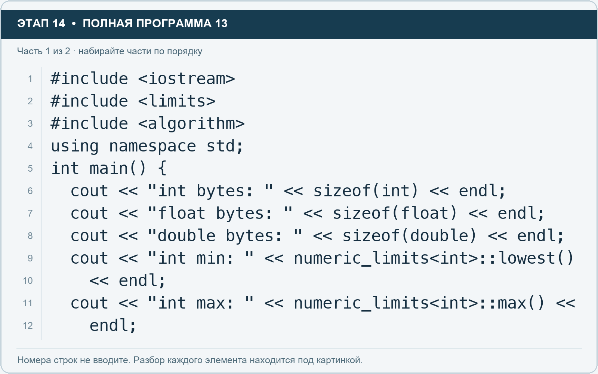
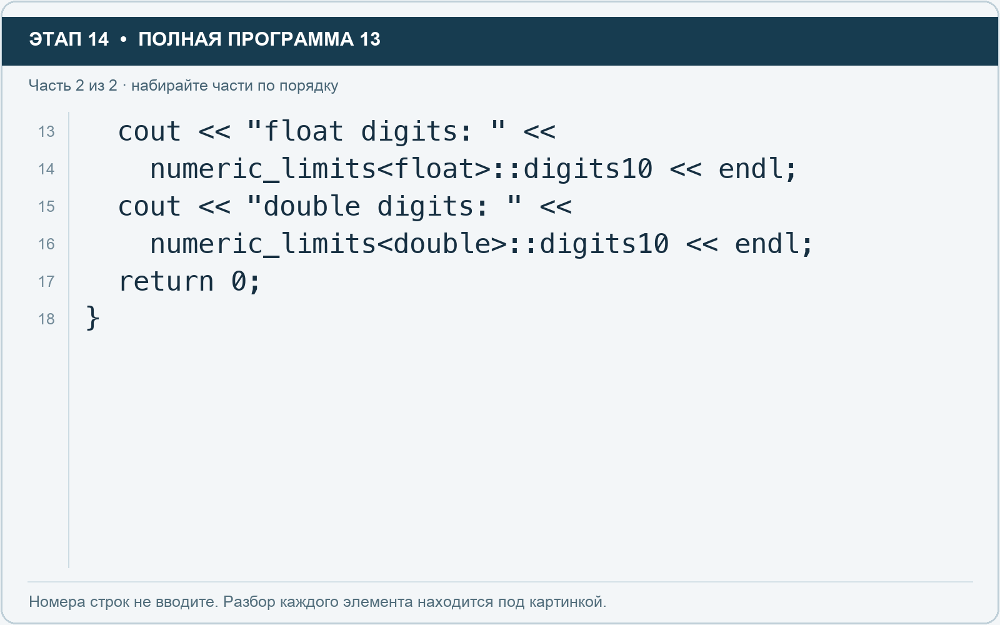

# Этап 14. sizeof и numeric_limits: узнайте свойства типов

[← Этап 13](13.md) · [Оглавление](../README.md) · [Этап 15 →](15.md)

Добавьте подключение `#include <limits>`. Очистите весь редактор и наберите полную программу:

**Полная программа 13.** Очистите редактор и наберите все 2 части по порядку. После последней части нажмите Run.

**Разбор всех элементов на этой картинке**

- `#include <iostream>` — директива подключения заголовка. # обозначает директиву препроцессора; include означает подключение; < и > ограничивают имя iostream. Заголовок предоставляет стандартные потоки ввода/вывода: cin, cout, endl и настройки потока.
- `#include <limits>` — директива подключения заголовка. # обозначает директиву препроцессора; include означает подключение; < и > ограничивают имя limits. Заголовок предоставляет свойства числовых типов numeric_limits.
- `#include <algorithm>` — директива подключения заголовка. # обозначает директиву препроцессора; include означает подключение; < и > ограничивают имя algorithm. Заголовок предоставляет алгоритм sort и функции min/max.
- `using` — вводит директиву использования имён; здесь работает вместе с namespace std.
- `namespace` — обозначает пространство имён; в строке using namespace std разрешает искать имена стандартной библиотеки без префикса std::.
- `std` — пространство имён стандартной библиотеки C++.
- `;` — точка с запятой: завершает объявление или выражение-команду; в заголовке обычного for разделяет начало, условие и шаг.
- `int` — целочисленный тип. В int main задаёт тип возвращаемого кода завершения; в объявлении переменной задаёт её тип.
- `main` — главная функция: выполнение этой программы начинается с неё.
- `(` — открывающая круглая скобка: начинает список параметров/аргументов, условие, заголовок цикла или группировку выражения.
- `)` — закрывающая круглая скобка: завершает соответствующий список, условие или выражение.
- `{` — открывающая фигурная скобка: начинает тело функции/ветки/цикла либо список начальных элементов.
- `cout` — стандартный поток вывода. Вместе с << печатает значения и текст.
- `<<` — оператор передачи значения в поток вывода. Несколько << позволяют последовательно вывести подпись и значения.
- `"int bytes: "` — строковый литерал. Двойные кавычки ограничивают текст и сами не печатаются; содержимое используется как сообщение, название или искомый текст. Пробел внутри кавычек является частью текста и сохраняется.
- `sizeof` — определяет размер типа или объекта в единицах байта реализации C++.
- `endl` — манипулятор потока: переводит строку и очищает буфер вывода. Точка с запятой после него завершает всю команду вывода.
- `"float bytes: "` — строковый литерал. Двойные кавычки ограничивают текст и сами не печатаются; содержимое используется как сообщение, название или искомый текст. Пробел внутри кавычек является частью текста и сохраняется.
- `float` — тип числа с плавающей точкой. Литералы с суффиксом f имеют этот тип; возможна погрешность представления дробей.
- `"double bytes: "` — строковый литерал. Двойные кавычки ограничивают текст и сами не печатаются; содержимое используется как сообщение, название или искомый текст. Пробел внутри кавычек является частью текста и сохраняется.
- `double` — тип числа с плавающей точкой, обычно более точный, чем float. Дробный литерал без суффикса обычно имеет тип double.
- `"int min: "` — строковый литерал. Двойные кавычки ограничивают текст и сами не печатаются; содержимое используется как сообщение, название или искомый текст. Пробел внутри кавычек является частью текста и сохраняется.
- `numeric_limits` — шаблон со свойствами числового типа. Тип указывают в угловых скобках.
- `<` — знак «меньше» в условии; также открывает параметры типа в vector или static_cast. В include ограничивает имя заголовка.
- `>` — знак «больше» в условии; также закрывает параметры типа или имя заголовка. Значение определяется местом использования.
- `::` — оператор разрешения области: обращение к имени внутри пространства имён или типа, например string::npos.
- `lowest` — метод numeric_limits, возвращающий минимальное конечное значение типа.
- `"int max: "` — строковый литерал. Двойные кавычки ограничивают текст и сами не печатаются; содержимое используется как сообщение, название или искомый текст. Пробел внутри кавычек является частью текста и сохраняется.
- `max` — для numeric_limits возвращает верхнюю границу типа; как функция max(a, b) выбирает большее из двух значений.

**Что делает каждая строка**

- Строка 1: подключает указанный заголовок до компиляции программы.
- Строка 2: подключает указанный заголовок до компиляции программы.
- Строка 3: подключает указанный заголовок до компиляции программы.
- Строка 4: разрешает обращаться к именам стандартной библиотеки без префикса std::.
- Строка 5: открывает главную функцию, с которой начинается выполнение программы.
- Строка 6: начинает вывод: последовательно передаёт в поток текст, значения или настройки после <<.
- Строка 7: начинает вывод: последовательно передаёт в поток текст, значения или настройки после <<.
- Строка 8: начинает вывод: последовательно передаёт в поток текст, значения или настройки после <<.
- Строка 9: начинает вывод: последовательно передаёт в поток текст, значения или настройки после <<.
- Строка 10: продолжает команду вывода с предыдущей строки; это не отдельная новая команда.
- Строка 11: начинает вывод: последовательно передаёт в поток текст, значения или настройки после <<.
- Строка 12: продолжает выражение или список предыдущей строки; учитывайте парные скобки и завершающую точку с запятой.

**Разбор всех элементов на этой картинке**

- `cout` — стандартный поток вывода. Вместе с << печатает значения и текст.
- `<<` — оператор передачи значения в поток вывода. Несколько << позволяют последовательно вывести подпись и значения.
- `"float digits: "` — строковый литерал. Двойные кавычки ограничивают текст и сами не печатаются; содержимое используется как сообщение, название или искомый текст. Пробел внутри кавычек является частью текста и сохраняется.
- `numeric_limits` — шаблон со свойствами числового типа. Тип указывают в угловых скобках.
- `<` — знак «меньше» в условии; также открывает параметры типа в vector или static_cast. В include ограничивает имя заголовка.
- `float` — тип числа с плавающей точкой. Литералы с суффиксом f имеют этот тип; возможна погрешность представления дробей.
- `>` — знак «больше» в условии; также закрывает параметры типа или имя заголовка. Значение определяется местом использования.
- `::` — оператор разрешения области: обращение к имени внутри пространства имён или типа, например string::npos.
- `digits10` — константа numeric_limits, описывающая гарантируемую десятичную точность типа.
- `endl` — манипулятор потока: переводит строку и очищает буфер вывода. Точка с запятой после него завершает всю команду вывода.
- `;` — точка с запятой: завершает объявление или выражение-команду; в заголовке обычного for разделяет начало, условие и шаг.
- `"double digits: "` — строковый литерал. Двойные кавычки ограничивают текст и сами не печатаются; содержимое используется как сообщение, название или искомый текст. Пробел внутри кавычек является частью текста и сохраняется.
- `double` — тип числа с плавающей точкой, обычно более точный, чем float. Дробный литерал без суффикса обычно имеет тип double.
- `return` — возвращает значение из функции и завершает её выполнение. return 0 в main обозначает успешное завершение.
- `0` — целочисленный литерал — конкретное число. Его роль видна в строке: начальное значение, граница, номер команды, индекс, аргумент или код возврата.
- `}` — закрывающая фигурная скобка: завершает соответствующее тело или список. Ей нужна парная открывающая скобка.

**Что делает каждая строка**

- Строка 13: начинает вывод: последовательно передаёт в поток текст, значения или настройки после <<.
- Строка 14: продолжает выражение или список предыдущей строки; учитывайте парные скобки и завершающую точку с запятой.
- Строка 15: начинает вывод: последовательно передаёт в поток текст, значения или настройки после <<.
- Строка 16: продолжает выражение или список предыдущей строки; учитывайте парные скобки и завершающую точку с запятой.
- Строка 17: завершает текущую функцию и возвращает указанное значение.
- Строка 18: закрывает ближайший открытый блок; соотнесите её с парной открывающей скобкой.

Sizeof показывает размер в единицах байта реализации C++. Numeric_limits даёт свойства выбранного числового типа. Здесь digits10 описывает гарантируемую десятичную точность, а не число знаков после точки для любого значения.

1. Запишите размеры int, float и double, полученные именно у вас.
2. Добавьте вывод sizeof для short и long long.
3. Сравните digits10 у float и double.
4. Не превращайте наблюдаемые размеры в утверждение «на любом компьютере только так».

---

[← Этап 13](13.md) · [Оглавление](../README.md) · [Этап 15 →](15.md)
