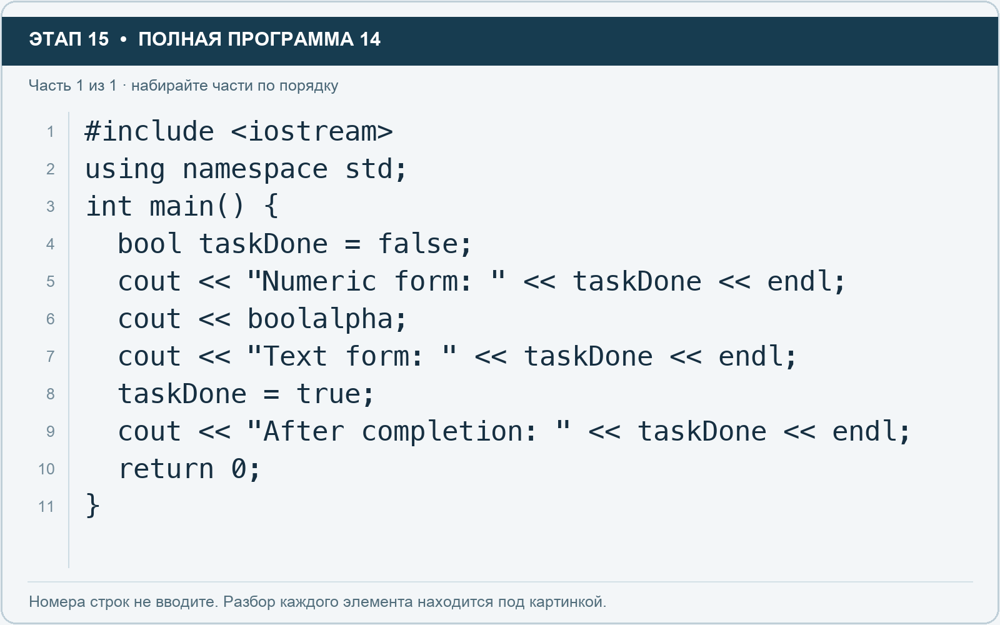

# Этап 15. bool и boolalpha: состояние задачи

[← Этап 14](14.md) · [Оглавление](../README.md) · [Этап 16 →](16.md)

Очистите весь редактор и наберите полную программу:

**Полная программа 14.** Очистите редактор и наберите все 1 части по порядку. После последней части нажмите Run.

**Разбор всех элементов на этой картинке**

- `#include <iostream>` — директива подключения заголовка. # обозначает директиву препроцессора; include означает подключение; < и > ограничивают имя iostream. Заголовок предоставляет стандартные потоки ввода/вывода: cin, cout, endl и настройки потока.
- `using` — вводит директиву использования имён; здесь работает вместе с namespace std.
- `namespace` — обозначает пространство имён; в строке using namespace std разрешает искать имена стандартной библиотеки без префикса std::.
- `std` — пространство имён стандартной библиотеки C++.
- `;` — точка с запятой: завершает объявление или выражение-команду; в заголовке обычного for разделяет начало, условие и шаг.
- `int` — целочисленный тип. В int main задаёт тип возвращаемого кода завершения; в объявлении переменной задаёт её тип.
- `main` — главная функция: выполнение этой программы начинается с неё.
- `(` — открывающая круглая скобка: начинает список параметров/аргументов, условие, заголовок цикла или группировку выражения.
- `)` — закрывающая круглая скобка: завершает соответствующий список, условие или выражение.
- `{` — открывающая фигурная скобка: начинает тело функции/ветки/цикла либо список начальных элементов.
- `bool` — логический тип с двумя значениями: true и false.
- `taskDone` — имя переменной/параметра; в этом примере объявлено с типом bool. Назначение: признак завершения задачи.
- `=` — присваивание: вычислить правую часть и записать результат слева; при объявлении задаёт начальное значение.
- `false` — логическая константа «ложь». Без boolalpha обычно выводится числом 0.
- `cout` — стандартный поток вывода. Вместе с << печатает значения и текст.
- `<<` — оператор передачи значения в поток вывода. Несколько << позволяют последовательно вывести подпись и значения.
- `"Numeric form: "` — строковый литерал. Двойные кавычки ограничивают текст и сами не печатаются; содержимое используется как сообщение, название или искомый текст. Пробел внутри кавычек является частью текста и сохраняется.
- `endl` — манипулятор потока: переводит строку и очищает буфер вывода. Точка с запятой после него завершает всю команду вывода.
- `boolalpha` — выводит bool словами true и false.
- `"Text form: "` — строковый литерал. Двойные кавычки ограничивают текст и сами не печатаются; содержимое используется как сообщение, название или искомый текст. Пробел внутри кавычек является частью текста и сохраняется.
- `true` — логическая константа «истина». Без boolalpha обычно выводится числом 1.
- `"After completion: "` — строковый литерал. Двойные кавычки ограничивают текст и сами не печатаются; содержимое используется как сообщение, название или искомый текст. Пробел внутри кавычек является частью текста и сохраняется.
- `return` — возвращает значение из функции и завершает её выполнение. return 0 в main обозначает успешное завершение.
- `0` — целочисленный литерал — конкретное число. Его роль видна в строке: начальное значение, граница, номер команды, индекс, аргумент или код возврата.
- `}` — закрывающая фигурная скобка: завершает соответствующее тело или список. Ей нужна парная открывающая скобка.

**Что делает каждая строка**

- Строка 1: подключает указанный заголовок до компиляции программы.
- Строка 2: разрешает обращаться к именам стандартной библиотеки без префикса std::.
- Строка 3: открывает главную функцию, с которой начинается выполнение программы.
- Строка 4: создаёт taskDone с типом bool. Начальное значение берётся из выражения справа от =. Назначение: признак завершения задачи.
- Строка 5: начинает вывод: последовательно передаёт в поток текст, значения или настройки после <<.
- Строка 6: начинает вывод: последовательно передаёт в поток текст, значения или настройки после <<.
- Строка 7: начинает вывод: последовательно передаёт в поток текст, значения или настройки после <<.
- Строка 8: вычисляет правую часть и записывает результат в переменную или элемент слева.
- Строка 9: начинает вывод: последовательно передаёт в поток текст, значения или настройки после <<.
- Строка 10: завершает текущую функцию и возвращает указанное значение.
- Строка 11: закрывает ближайший открытый блок; соотнесите её с парной открывающей скобкой.

Получится 0, затем false, затем true. Манипулятор boolalpha меняет отображение логических значений. Для возврата к числам используется noboolalpha.

1. Добавьте переменную `bool approved = true`.
2. Выведите её с подписью.
3. Добавьте noboolalpha перед последним выводом.
4. Проверьте, что логическое значение осталось тем же, изменилось представление.

**Самостоятельно:** придумайте ещё два признака проекта, у которых есть только два состояния.

---

[← Этап 14](14.md) · [Оглавление](../README.md) · [Этап 16 →](16.md)
