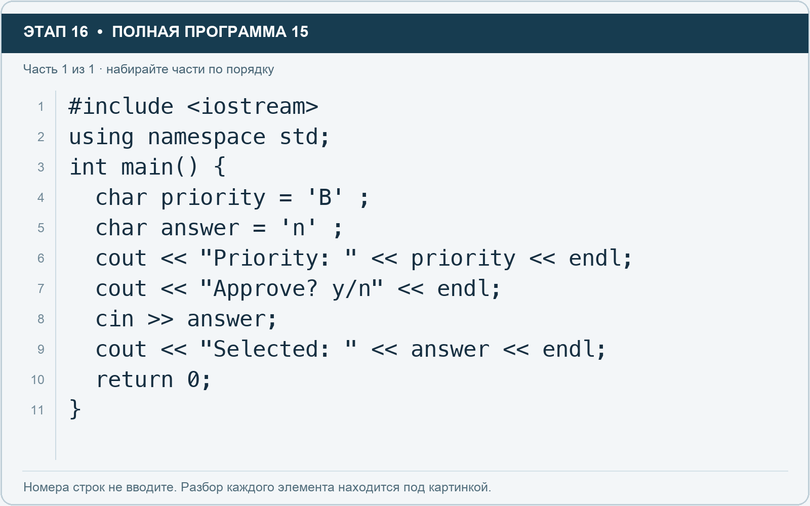

# Этап 16. char: одна буква или команда

[← Этап 15](15.md) · [Оглавление](../README.md) · [Этап 17 →](17.md)

Очистите весь редактор и наберите полную программу:

**Полная программа 15.** Очистите редактор и наберите все 1 части по порядку. После последней части нажмите Run.

**Разбор всех элементов на этой картинке**

- `#include <iostream>` — директива подключения заголовка. # обозначает директиву препроцессора; include означает подключение; < и > ограничивают имя iostream. Заголовок предоставляет стандартные потоки ввода/вывода: cin, cout, endl и настройки потока.
- `using` — вводит директиву использования имён; здесь работает вместе с namespace std.
- `namespace` — обозначает пространство имён; в строке using namespace std разрешает искать имена стандартной библиотеки без префикса std::.
- `std` — пространство имён стандартной библиотеки C++.
- `;` — точка с запятой: завершает объявление или выражение-команду; в заголовке обычного for разделяет начало, условие и шаг.
- `int` — целочисленный тип. В int main задаёт тип возвращаемого кода завершения; в объявлении переменной задаёт её тип.
- `main` — главная функция: выполнение этой программы начинается с неё.
- `(` — открывающая круглая скобка: начинает список параметров/аргументов, условие, заголовок цикла или группировку выражения.
- `)` — закрывающая круглая скобка: завершает соответствующий список, условие или выражение.
- `{` — открывающая фигурная скобка: начинает тело функции/ветки/цикла либо список начальных элементов.
- `char` — тип для одного узкого символа или кодовой единицы; здесь используются латинские символы и специальные символы вроде перевода строки.
- `priority` — имя переменной/параметра; в этом примере объявлено с типом char. Назначение: символьный приоритет.
- `=` — присваивание: вычислить правую часть и записать результат слева; при объявлении задаёт начальное значение.
- `'B'` — символьный литерал в одинарных кавычках. Кавычки задают один char; \n внутри обозначает символ перевода строки, обычный пробел — символ пробела.
- `answer` — имя переменной/параметра; в этом примере объявлено с типом char. Назначение: однобуквенный ответ пользователя.
- `'n'` — символьный литерал в одинарных кавычках. Кавычки задают один char; \n внутри обозначает символ перевода строки, обычный пробел — символ пробела.
- `cout` — стандартный поток вывода. Вместе с << печатает значения и текст.
- `<<` — оператор передачи значения в поток вывода. Несколько << позволяют последовательно вывести подпись и значения.
- `"Priority: "` — строковый литерал. Двойные кавычки ограничивают текст и сами не печатаются; содержимое используется как сообщение, название или искомый текст. Пробел внутри кавычек является частью текста и сохраняется.
- `endl` — манипулятор потока: переводит строку и очищает буфер вывода. Точка с запятой после него завершает всю команду вывода.
- `"Approve? y/n"` — строковый литерал. Двойные кавычки ограничивают текст и сами не печатаются; содержимое используется как сообщение, название или искомый текст.
- `cin` — стандартный поток ввода. Вместе с >> читает значения; результат чтения можно проверить как логическое условие.
- `>>` — оператор чтения из потока ввода в указанную переменную; в cin >> ws применяется манипулятор потока.
- `"Selected: "` — строковый литерал. Двойные кавычки ограничивают текст и сами не печатаются; содержимое используется как сообщение, название или искомый текст. Пробел внутри кавычек является частью текста и сохраняется.
- `return` — возвращает значение из функции и завершает её выполнение. return 0 в main обозначает успешное завершение.
- `0` — целочисленный литерал — конкретное число. Его роль видна в строке: начальное значение, граница, номер команды, индекс, аргумент или код возврата.
- `}` — закрывающая фигурная скобка: завершает соответствующее тело или список. Ей нужна парная открывающая скобка.

**Что делает каждая строка**

- Строка 1: подключает указанный заголовок до компиляции программы.
- Строка 2: разрешает обращаться к именам стандартной библиотеки без префикса std::.
- Строка 3: открывает главную функцию, с которой начинается выполнение программы.
- Строка 4: создаёт priority с типом char. Начальное значение берётся из выражения справа от =. Назначение: символьный приоритет.
- Строка 5: создаёт answer с типом char. Начальное значение берётся из выражения справа от =. Назначение: однобуквенный ответ пользователя.
- Строка 6: начинает вывод: последовательно передаёт в поток текст, значения или настройки после <<.
- Строка 7: начинает вывод: последовательно передаёт в поток текст, значения или настройки после <<.
- Строка 8: считывает пользовательские данные в указанную переменную.
- Строка 9: начинает вывод: последовательно передаёт в поток текст, значения или настройки после <<.
- Строка 10: завершает текущую функцию и возвращает указанное значение.
- Строка 11: закрывает ближайший открытый блок; соотнесите её с парной открывающей скобкой.

1. Запустите и введите y.
2. Запустите заново и введите n.
3. Измените приоритет на A.
4. Объясните разницу между `'A'` и `"A"`.

Одинарные кавычки используются для символьного литерала, двойные — для строки. В этих упражнениях вводите одну латинскую букву: один char не является универсальным контейнером для любой буквы Unicode.

---

[← Этап 15](15.md) · [Оглавление](../README.md) · [Этап 17 →](17.md)
