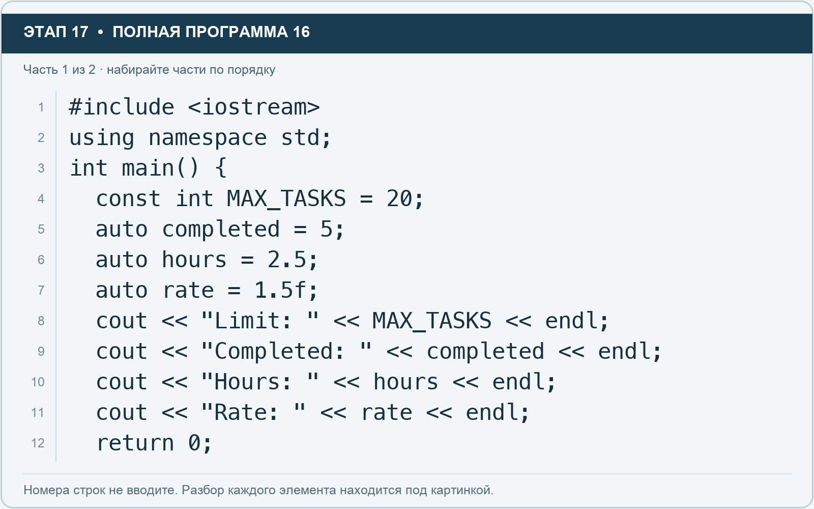
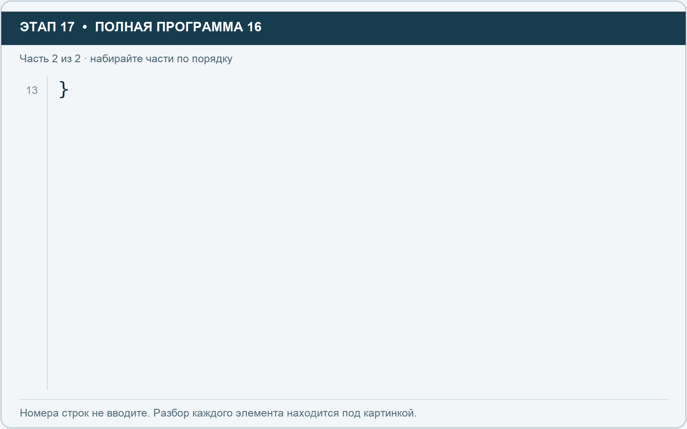

# Этап 17. const и auto: постоянное значение и вывод типа

[← Этап 16](16.md) · [Оглавление](../README.md) · [Этап 18 →](18.md)

Очистите весь редактор и наберите полную программу:

**Полная программа 16.** Очистите редактор и наберите все 2 части по порядку. После последней части нажмите Run.

**Разбор всех элементов на этой картинке**

- `#include <iostream>` — директива подключения заголовка. # обозначает директиву препроцессора; include означает подключение; < и > ограничивают имя iostream. Заголовок предоставляет стандартные потоки ввода/вывода: cin, cout, endl и настройки потока.
- `using` — вводит директиву использования имён; здесь работает вместе с namespace std.
- `namespace` — обозначает пространство имён; в строке using namespace std разрешает искать имена стандартной библиотеки без префикса std::.
- `std` — пространство имён стандартной библиотеки C++.
- `;` — точка с запятой: завершает объявление или выражение-команду; в заголовке обычного for разделяет начало, условие и шаг.
- `int` — целочисленный тип. В int main задаёт тип возвращаемого кода завершения; в объявлении переменной задаёт её тип.
- `main` — главная функция: выполнение этой программы начинается с неё.
- `(` — открывающая круглая скобка: начинает список параметров/аргументов, условие, заголовок цикла или группировку выражения.
- `)` — закрывающая круглая скобка: завершает соответствующий список, условие или выражение.
- `{` — открывающая фигурная скобка: начинает тело функции/ветки/цикла либо список начальных элементов.
- `const` — запрещает изменение объявленного значения через это имя или ссылку.
- `MAX_TASKS` — имя переменной/параметра; в этом примере объявлено с типом const int. Назначение: постоянный лимит числа задач.
- `=` — присваивание: вычислить правую часть и записать результат слева; при объявлении задаёт начальное значение.
- `20` — целочисленный литерал — конкретное число. Его роль видна в строке: начальное значение, граница, номер команды, индекс, аргумент или код возврата.
- `auto` — просит компилятор определить тип из начального выражения. После создания тип переменной не меняется произвольно.
- `completed` — имя переменной/параметра; в этом примере объявлено с типом auto. Назначение: количество выполненных задач.
- `5` — целочисленный литерал — конкретное число. Его роль видна в строке: начальное значение, граница, номер команды, индекс, аргумент или код возврата.
- `hours` — имя переменной/параметра; в этом примере объявлено с типом auto. Назначение: оценка времени либо коллекция оценок времени.
- `2.5` — дробный числовой литерал типа double без специального суффикса. Точка отделяет дробную часть.
- `rate` — имя переменной/параметра; в этом примере объявлено с типом auto. Назначение: ставка или коэффициент.
- `1.5f` — числовой литерал типа float: точка задаёт дробную часть, суффикс f указывает тип. При вводе пользователем суффикс не печатают.
- `cout` — стандартный поток вывода. Вместе с << печатает значения и текст.
- `<<` — оператор передачи значения в поток вывода. Несколько << позволяют последовательно вывести подпись и значения.
- `"Limit: "` — строковый литерал. Двойные кавычки ограничивают текст и сами не печатаются; содержимое используется как сообщение, название или искомый текст. Пробел внутри кавычек является частью текста и сохраняется.
- `endl` — манипулятор потока: переводит строку и очищает буфер вывода. Точка с запятой после него завершает всю команду вывода.
- `"Completed: "` — строковый литерал. Двойные кавычки ограничивают текст и сами не печатаются; содержимое используется как сообщение, название или искомый текст. Пробел внутри кавычек является частью текста и сохраняется.
- `"Hours: "` — строковый литерал. Двойные кавычки ограничивают текст и сами не печатаются; содержимое используется как сообщение, название или искомый текст. Пробел внутри кавычек является частью текста и сохраняется.
- `"Rate: "` — строковый литерал. Двойные кавычки ограничивают текст и сами не печатаются; содержимое используется как сообщение, название или искомый текст. Пробел внутри кавычек является частью текста и сохраняется.
- `return` — возвращает значение из функции и завершает её выполнение. return 0 в main обозначает успешное завершение.
- `0` — целочисленный литерал — конкретное число. Его роль видна в строке: начальное значение, граница, номер команды, индекс, аргумент или код возврата.

**Что делает каждая строка**

- Строка 1: подключает указанный заголовок до компиляции программы.
- Строка 2: разрешает обращаться к именам стандартной библиотеки без префикса std::.
- Строка 3: открывает главную функцию, с которой начинается выполнение программы.
- Строка 4: создаёт MAX_TASKS с типом const int. Начальное значение берётся из выражения справа от =. Назначение: постоянный лимит числа задач.
- Строка 5: создаёт completed с типом auto. Начальное значение берётся из выражения справа от =. Назначение: количество выполненных задач.
- Строка 6: создаёт hours с типом auto. Начальное значение берётся из выражения справа от =. Назначение: оценка времени либо коллекция оценок времени.
- Строка 7: создаёт rate с типом auto. Начальное значение берётся из выражения справа от =. Назначение: ставка или коэффициент.
- Строка 8: начинает вывод: последовательно передаёт в поток текст, значения или настройки после <<.
- Строка 9: начинает вывод: последовательно передаёт в поток текст, значения или настройки после <<.
- Строка 10: начинает вывод: последовательно передаёт в поток текст, значения или настройки после <<.
- Строка 11: начинает вывод: последовательно передаёт в поток текст, значения или настройки после <<.
- Строка 12: завершает текущую функцию и возвращает указанное значение.

**Разбор всех элементов на этой картинке**

- `}` — закрывающая фигурная скобка: завершает соответствующее тело или список. Ей нужна парная открывающая скобка.

**Что делает каждая строка**

- Строка 13: закрывает ближайший открытый блок; соотнесите её с парной открывающей скобкой.

Const запрещает изменение переменной после инициализации. Auto просит компилятор вывести тип из начального выражения: здесь completed имеет тип int, hours — double, rate — float.

1. Добавьте увеличение completed и выведите новое значение.
2. Добавьте команду присваивания нового значения MAX_TASKS.
3. Запустите и прочитайте сообщение компилятора о попытке изменения постоянного значения.
4. Удалите только ошибочную команду и запустите снова.

Не оставляйте ошибочную строку в сдаваемой версии. Auto сохраняет определённый при создании тип; это не переменная с произвольно меняющимся типом.

---

[← Этап 16](16.md) · [Оглавление](../README.md) · [Этап 18 →](18.md)
