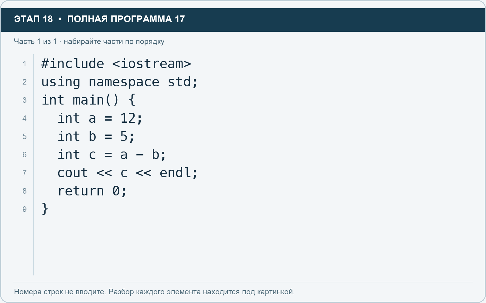

# Этап 18. Назовите переменные понятно

[← Этап 17](17.md) · [Оглавление](../README.md) · [Этап 19 →](19.md)

Очистите весь редактор и наберите полную программу:

**Полная программа 17.** Очистите редактор и наберите все 1 части по порядку. После последней части нажмите Run.

**Разбор всех элементов на этой картинке**

- `#include <iostream>` — директива подключения заголовка. # обозначает директиву препроцессора; include означает подключение; < и > ограничивают имя iostream. Заголовок предоставляет стандартные потоки ввода/вывода: cin, cout, endl и настройки потока.
- `using` — вводит директиву использования имён; здесь работает вместе с namespace std.
- `namespace` — обозначает пространство имён; в строке using namespace std разрешает искать имена стандартной библиотеки без префикса std::.
- `std` — пространство имён стандартной библиотеки C++.
- `;` — точка с запятой: завершает объявление или выражение-команду; в заголовке обычного for разделяет начало, условие и шаг.
- `int` — целочисленный тип. В int main задаёт тип возвращаемого кода завершения; в объявлении переменной задаёт её тип.
- `main` — главная функция: выполнение этой программы начинается с неё.
- `(` — открывающая круглая скобка: начинает список параметров/аргументов, условие, заголовок цикла или группировку выражения.
- `)` — закрывающая круглая скобка: завершает соответствующий список, условие или выражение.
- `{` — открывающая фигурная скобка: начинает тело функции/ветки/цикла либо список начальных элементов.
- `a` — имя переменной/параметра; в этом примере объявлено с типом int. Назначение: исходное запланированное количество в примере с неясными именами.
- `=` — присваивание: вычислить правую часть и записать результат слева; при объявлении задаёт начальное значение.
- `12` — целочисленный литерал — конкретное число. Его роль видна в строке: начальное значение, граница, номер команды, индекс, аргумент или код возврата.
- `b` — имя переменной/параметра; в этом примере объявлено с типом int. Назначение: исходное выполненное количество в примере с неясными именами.
- `5` — целочисленный литерал — конкретное число. Его роль видна в строке: начальное значение, граница, номер команды, индекс, аргумент или код возврата.
- `c` — имя переменной/параметра; в этом примере объявлено с типом int. Назначение: разница a и b в примере с неясными именами.
- `-` — вычитание или знак отрицательного числа. В count - 1 получает последний индекс.
- `cout` — стандартный поток вывода. Вместе с << печатает значения и текст.
- `<<` — оператор передачи значения в поток вывода. Несколько << позволяют последовательно вывести подпись и значения.
- `endl` — манипулятор потока: переводит строку и очищает буфер вывода. Точка с запятой после него завершает всю команду вывода.
- `return` — возвращает значение из функции и завершает её выполнение. return 0 в main обозначает успешное завершение.
- `0` — целочисленный литерал — конкретное число. Его роль видна в строке: начальное значение, граница, номер команды, индекс, аргумент или код возврата.
- `}` — закрывающая фигурная скобка: завершает соответствующее тело или список. Ей нужна парная открывающая скобка.

**Что делает каждая строка**

- Строка 1: подключает указанный заголовок до компиляции программы.
- Строка 2: разрешает обращаться к именам стандартной библиотеки без префикса std::.
- Строка 3: открывает главную функцию, с которой начинается выполнение программы.
- Строка 4: создаёт a с типом int. Начальное значение берётся из выражения справа от =. Назначение: исходное запланированное количество в примере с неясными именами.
- Строка 5: создаёт b с типом int. Начальное значение берётся из выражения справа от =. Назначение: исходное выполненное количество в примере с неясными именами.
- Строка 6: создаёт c с типом int. Начальное значение берётся из выражения справа от =. Назначение: разница a и b в примере с неясными именами.
- Строка 7: начинает вывод: последовательно передаёт в поток текст, значения или настройки после <<.
- Строка 8: завершает текущую функцию и возвращает указанное значение.
- Строка 9: закрывает ближайший открытый блок; соотнесите её с парной открывающей скобкой.

Сейчас программа выводит 7, но из имён неясно, что она считает.

1. Переименуйте `a` в `plannedTasks`.
2. Переименуйте `b` в `completedTasks`.
3. Переименуйте `c` в `remainingTasks`.
4. Замените имена **во всех местах использования**.
5. Добавьте понятную подпись перед результатом.
6. Запустите и убедитесь, что результат остался тем же.

Имена чувствительны к регистру: `tasks` и `Tasks` — разные имена. В учебных примерах используйте латинские буквы. Имя не начинается с цифры и не содержит пробелов. `plannedTasks` допустимо, `planned tasks` — нет.

Вы только что выполнили маленький рефакторинг: улучшили читаемость, сохранив результат.

---

[← Этап 17](17.md) · [Оглавление](../README.md) · [Этап 19 →](19.md)
