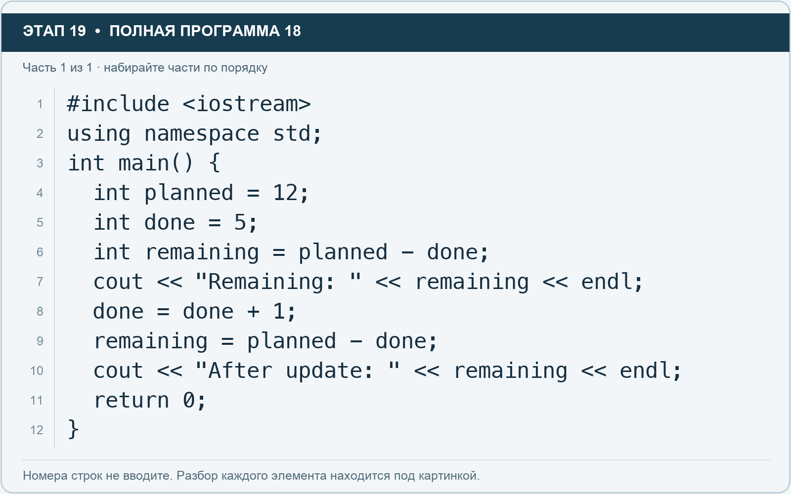

# Этап 19. Посчитайте остаток и измените значение

[← Этап 18](18.md) · [Оглавление](../README.md) · [Этап 20 →](20.md)

Очистите весь редактор и наберите полную программу:

**Полная программа 18.** Очистите редактор и наберите все 1 части по порядку. После последней части нажмите Run.

**Разбор всех элементов на этой картинке**

- `#include <iostream>` — директива подключения заголовка. # обозначает директиву препроцессора; include означает подключение; < и > ограничивают имя iostream. Заголовок предоставляет стандартные потоки ввода/вывода: cin, cout, endl и настройки потока.
- `using` — вводит директиву использования имён; здесь работает вместе с namespace std.
- `namespace` — обозначает пространство имён; в строке using namespace std разрешает искать имена стандартной библиотеки без префикса std::.
- `std` — пространство имён стандартной библиотеки C++.
- `;` — точка с запятой: завершает объявление или выражение-команду; в заголовке обычного for разделяет начало, условие и шаг.
- `int` — целочисленный тип. В int main задаёт тип возвращаемого кода завершения; в объявлении переменной задаёт её тип.
- `main` — главная функция: выполнение этой программы начинается с неё.
- `(` — открывающая круглая скобка: начинает список параметров/аргументов, условие, заголовок цикла или группировку выражения.
- `)` — закрывающая круглая скобка: завершает соответствующий список, условие или выражение.
- `{` — открывающая фигурная скобка: начинает тело функции/ветки/цикла либо список начальных элементов.
- `planned` — имя переменной/параметра; в этом примере объявлено с типом int. Назначение: запланированное количество задач.
- `=` — присваивание: вычислить правую часть и записать результат слева; при объявлении задаёт начальное значение.
- `12` — целочисленный литерал — конкретное число. Его роль видна в строке: начальное значение, граница, номер команды, индекс, аргумент или код возврата.
- `done` — имя переменной/параметра; в этом примере объявлено с типом int. Назначение: количество завершённых задач.
- `5` — целочисленный литерал — конкретное число. Его роль видна в строке: начальное значение, граница, номер команды, индекс, аргумент или код возврата.
- `remaining` — имя переменной/параметра; в этом примере объявлено с типом int. Назначение: оставшееся количество или остаток бюджета.
- `-` — вычитание или знак отрицательного числа. В count - 1 получает последний индекс.
- `cout` — стандартный поток вывода. Вместе с << печатает значения и текст.
- `<<` — оператор передачи значения в поток вывода. Несколько << позволяют последовательно вывести подпись и значения.
- `"Remaining: "` — строковый литерал. Двойные кавычки ограничивают текст и сами не печатаются; содержимое используется как сообщение, название или искомый текст. Пробел внутри кавычек является частью текста и сохраняется.
- `endl` — манипулятор потока: переводит строку и очищает буфер вывода. Точка с запятой после него завершает всю команду вывода.
- `+` — сложение чисел или объединение строки с другой строкой/строковым литералом. В i + 1 переводит индекс в привычный номер.
- `1` — целочисленный литерал — конкретное число. Его роль видна в строке: начальное значение, граница, номер команды, индекс, аргумент или код возврата.
- `"After update: "` — строковый литерал. Двойные кавычки ограничивают текст и сами не печатаются; содержимое используется как сообщение, название или искомый текст. Пробел внутри кавычек является частью текста и сохраняется.
- `return` — возвращает значение из функции и завершает её выполнение. return 0 в main обозначает успешное завершение.
- `0` — целочисленный литерал — конкретное число. Его роль видна в строке: начальное значение, граница, номер команды, индекс, аргумент или код возврата.
- `}` — закрывающая фигурная скобка: завершает соответствующее тело или список. Ей нужна парная открывающая скобка.

**Что делает каждая строка**

- Строка 1: подключает указанный заголовок до компиляции программы.
- Строка 2: разрешает обращаться к именам стандартной библиотеки без префикса std::.
- Строка 3: открывает главную функцию, с которой начинается выполнение программы.
- Строка 4: создаёт planned с типом int. Начальное значение берётся из выражения справа от =. Назначение: запланированное количество задач.
- Строка 5: создаёт done с типом int. Начальное значение берётся из выражения справа от =. Назначение: количество завершённых задач.
- Строка 6: создаёт remaining с типом int. Начальное значение берётся из выражения справа от =. Назначение: оставшееся количество или остаток бюджета.
- Строка 7: начинает вывод: последовательно передаёт в поток текст, значения или настройки после <<.
- Строка 8: начинает тело do while, выполняемое до проверки условия.
- Строка 9: вычисляет правую часть и записывает результат в переменную или элемент слева.
- Строка 10: начинает вывод: последовательно передаёт в поток текст, значения или настройки после <<.
- Строка 11: завершает текущую функцию и возвращает указанное значение.
- Строка 12: закрывает ближайший открытый блок; соотнесите её с парной открывающей скобкой.

Ожидаемые значения: сначала 7, затем 6.

Знак `=` означает присваивание: вычислить правую часть и записать результат в переменную слева. Поэтому `done = done + 1;` — нормальная команда.

Обратите внимание: `remaining` не пересчитывается автоматически после изменения `done`. Мы явно присвоили ему новое значение второй раз.

**Самостоятельно:** после этого отметьте завершение ещё двух задач. Обновите `remaining` и выведите результат. Должно остаться 4 задачи.

---

[← Этап 18](18.md) · [Оглавление](../README.md) · [Этап 20 →](20.md)
