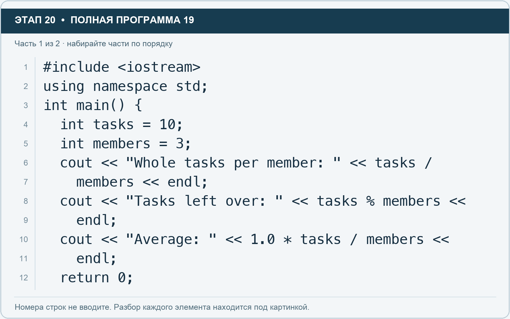
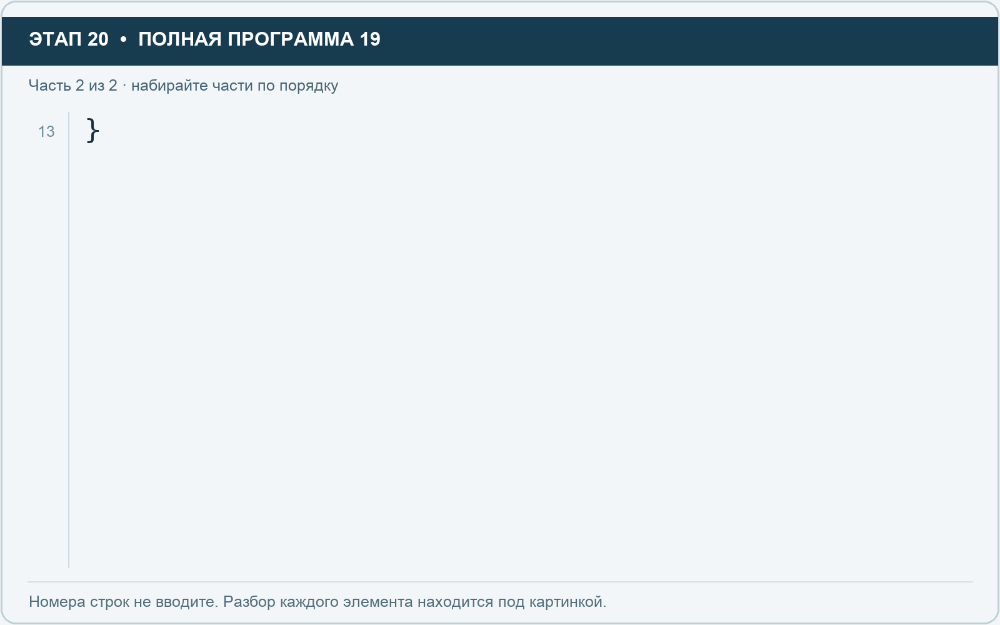

# Этап 20. Проверьте арифметику и деление

[← Этап 19](19.md) · [Оглавление](../README.md) · [Этап 21 →](21.md)

Очистите весь редактор и наберите полную программу:

**Полная программа 19.** Очистите редактор и наберите все 2 части по порядку. После последней части нажмите Run.

**Разбор всех элементов на этой картинке**

- `#include <iostream>` — директива подключения заголовка. # обозначает директиву препроцессора; include означает подключение; < и > ограничивают имя iostream. Заголовок предоставляет стандартные потоки ввода/вывода: cin, cout, endl и настройки потока.
- `using` — вводит директиву использования имён; здесь работает вместе с namespace std.
- `namespace` — обозначает пространство имён; в строке using namespace std разрешает искать имена стандартной библиотеки без префикса std::.
- `std` — пространство имён стандартной библиотеки C++.
- `;` — точка с запятой: завершает объявление или выражение-команду; в заголовке обычного for разделяет начало, условие и шаг.
- `int` — целочисленный тип. В int main задаёт тип возвращаемого кода завершения; в объявлении переменной задаёт её тип.
- `main` — главная функция: выполнение этой программы начинается с неё.
- `(` — открывающая круглая скобка: начинает список параметров/аргументов, условие, заголовок цикла или группировку выражения.
- `)` — закрывающая круглая скобка: завершает соответствующий список, условие или выражение.
- `{` — открывающая фигурная скобка: начинает тело функции/ветки/цикла либо список начальных элементов.
- `tasks` — имя переменной/параметра; в этом примере объявлено с типом int. Назначение: количество задач.
- `=` — присваивание: вычислить правую часть и записать результат слева; при объявлении задаёт начальное значение.
- `10` — целочисленный литерал — конкретное число. Его роль видна в строке: начальное значение, граница, номер команды, индекс, аргумент или код возврата.
- `members` — имя переменной/параметра; в этом примере объявлено с типом int. Назначение: количество участников.
- `3` — целочисленный литерал — конкретное число. Его роль видна в строке: начальное значение, граница, номер команды, индекс, аргумент или код возврата.
- `cout` — стандартный поток вывода. Вместе с << печатает значения и текст.
- `<<` — оператор передачи значения в поток вывода. Несколько << позволяют последовательно вывести подпись и значения.
- `"Whole tasks per member: "` — строковый литерал. Двойные кавычки ограничивают текст и сами не печатаются; содержимое используется как сообщение, название или искомый текст. Пробел внутри кавычек является частью текста и сохраняется.
- `/` — деление. Для двух целых операндов дробная часть отбрасывается.
- `endl` — манипулятор потока: переводит строку и очищает буфер вывода. Точка с запятой после него завершает всю команду вывода.
- `"Tasks left over: "` — строковый литерал. Двойные кавычки ограничивают текст и сами не печатаются; содержимое используется как сообщение, название или искомый текст. Пробел внутри кавычек является частью текста и сохраняется.
- `%` — остаток от целочисленного деления; к float и double как оператор не применяется.
- `"Average: "` — строковый литерал. Двойные кавычки ограничивают текст и сами не печатаются; содержимое используется как сообщение, название или искомый текст. Пробел внутри кавычек является частью текста и сохраняется.
- `1.0` — дробный числовой литерал типа double без специального суффикса. Точка отделяет дробную часть.
- `*` — умножение; например часы умножаются на ставку.
- `return` — возвращает значение из функции и завершает её выполнение. return 0 в main обозначает успешное завершение.
- `0` — целочисленный литерал — конкретное число. Его роль видна в строке: начальное значение, граница, номер команды, индекс, аргумент или код возврата.

**Что делает каждая строка**

- Строка 1: подключает указанный заголовок до компиляции программы.
- Строка 2: разрешает обращаться к именам стандартной библиотеки без префикса std::.
- Строка 3: открывает главную функцию, с которой начинается выполнение программы.
- Строка 4: создаёт tasks с типом int. Начальное значение берётся из выражения справа от =. Назначение: число задач либо вектор их названий — точный тип указан в объявлении.
- Строка 5: создаёт members с типом int. Начальное значение берётся из выражения справа от =. Назначение: количество участников.
- Строка 6: начинает вывод: последовательно передаёт в поток текст, значения или настройки после <<.
- Строка 7: продолжает выражение или список предыдущей строки; учитывайте парные скобки и завершающую точку с запятой.
- Строка 8: начинает вывод: последовательно передаёт в поток текст, значения или настройки после <<.
- Строка 9: продолжает выражение или список предыдущей строки; учитывайте парные скобки и завершающую точку с запятой.
- Строка 10: начинает вывод: последовательно передаёт в поток текст, значения или настройки после <<.
- Строка 11: продолжает выражение или список предыдущей строки; учитывайте парные скобки и завершающую точку с запятой.
- Строка 12: завершает текущую функцию и возвращает указанное значение.

**Разбор всех элементов на этой картинке**

- `}` — закрывающая фигурная скобка: завершает соответствующее тело или список. Ей нужна парная открывающая скобка.

**Что делает каждая строка**

- Строка 13: закрывает ближайший открытый блок; соотнесите её с парной открывающей скобкой.

В первой строке получится 3: при делении двух целых чисел дробная часть отбрасывается. Во второй — 1: `%` находит остаток от целочисленного деления. В третьей — примерно 3.33333: `1.0` переводит вычисление в арифметику с дробной частью.

Также доступны `+`, `-` и `*`.

1. Измените количество задач на 14, людей — на 4.
2. Сначала предскажите три результата.
3. Запустите и проверьте.
4. Добавьте расчёт `tasks * 2` с подписью «общее время», если каждая задача занимает два часа.

На ноль делить нельзя. В этом упражнении `members` должно быть положительным.

---

[← Этап 19](19.md) · [Оглавление](../README.md) · [Этап 21 →](21.md)
