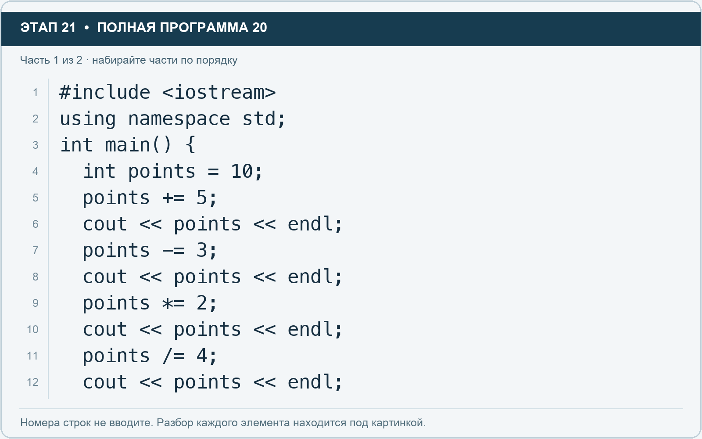
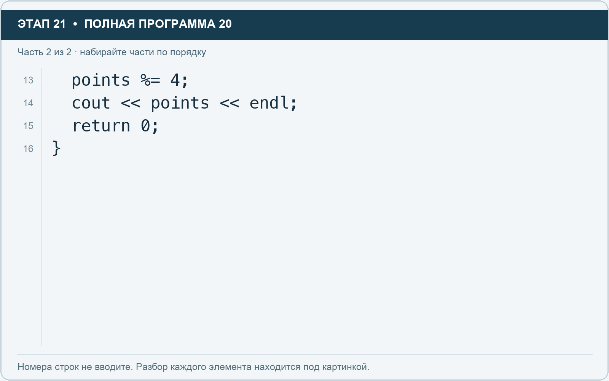

# Этап 21. Сокращённые операции присваивания

[← Этап 20](20.md) · [Оглавление](../README.md) · [Этап 22 →](22.md)

Очистите весь редактор и наберите полную программу:

**Полная программа 20.** Очистите редактор и наберите все 2 части по порядку. После последней части нажмите Run.

**Разбор всех элементов на этой картинке**

- `#include <iostream>` — директива подключения заголовка. # обозначает директиву препроцессора; include означает подключение; < и > ограничивают имя iostream. Заголовок предоставляет стандартные потоки ввода/вывода: cin, cout, endl и настройки потока.
- `using` — вводит директиву использования имён; здесь работает вместе с namespace std.
- `namespace` — обозначает пространство имён; в строке using namespace std разрешает искать имена стандартной библиотеки без префикса std::.
- `std` — пространство имён стандартной библиотеки C++.
- `;` — точка с запятой: завершает объявление или выражение-команду; в заголовке обычного for разделяет начало, условие и шаг.
- `int` — целочисленный тип. В int main задаёт тип возвращаемого кода завершения; в объявлении переменной задаёт её тип.
- `main` — главная функция: выполнение этой программы начинается с неё.
- `(` — открывающая круглая скобка: начинает список параметров/аргументов, условие, заголовок цикла или группировку выражения.
- `)` — закрывающая круглая скобка: завершает соответствующий список, условие или выражение.
- `{` — открывающая фигурная скобка: начинает тело функции/ветки/цикла либо список начальных элементов.
- `points` — имя переменной/параметра; в этом примере объявлено с типом int. Назначение: текущий счёт баллов.
- `=` — присваивание: вычислить правую часть и записать результат слева; при объявлении задаёт начальное значение.
- `10` — целочисленный литерал — конкретное число. Его роль видна в строке: начальное значение, граница, номер команды, индекс, аргумент или код возврата.
- `+=` — прибавляет правое значение к текущему левому и сохраняет результат; у строки дописывает текст.
- `5` — целочисленный литерал — конкретное число. Его роль видна в строке: начальное значение, граница, номер команды, индекс, аргумент или код возврата.
- `cout` — стандартный поток вывода. Вместе с << печатает значения и текст.
- `<<` — оператор передачи значения в поток вывода. Несколько << позволяют последовательно вывести подпись и значения.
- `endl` — манипулятор потока: переводит строку и очищает буфер вывода. Точка с запятой после него завершает всю команду вывода.
- `-=` — вычитает правое значение из текущего левого и сохраняет результат.
- `3` — целочисленный литерал — конкретное число. Его роль видна в строке: начальное значение, граница, номер команды, индекс, аргумент или код возврата.
- `*=` — умножает текущее значение на правое и сохраняет результат.
- `2` — целочисленный литерал — конкретное число. Его роль видна в строке: начальное значение, граница, номер команды, индекс, аргумент или код возврата.
- `/=` — делит текущее значение на правое и сохраняет результат с учётом типа.
- `4` — целочисленный литерал — конкретное число. Его роль видна в строке: начальное значение, граница, номер команды, индекс, аргумент или код возврата.

**Что делает каждая строка**

- Строка 1: подключает указанный заголовок до компиляции программы.
- Строка 2: разрешает обращаться к именам стандартной библиотеки без префикса std::.
- Строка 3: открывает главную функцию, с которой начинается выполнение программы.
- Строка 4: создаёт points с типом int. Начальное значение берётся из выражения справа от =. Назначение: текущий счёт баллов.
- Строка 5: вычисляет правую часть и записывает результат в переменную или элемент слева.
- Строка 6: начинает вывод: последовательно передаёт в поток текст, значения или настройки после <<.
- Строка 7: вычисляет правую часть и записывает результат в переменную или элемент слева.
- Строка 8: начинает вывод: последовательно передаёт в поток текст, значения или настройки после <<.
- Строка 9: вычисляет правую часть и записывает результат в переменную или элемент слева.
- Строка 10: начинает вывод: последовательно передаёт в поток текст, значения или настройки после <<.
- Строка 11: вычисляет правую часть и записывает результат в переменную или элемент слева.
- Строка 12: начинает вывод: последовательно передаёт в поток текст, значения или настройки после <<.

**Разбор всех элементов на этой картинке**

- `points` — имя переменной/параметра; в этом примере объявлено с типом int. Назначение: текущий счёт баллов.
- `%=` — находит остаток от деления текущего целого значения и сохраняет его.
- `4` — целочисленный литерал — конкретное число. Его роль видна в строке: начальное значение, граница, номер команды, индекс, аргумент или код возврата.
- `;` — точка с запятой: завершает объявление или выражение-команду; в заголовке обычного for разделяет начало, условие и шаг.
- `cout` — стандартный поток вывода. Вместе с << печатает значения и текст.
- `<<` — оператор передачи значения в поток вывода. Несколько << позволяют последовательно вывести подпись и значения.
- `endl` — манипулятор потока: переводит строку и очищает буфер вывода. Точка с запятой после него завершает всю команду вывода.
- `return` — возвращает значение из функции и завершает её выполнение. return 0 в main обозначает успешное завершение.
- `0` — целочисленный литерал — конкретное число. Его роль видна в строке: начальное значение, граница, номер команды, индекс, аргумент или код возврата.
- `}` — закрывающая фигурная скобка: завершает соответствующее тело или список. Ей нужна парная открывающая скобка.

**Что делает каждая строка**

- Строка 13: вычисляет правую часть и записывает результат в переменную или элемент слева.
- Строка 14: начинает вывод: последовательно передаёт в поток текст, значения или настройки после <<.
- Строка 15: завершает текущую функцию и возвращает указанное значение.
- Строка 16: закрывает ближайший открытый блок; соотнесите её с парной открывающей скобкой.

Ожидаемые значения: 15, 12, 24, 6, 2. Каждая команда использует текущее значение, поэтому порядок важен.

1. Перепишите первые две сокращённые операции в развёрнутом виде.
2. Проверьте, что вывод не изменился.
3. Создайте собственный расчёт баллов за выполненные задачи: старт, прибавление, штраф, удвоение.

Операция остатка % применяется к целым типам. Для float и double нельзя использовать её как обычный оператор остатка.

---

[← Этап 20](20.md) · [Оглавление](../README.md) · [Этап 22 →](22.md)
