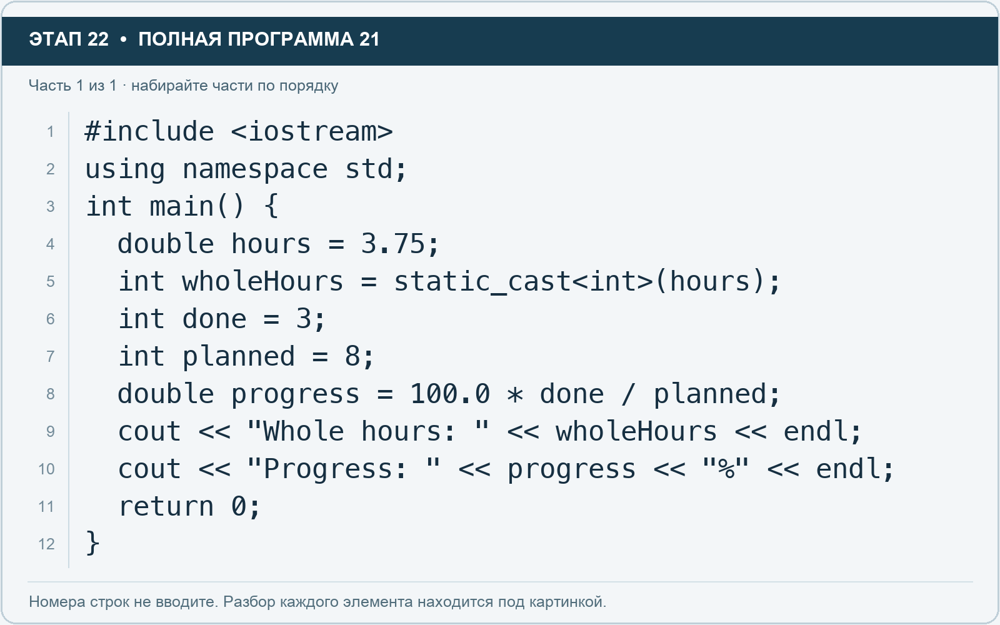

# Этап 22. Явное преобразование: int и дробная часть

[← Этап 21](21.md) · [Оглавление](../README.md) · [Этап 23 →](23.md)

Очистите весь редактор и наберите полную программу:

**Полная программа 21.** Очистите редактор и наберите все 1 части по порядку. После последней части нажмите Run.

**Разбор всех элементов на этой картинке**

- `#include <iostream>` — директива подключения заголовка. # обозначает директиву препроцессора; include означает подключение; < и > ограничивают имя iostream. Заголовок предоставляет стандартные потоки ввода/вывода: cin, cout, endl и настройки потока.
- `using` — вводит директиву использования имён; здесь работает вместе с namespace std.
- `namespace` — обозначает пространство имён; в строке using namespace std разрешает искать имена стандартной библиотеки без префикса std::.
- `std` — пространство имён стандартной библиотеки C++.
- `;` — точка с запятой: завершает объявление или выражение-команду; в заголовке обычного for разделяет начало, условие и шаг.
- `int` — целочисленный тип. В int main задаёт тип возвращаемого кода завершения; в объявлении переменной задаёт её тип.
- `main` — главная функция: выполнение этой программы начинается с неё.
- `(` — открывающая круглая скобка: начинает список параметров/аргументов, условие, заголовок цикла или группировку выражения.
- `)` — закрывающая круглая скобка: завершает соответствующий список, условие или выражение.
- `{` — открывающая фигурная скобка: начинает тело функции/ветки/цикла либо список начальных элементов.
- `double` — тип числа с плавающей точкой, обычно более точный, чем float. Дробный литерал без суффикса обычно имеет тип double.
- `hours` — имя переменной/параметра; в этом примере объявлено с типом double. Назначение: оценка времени либо коллекция оценок времени.
- `=` — присваивание: вычислить правую часть и записать результат слева; при объявлении задаёт начальное значение.
- `3.75` — дробный числовой литерал типа double без специального суффикса. Точка отделяет дробную часть.
- `wholeHours` — имя переменной/параметра; в этом примере объявлено с типом int. Назначение: целая часть времени после явного преобразования.
- `static_cast` — выполняет явное преобразование в тип, записанный в угловых скобках.
- `<` — знак «меньше» в условии; также открывает параметры типа в vector или static_cast. В include ограничивает имя заголовка.
- `>` — знак «больше» в условии; также закрывает параметры типа или имя заголовка. Значение определяется местом использования.
- `done` — имя переменной/параметра; в этом примере объявлено с типом int. Назначение: количество завершённых задач.
- `3` — целочисленный литерал — конкретное число. Его роль видна в строке: начальное значение, граница, номер команды, индекс, аргумент или код возврата.
- `planned` — имя переменной/параметра; в этом примере объявлено с типом int. Назначение: запланированное количество задач.
- `8` — целочисленный литерал — конкретное число. Его роль видна в строке: начальное значение, граница, номер команды, индекс, аргумент или код возврата.
- `progress` — имя переменной/параметра; в этом примере объявлено с типом double. Назначение: переменная или параметр с именем, выбранным автором программы; значение используется в соответствующей строке расчёта или вывода.
- `100.0` — дробный числовой литерал типа double без специального суффикса. Точка отделяет дробную часть.
- `*` — умножение; например часы умножаются на ставку.
- `/` — деление. Для двух целых операндов дробная часть отбрасывается.
- `cout` — стандартный поток вывода. Вместе с << печатает значения и текст.
- `<<` — оператор передачи значения в поток вывода. Несколько << позволяют последовательно вывести подпись и значения.
- `"Whole hours: "` — строковый литерал. Двойные кавычки ограничивают текст и сами не печатаются; содержимое используется как сообщение, название или искомый текст. Пробел внутри кавычек является частью текста и сохраняется.
- `endl` — манипулятор потока: переводит строку и очищает буфер вывода. Точка с запятой после него завершает всю команду вывода.
- `"Progress: "` — строковый литерал. Двойные кавычки ограничивают текст и сами не печатаются; содержимое используется как сообщение, название или искомый текст. Пробел внутри кавычек является частью текста и сохраняется.
- `"%"` — строковый литерал. Двойные кавычки ограничивают текст и сами не печатаются; содержимое используется как сообщение, название или искомый текст.
- `return` — возвращает значение из функции и завершает её выполнение. return 0 в main обозначает успешное завершение.
- `0` — целочисленный литерал — конкретное число. Его роль видна в строке: начальное значение, граница, номер команды, индекс, аргумент или код возврата.
- `}` — закрывающая фигурная скобка: завершает соответствующее тело или список. Ей нужна парная открывающая скобка.

**Что делает каждая строка**

- Строка 1: подключает указанный заголовок до компиляции программы.
- Строка 2: разрешает обращаться к именам стандартной библиотеки без префикса std::.
- Строка 3: открывает главную функцию, с которой начинается выполнение программы.
- Строка 4: начинает тело do while, выполняемое до проверки условия.
- Строка 5: создаёт wholeHours с типом int. Начальное значение берётся из выражения справа от =. Назначение: целая часть времени после явного преобразования.
- Строка 6: создаёт done с типом int. Начальное значение берётся из выражения справа от =. Назначение: количество завершённых задач.
- Строка 7: создаёт planned с типом int. Начальное значение берётся из выражения справа от =. Назначение: запланированное количество задач.
- Строка 8: начинает тело do while, выполняемое до проверки условия.
- Строка 9: начинает вывод: последовательно передаёт в поток текст, значения или настройки после <<.
- Строка 10: начинает вывод: последовательно передаёт в поток текст, значения или настройки после <<.
- Строка 11: завершает текущую функцию и возвращает указанное значение.
- Строка 12: закрывает ближайший открытый блок; соотнесите её с парной открывающей скобкой.

Преобразование в int отбрасывает дробную часть в направлении нуля: здесь получится 3. Прогресс равен 37.5%. Число 100.0 помогает выполнить вычисление с дробной частью.

1. Измените hours на 8.9 и предскажите wholeHours.
2. Замените 100.0 на 100 и сравните прогресс.
3. Верните корректную дробную версию.
4. Не используйте преобразование в int как универсальное математическое округление.

---

[← Этап 21](21.md) · [Оглавление](../README.md) · [Этап 23 →](23.md)
