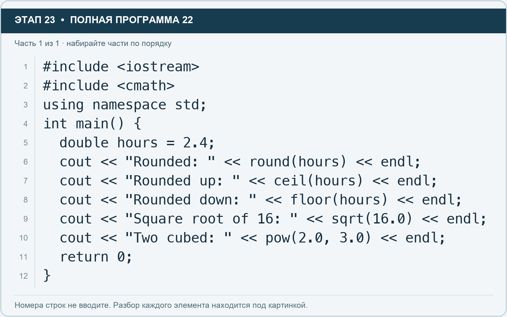

# Этап 23. cmath: округление и простые вычисления

[← Этап 22](22.md) · [Оглавление](../README.md) · [Этап 24 →](24.md)

Добавьте подключение `#include <cmath>`. Очистите весь редактор и наберите полную программу:

**Полная программа 22.** Очистите редактор и наберите все 1 части по порядку. После последней части нажмите Run.

**Разбор всех элементов на этой картинке**

- `#include <iostream>` — директива подключения заголовка. # обозначает директиву препроцессора; include означает подключение; < и > ограничивают имя iostream. Заголовок предоставляет стандартные потоки ввода/вывода: cin, cout, endl и настройки потока.
- `#include <cmath>` — директива подключения заголовка. # обозначает директиву препроцессора; include означает подключение; < и > ограничивают имя cmath. Заголовок предоставляет математические функции round, ceil, floor, sqrt и pow.
- `using` — вводит директиву использования имён; здесь работает вместе с namespace std.
- `namespace` — обозначает пространство имён; в строке using namespace std разрешает искать имена стандартной библиотеки без префикса std::.
- `std` — пространство имён стандартной библиотеки C++.
- `;` — точка с запятой: завершает объявление или выражение-команду; в заголовке обычного for разделяет начало, условие и шаг.
- `int` — целочисленный тип. В int main задаёт тип возвращаемого кода завершения; в объявлении переменной задаёт её тип.
- `main` — главная функция: выполнение этой программы начинается с неё.
- `(` — открывающая круглая скобка: начинает список параметров/аргументов, условие, заголовок цикла или группировку выражения.
- `)` — закрывающая круглая скобка: завершает соответствующий список, условие или выражение.
- `{` — открывающая фигурная скобка: начинает тело функции/ветки/цикла либо список начальных элементов.
- `double` — тип числа с плавающей точкой, обычно более точный, чем float. Дробный литерал без суффикса обычно имеет тип double.
- `hours` — имя переменной/параметра; в этом примере объявлено с типом double. Назначение: оценка времени либо коллекция оценок времени.
- `=` — присваивание: вычислить правую часть и записать результат слева; при объявлении задаёт начальное значение.
- `2.4` — дробный числовой литерал типа double без специального суффикса. Точка отделяет дробную часть.
- `cout` — стандартный поток вывода. Вместе с << печатает значения и текст.
- `<<` — оператор передачи значения в поток вывода. Несколько << позволяют последовательно вывести подпись и значения.
- `"Rounded: "` — строковый литерал. Двойные кавычки ограничивают текст и сами не печатаются; содержимое используется как сообщение, название или искомый текст. Пробел внутри кавычек является частью текста и сохраняется.
- `round` — округляет до ближайшего целого значения; половинные случаи — от нуля. Исходную переменную сама не меняет.
- `endl` — манипулятор потока: переводит строку и очищает буфер вывода. Точка с запятой после него завершает всю команду вывода.
- `"Rounded up: "` — строковый литерал. Двойные кавычки ограничивают текст и сами не печатаются; содержимое используется как сообщение, название или искомый текст. Пробел внутри кавычек является частью текста и сохраняется.
- `ceil` — возвращает округление вверх.
- `"Rounded down: "` — строковый литерал. Двойные кавычки ограничивают текст и сами не печатаются; содержимое используется как сообщение, название или искомый текст. Пробел внутри кавычек является частью текста и сохраняется.
- `floor` — возвращает округление вниз.
- `"Square root of 16: "` — строковый литерал. Двойные кавычки ограничивают текст и сами не печатаются; содержимое используется как сообщение, название или искомый текст. Пробел внутри кавычек является частью текста и сохраняется.
- `sqrt` — возвращает квадратный корень.
- `16.0` — дробный числовой литерал типа double без специального суффикса. Точка отделяет дробную часть.
- `"Two cubed: "` — строковый литерал. Двойные кавычки ограничивают текст и сами не печатаются; содержимое используется как сообщение, название или искомый текст. Пробел внутри кавычек является частью текста и сохраняется.
- `pow` — возводит первый аргумент в степень второго.
- `2.0` — дробный числовой литерал типа double без специального суффикса. Точка отделяет дробную часть.
- `,` — разделяет элементы списка и аргументы функции.
- `3.0` — дробный числовой литерал типа double без специального суффикса. Точка отделяет дробную часть.
- `return` — возвращает значение из функции и завершает её выполнение. return 0 в main обозначает успешное завершение.
- `0` — целочисленный литерал — конкретное число. Его роль видна в строке: начальное значение, граница, номер команды, индекс, аргумент или код возврата.
- `}` — закрывающая фигурная скобка: завершает соответствующее тело или список. Ей нужна парная открывающая скобка.

**Что делает каждая строка**

- Строка 1: подключает указанный заголовок до компиляции программы.
- Строка 2: подключает указанный заголовок до компиляции программы.
- Строка 3: разрешает обращаться к именам стандартной библиотеки без префикса std::.
- Строка 4: открывает главную функцию, с которой начинается выполнение программы.
- Строка 5: начинает тело do while, выполняемое до проверки условия.
- Строка 6: начинает вывод: последовательно передаёт в поток текст, значения или настройки после <<.
- Строка 7: начинает вывод: последовательно передаёт в поток текст, значения или настройки после <<.
- Строка 8: начинает вывод: последовательно передаёт в поток текст, значения или настройки после <<.
- Строка 9: начинает вывод: последовательно передаёт в поток текст, значения или настройки после <<.
- Строка 10: начинает вывод: последовательно передаёт в поток текст, значения или настройки после <<.
- Строка 11: завершает текущую функцию и возвращает указанное значение.
- Строка 12: закрывает ближайший открытый блок; соотнесите её с парной открывающей скобкой.

Round округляет до ближайшего целого значения, половины — от нуля; ceil округляет вверх, floor — вниз. Эти функции возвращают числовой результат, а не переписывают hours. Sqrt находит квадратный корень, pow возводит в степень.

1. Проверьте первые три операции для 2.4.
2. Измените hours на 2.6 и повторите.
3. Измените число под корнем на 25.
4. Посчитайте через ceil, сколько целых часовых слотов нужно для задачи длительностью 3.2 часа.

---

[← Этап 22](22.md) · [Оглавление](../README.md) · [Этап 24 →](24.md)
