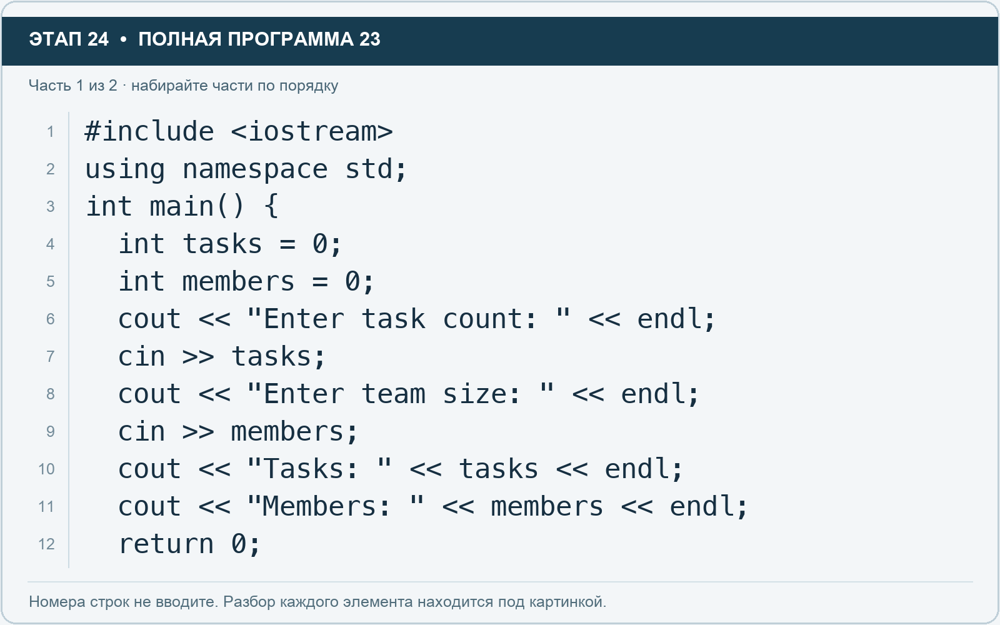
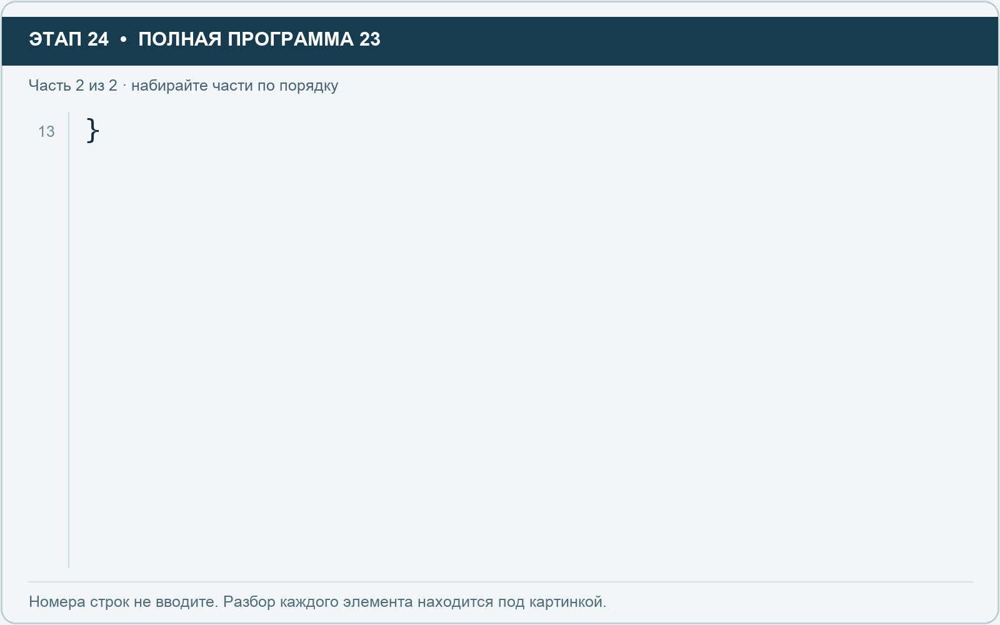

# Этап 24. Получите данные от пользователя

[← Этап 23](23.md) · [Оглавление](../README.md) · [Этап 25 →](25.md)

Очистите весь редактор и наберите полную программу:

**Полная программа 23.** Очистите редактор и наберите все 2 части по порядку. После последней части нажмите Run.

**Разбор всех элементов на этой картинке**

- `#include <iostream>` — директива подключения заголовка. # обозначает директиву препроцессора; include означает подключение; < и > ограничивают имя iostream. Заголовок предоставляет стандартные потоки ввода/вывода: cin, cout, endl и настройки потока.
- `using` — вводит директиву использования имён; здесь работает вместе с namespace std.
- `namespace` — обозначает пространство имён; в строке using namespace std разрешает искать имена стандартной библиотеки без префикса std::.
- `std` — пространство имён стандартной библиотеки C++.
- `;` — точка с запятой: завершает объявление или выражение-команду; в заголовке обычного for разделяет начало, условие и шаг.
- `int` — целочисленный тип. В int main задаёт тип возвращаемого кода завершения; в объявлении переменной задаёт её тип.
- `main` — главная функция: выполнение этой программы начинается с неё.
- `(` — открывающая круглая скобка: начинает список параметров/аргументов, условие, заголовок цикла или группировку выражения.
- `)` — закрывающая круглая скобка: завершает соответствующий список, условие или выражение.
- `{` — открывающая фигурная скобка: начинает тело функции/ветки/цикла либо список начальных элементов.
- `tasks` — имя переменной/параметра; в этом примере объявлено с типом int. Назначение: количество задач.
- `=` — присваивание: вычислить правую часть и записать результат слева; при объявлении задаёт начальное значение.
- `0` — целочисленный литерал — конкретное число. Его роль видна в строке: начальное значение, граница, номер команды, индекс, аргумент или код возврата.
- `members` — имя переменной/параметра; в этом примере объявлено с типом int. Назначение: количество участников.
- `cout` — стандартный поток вывода. Вместе с << печатает значения и текст.
- `<<` — оператор передачи значения в поток вывода. Несколько << позволяют последовательно вывести подпись и значения.
- `"Enter task count: "` — строковый литерал. Двойные кавычки ограничивают текст и сами не печатаются; содержимое используется как сообщение, название или искомый текст. Пробел внутри кавычек является частью текста и сохраняется.
- `endl` — манипулятор потока: переводит строку и очищает буфер вывода. Точка с запятой после него завершает всю команду вывода.
- `cin` — стандартный поток ввода. Вместе с >> читает значения; результат чтения можно проверить как логическое условие.
- `>>` — оператор чтения из потока ввода в указанную переменную; в cin >> ws применяется манипулятор потока.
- `"Enter team size: "` — строковый литерал. Двойные кавычки ограничивают текст и сами не печатаются; содержимое используется как сообщение, название или искомый текст. Пробел внутри кавычек является частью текста и сохраняется.
- `"Tasks: "` — строковый литерал. Двойные кавычки ограничивают текст и сами не печатаются; содержимое используется как сообщение, название или искомый текст. Пробел внутри кавычек является частью текста и сохраняется.
- `"Members: "` — строковый литерал. Двойные кавычки ограничивают текст и сами не печатаются; содержимое используется как сообщение, название или искомый текст. Пробел внутри кавычек является частью текста и сохраняется.
- `return` — возвращает значение из функции и завершает её выполнение. return 0 в main обозначает успешное завершение.

**Что делает каждая строка**

- Строка 1: подключает указанный заголовок до компиляции программы.
- Строка 2: разрешает обращаться к именам стандартной библиотеки без префикса std::.
- Строка 3: открывает главную функцию, с которой начинается выполнение программы.
- Строка 4: создаёт tasks с типом int. Начальное значение берётся из выражения справа от =. Назначение: число задач либо вектор их названий — точный тип указан в объявлении.
- Строка 5: создаёт members с типом int. Начальное значение берётся из выражения справа от =. Назначение: количество участников.
- Строка 6: начинает вывод: последовательно передаёт в поток текст, значения или настройки после <<.
- Строка 7: считывает пользовательские данные в указанную переменную.
- Строка 8: начинает вывод: последовательно передаёт в поток текст, значения или настройки после <<.
- Строка 9: считывает пользовательские данные в указанную переменную.
- Строка 10: начинает вывод: последовательно передаёт в поток текст, значения или настройки после <<.
- Строка 11: начинает вывод: последовательно передаёт в поток текст, значения или настройки после <<.
- Строка 12: завершает текущую функцию и возвращает указанное значение.

**Разбор всех элементов на этой картинке**

- `}` — закрывающая фигурная скобка: завершает соответствующее тело или список. Ей нужна парная открывающая скобка.

**Что делает каждая строка**

- Строка 13: закрывает ближайший открытый блок; соотнесите её с парной открывающей скобкой.

1. Нажмите Run.
2. Щёлкните в области Output после приглашения.
3. Введите `12` и нажмите Enter.
4. После второго приглашения введите `4` и нажмите Enter.
5. Сравните итоговые значения со своим вводом.

`cin >> tasks;` читает значение из стандартного ввода в переменную. Направление стрелок удобно запомнить так: `cout <<` — выводим, `cin >>` — вводим.

В этих первых упражнениях вводите числа нужного типа. Проверку некорректного ввода разберём отдельно.

**Самостоятельно:** добавьте вопрос о числе дней до сдачи проекта, переменную и вывод ответа.

В Programiz дождитесь приглашения в Output, щёлкните в этой области и введите значение. Не печатайте ответы пользователя в редактор main.cpp. Если данных требуется несколько, вводите их по очереди с Enter.

---

[← Этап 23](23.md) · [Оглавление](../README.md) · [Этап 25 →](25.md)
