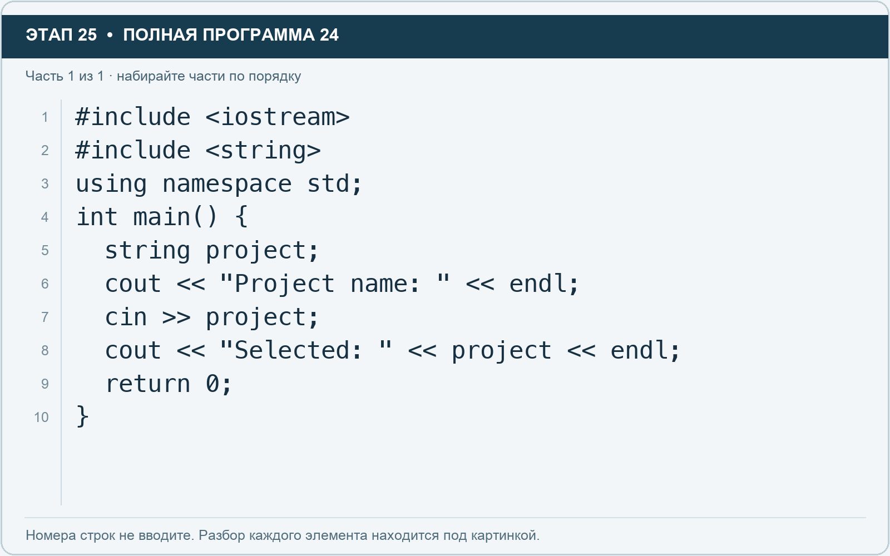
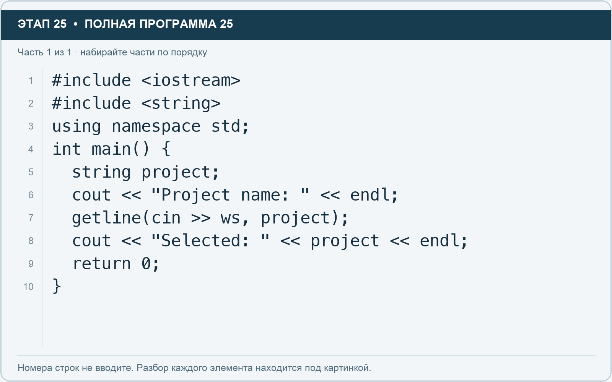

# Этап 25. Считайте название с пробелами

[← Этап 24](24.md) · [Оглавление](../README.md) · [Этап 26 →](26.md)

Очистите весь редактор и наберите полную программу:

**Полная программа 24.** Очистите редактор и наберите все 1 части по порядку. После последней части нажмите Run.

**Разбор всех элементов на этой картинке**

- `#include <iostream>` — директива подключения заголовка. # обозначает директиву препроцессора; include означает подключение; < и > ограничивают имя iostream. Заголовок предоставляет стандартные потоки ввода/вывода: cin, cout, endl и настройки потока.
- `#include <string>` — директива подключения заголовка. # обозначает директиву препроцессора; include означает подключение; < и > ограничивают имя string. Заголовок предоставляет тип string и средства чтения/обработки строк.
- `using` — вводит директиву использования имён; здесь работает вместе с namespace std.
- `namespace` — обозначает пространство имён; в строке using namespace std разрешает искать имена стандартной библиотеки без префикса std::.
- `std` — пространство имён стандартной библиотеки C++.
- `;` — точка с запятой: завершает объявление или выражение-команду; в заголовке обычного for разделяет начало, условие и шаг.
- `int` — целочисленный тип. В int main задаёт тип возвращаемого кода завершения; в объявлении переменной задаёт её тип.
- `main` — главная функция: выполнение этой программы начинается с неё.
- `(` — открывающая круглая скобка: начинает список параметров/аргументов, условие, заголовок цикла или группировку выражения.
- `)` — закрывающая круглая скобка: завершает соответствующий список, условие или выражение.
- `{` — открывающая фигурная скобка: начинает тело функции/ветки/цикла либо список начальных элементов.
- `string` — стандартная строка: хранит последовательность символов, поддерживает чтение и методы обработки.
- `project` — имя переменной/параметра; в этом примере объявлено с типом string. Назначение: название проекта.
- `cout` — стандартный поток вывода. Вместе с << печатает значения и текст.
- `<<` — оператор передачи значения в поток вывода. Несколько << позволяют последовательно вывести подпись и значения.
- `"Project name: "` — строковый литерал. Двойные кавычки ограничивают текст и сами не печатаются; содержимое используется как сообщение, название или искомый текст. Пробел внутри кавычек является частью текста и сохраняется.
- `endl` — манипулятор потока: переводит строку и очищает буфер вывода. Точка с запятой после него завершает всю команду вывода.
- `cin` — стандартный поток ввода. Вместе с >> читает значения; результат чтения можно проверить как логическое условие.
- `>>` — оператор чтения из потока ввода в указанную переменную; в cin >> ws применяется манипулятор потока.
- `"Selected: "` — строковый литерал. Двойные кавычки ограничивают текст и сами не печатаются; содержимое используется как сообщение, название или искомый текст. Пробел внутри кавычек является частью текста и сохраняется.
- `return` — возвращает значение из функции и завершает её выполнение. return 0 в main обозначает успешное завершение.
- `0` — целочисленный литерал — конкретное число. Его роль видна в строке: начальное значение, граница, номер команды, индекс, аргумент или код возврата.
- `}` — закрывающая фигурная скобка: завершает соответствующее тело или список. Ей нужна парная открывающая скобка.

**Что делает каждая строка**

- Строка 1: подключает указанный заголовок до компиляции программы.
- Строка 2: подключает указанный заголовок до компиляции программы.
- Строка 3: разрешает обращаться к именам стандартной библиотеки без префикса std::.
- Строка 4: открывает главную функцию, с которой начинается выполнение программы.
- Строка 5: создаёт project с типом string. Назначение: название проекта.
- Строка 6: начинает вывод: последовательно передаёт в поток текст, значения или настройки после <<.
- Строка 7: считывает пользовательские данные в указанную переменную.
- Строка 8: начинает вывод: последовательно передаёт в поток текст, значения или настройки после <<.
- Строка 9: завершает текущую функцию и возвращает указанное значение.
- Строка 10: закрывает ближайший открытый блок; соотнесите её с парной открывающей скобкой.

Введите `College Quest`. Выведется только `College`: оператор `>>` для строки останавливается на пробельном разделителе.

Теперь сравните со второй полной программой: в ней чтение слова заменено чтением строки. Очистите редактор и наберите её целиком:

**Полная программа 25.** Очистите редактор и наберите все 1 части по порядку. После последней части нажмите Run.

**Разбор всех элементов на этой картинке**

- `#include <iostream>` — директива подключения заголовка. # обозначает директиву препроцессора; include означает подключение; < и > ограничивают имя iostream. Заголовок предоставляет стандартные потоки ввода/вывода: cin, cout, endl и настройки потока.
- `#include <string>` — директива подключения заголовка. # обозначает директиву препроцессора; include означает подключение; < и > ограничивают имя string. Заголовок предоставляет тип string и средства чтения/обработки строк.
- `using` — вводит директиву использования имён; здесь работает вместе с namespace std.
- `namespace` — обозначает пространство имён; в строке using namespace std разрешает искать имена стандартной библиотеки без префикса std::.
- `std` — пространство имён стандартной библиотеки C++.
- `;` — точка с запятой: завершает объявление или выражение-команду; в заголовке обычного for разделяет начало, условие и шаг.
- `int` — целочисленный тип. В int main задаёт тип возвращаемого кода завершения; в объявлении переменной задаёт её тип.
- `main` — главная функция: выполнение этой программы начинается с неё.
- `(` — открывающая круглая скобка: начинает список параметров/аргументов, условие, заголовок цикла или группировку выражения.
- `)` — закрывающая круглая скобка: завершает соответствующий список, условие или выражение.
- `{` — открывающая фигурная скобка: начинает тело функции/ветки/цикла либо список начальных элементов.
- `string` — стандартная строка: хранит последовательность символов, поддерживает чтение и методы обработки.
- `project` — имя переменной/параметра; в этом примере объявлено с типом string. Назначение: название проекта.
- `cout` — стандартный поток вывода. Вместе с << печатает значения и текст.
- `<<` — оператор передачи значения в поток вывода. Несколько << позволяют последовательно вывести подпись и значения.
- `"Project name: "` — строковый литерал. Двойные кавычки ограничивают текст и сами не печатаются; содержимое используется как сообщение, название или искомый текст. Пробел внутри кавычек является частью текста и сохраняется.
- `endl` — манипулятор потока: переводит строку и очищает буфер вывода. Точка с запятой после него завершает всю команду вывода.
- `getline` — читает строку до Enter. Первым аргументом получает поток, вторым — строковую переменную.
- `cin` — стандартный поток ввода. Вместе с >> читает значения; результат чтения можно проверить как логическое условие.
- `>>` — оператор чтения из потока ввода в указанную переменную; в cin >> ws применяется манипулятор потока.
- `ws` — манипулятор ввода, пропускающий начальные пробельные символы перед getline.
- `,` — разделяет элементы списка и аргументы функции.
- `"Selected: "` — строковый литерал. Двойные кавычки ограничивают текст и сами не печатаются; содержимое используется как сообщение, название или искомый текст. Пробел внутри кавычек является частью текста и сохраняется.
- `return` — возвращает значение из функции и завершает её выполнение. return 0 в main обозначает успешное завершение.
- `0` — целочисленный литерал — конкретное число. Его роль видна в строке: начальное значение, граница, номер команды, индекс, аргумент или код возврата.
- `}` — закрывающая фигурная скобка: завершает соответствующее тело или список. Ей нужна парная открывающая скобка.

**Что делает каждая строка**

- Строка 1: подключает указанный заголовок до компиляции программы.
- Строка 2: подключает указанный заголовок до компиляции программы.
- Строка 3: разрешает обращаться к именам стандартной библиотеки без префикса std::.
- Строка 4: открывает главную функцию, с которой начинается выполнение программы.
- Строка 5: создаёт project с типом string. Назначение: название проекта.
- Строка 6: начинает вывод: последовательно передаёт в поток текст, значения или настройки после <<.
- Строка 7: считывает пользовательские данные в указанную переменную.
- Строка 8: начинает вывод: последовательно передаёт в поток текст, значения или настройки после <<.
- Строка 9: завершает текущую функцию и возвращает указанное значение.
- Строка 10: закрывает ближайший открытый блок; соотнесите её с парной открывающей скобкой.

Запустите заново и снова введите `College Quest`. Теперь название считывается целиком.

`getline` читает строку до Enter. `ws` предварительно пропускает начальные пробельные символы; это помогает, если перед чтением строки использовался числовой ввод. В нашем варианте название должно содержать непробельные символы: пустую строку через этот способ не вводим.

**Самостоятельно:** добавьте чтение имени руководителя целой строкой и выведите оба значения с подписями.

---

[← Этап 24](24.md) · [Оглавление](../README.md) · [Этап 26 →](26.md)
