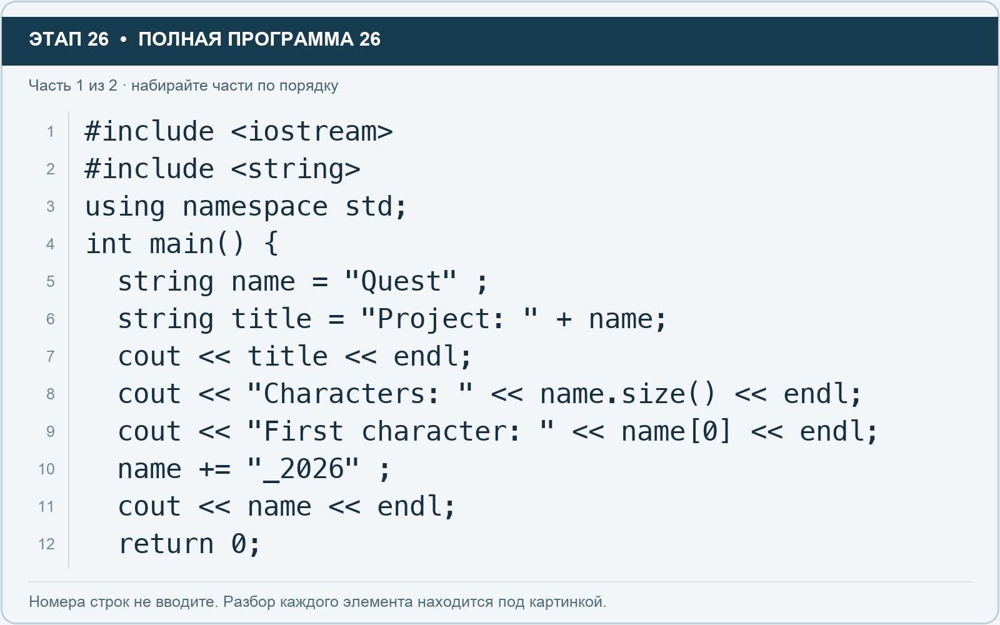
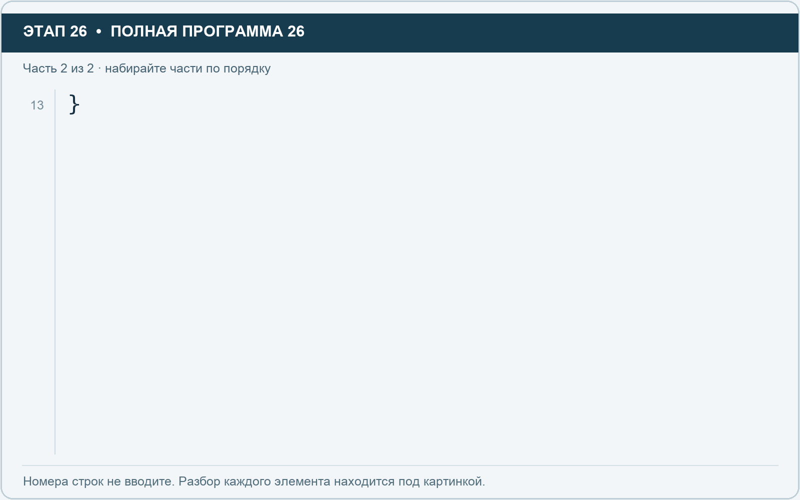

# Этап 26. Строки: объединение, длина и символы

[← Этап 25](25.md) · [Оглавление](../README.md) · [Этап 27 →](27.md)

Очистите весь редактор и наберите полную программу:

**Полная программа 26.** Очистите редактор и наберите все 2 части по порядку. После последней части нажмите Run.

**Разбор всех элементов на этой картинке**

- `#include <iostream>` — директива подключения заголовка. # обозначает директиву препроцессора; include означает подключение; < и > ограничивают имя iostream. Заголовок предоставляет стандартные потоки ввода/вывода: cin, cout, endl и настройки потока.
- `#include <string>` — директива подключения заголовка. # обозначает директиву препроцессора; include означает подключение; < и > ограничивают имя string. Заголовок предоставляет тип string и средства чтения/обработки строк.
- `using` — вводит директиву использования имён; здесь работает вместе с namespace std.
- `namespace` — обозначает пространство имён; в строке using namespace std разрешает искать имена стандартной библиотеки без префикса std::.
- `std` — пространство имён стандартной библиотеки C++.
- `;` — точка с запятой: завершает объявление или выражение-команду; в заголовке обычного for разделяет начало, условие и шаг.
- `int` — целочисленный тип. В int main задаёт тип возвращаемого кода завершения; в объявлении переменной задаёт её тип.
- `main` — главная функция: выполнение этой программы начинается с неё.
- `(` — открывающая круглая скобка: начинает список параметров/аргументов, условие, заголовок цикла или группировку выражения.
- `)` — закрывающая круглая скобка: завершает соответствующий список, условие или выражение.
- `{` — открывающая фигурная скобка: начинает тело функции/ветки/цикла либо список начальных элементов.
- `string` — стандартная строка: хранит последовательность символов, поддерживает чтение и методы обработки.
- `name` — имя переменной/параметра; в этом примере объявлено с типом string. Назначение: название задачи или проекта.
- `=` — присваивание: вычислить правую часть и записать результат слева; при объявлении задаёт начальное значение.
- `"Quest"` — строковый литерал. Двойные кавычки ограничивают текст и сами не печатаются; содержимое используется как сообщение, название или искомый текст.
- `title` — имя переменной/параметра; в этом примере объявлено с типом string. Назначение: подпись или составное название.
- `"Project: "` — строковый литерал. Двойные кавычки ограничивают текст и сами не печатаются; содержимое используется как сообщение, название или искомый текст. Пробел внутри кавычек является частью текста и сохраняется.
- `+` — сложение чисел или объединение строки с другой строкой/строковым литералом. В i + 1 переводит индекс в привычный номер.
- `cout` — стандартный поток вывода. Вместе с << печатает значения и текст.
- `<<` — оператор передачи значения в поток вывода. Несколько << позволяют последовательно вывести подпись и значения.
- `endl` — манипулятор потока: переводит строку и очищает буфер вывода. Точка с запятой после него завершает всю команду вывода.
- `"Characters: "` — строковый литерал. Двойные кавычки ограничивают текст и сами не печатаются; содержимое используется как сообщение, название или искомый текст. Пробел внутри кавычек является частью текста и сохраняется.
- `.` — обращение к методу или свойству объекта, например tasks.size(). Точка внутри числового литерала отделяет дробную часть.
- `size` — метод строки или вектора, возвращающий количество элементов; у string в UTF-8 это количество байтов.
- `"First character: "` — строковый литерал. Двойные кавычки ограничивают текст и сами не печатаются; содержимое используется как сообщение, название или искомый текст. Пробел внутри кавычек является частью текста и сохраняется.
- `[` — открывающая квадратная скобка: начинает индекс элемента или размер объявляемого массива.
- `0` — целочисленный литерал — конкретное число. Его роль видна в строке: начальное значение, граница, номер команды, индекс, аргумент или код возврата.
- `]` — закрывающая квадратная скобка: завершает индекс или размер массива.
- `+=` — прибавляет правое значение к текущему левому и сохраняет результат; у строки дописывает текст.
- `"_2026"` — строковый литерал. Двойные кавычки ограничивают текст и сами не печатаются; содержимое используется как сообщение, название или искомый текст.
- `return` — возвращает значение из функции и завершает её выполнение. return 0 в main обозначает успешное завершение.

**Что делает каждая строка**

- Строка 1: подключает указанный заголовок до компиляции программы.
- Строка 2: подключает указанный заголовок до компиляции программы.
- Строка 3: разрешает обращаться к именам стандартной библиотеки без префикса std::.
- Строка 4: открывает главную функцию, с которой начинается выполнение программы.
- Строка 5: создаёт name с типом string. Начальное значение берётся из выражения справа от =. Назначение: название задачи или проекта.
- Строка 6: создаёт title с типом string. Начальное значение берётся из выражения справа от =. Назначение: подпись или составное название.
- Строка 7: начинает вывод: последовательно передаёт в поток текст, значения или настройки после <<.
- Строка 8: начинает вывод: последовательно передаёт в поток текст, значения или настройки после <<.
- Строка 9: начинает вывод: последовательно передаёт в поток текст, значения или настройки после <<.
- Строка 10: вычисляет правую часть и записывает результат в переменную или элемент слева.
- Строка 11: начинает вывод: последовательно передаёт в поток текст, значения или настройки после <<.
- Строка 12: завершает текущую функцию и возвращает указанное значение.

**Разбор всех элементов на этой картинке**

- `}` — закрывающая фигурная скобка: завершает соответствующее тело или список. Ей нужна парная открывающая скобка.

**Что делает каждая строка**

- Строка 13: закрывает ближайший открытый блок; соотнесите её с парной открывающей скобкой.

1. Запустите: исходная длина слова Quest — 5, первый символ Q.
2. Измените название на своё латинское слово.
3. Выведите последний символ через индекс size минус один, предварительно проверив, что строка не пустая.
4. Добавьте через += ещё одну часть названия.

Пустоту проверяют методом empty. Размер string в кодировке UTF-8 считает байты, поэтому для первых упражнений с индексами используйте латинские названия. Последовательность байтов многобайтной буквы нельзя безопасно разбирать как отдельные буквы через один char.

---

[← Этап 25](25.md) · [Оглавление](../README.md) · [Этап 27 →](27.md)
