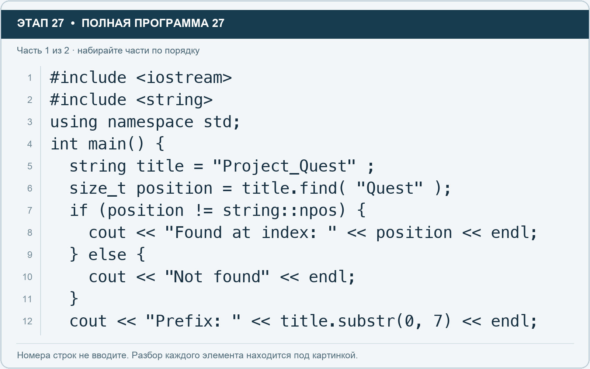
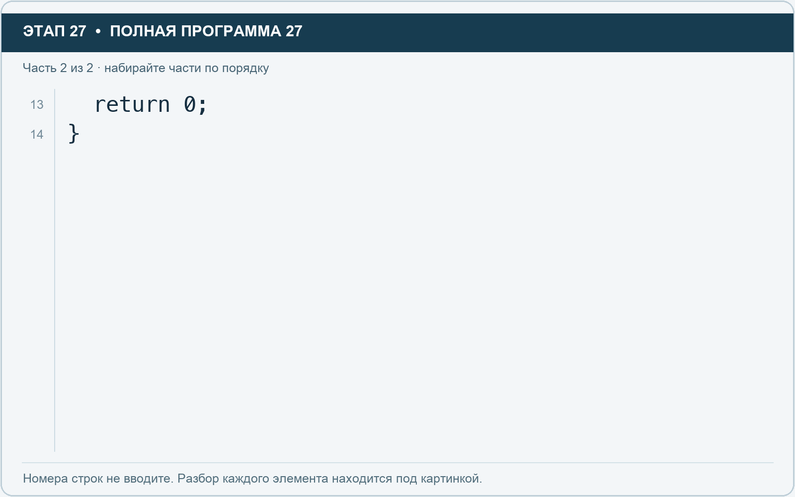

# Этап 27. Строки: найти часть названия и выделить фрагмент

[← Этап 26](26.md) · [Оглавление](../README.md) · [Этап 28 →](28.md)

Очистите весь редактор и наберите полную программу:

**Полная программа 27.** Очистите редактор и наберите все 2 части по порядку. После последней части нажмите Run.

**Разбор всех элементов на этой картинке**

- `#include <iostream>` — директива подключения заголовка. # обозначает директиву препроцессора; include означает подключение; < и > ограничивают имя iostream. Заголовок предоставляет стандартные потоки ввода/вывода: cin, cout, endl и настройки потока.
- `#include <string>` — директива подключения заголовка. # обозначает директиву препроцессора; include означает подключение; < и > ограничивают имя string. Заголовок предоставляет тип string и средства чтения/обработки строк.
- `using` — вводит директиву использования имён; здесь работает вместе с namespace std.
- `namespace` — обозначает пространство имён; в строке using namespace std разрешает искать имена стандартной библиотеки без префикса std::.
- `std` — пространство имён стандартной библиотеки C++.
- `;` — точка с запятой: завершает объявление или выражение-команду; в заголовке обычного for разделяет начало, условие и шаг.
- `int` — целочисленный тип. В int main задаёт тип возвращаемого кода завершения; в объявлении переменной задаёт её тип.
- `main` — главная функция: выполнение этой программы начинается с неё.
- `(` — открывающая круглая скобка: начинает список параметров/аргументов, условие, заголовок цикла или группировку выражения.
- `)` — закрывающая круглая скобка: завершает соответствующий список, условие или выражение.
- `{` — открывающая фигурная скобка: начинает тело функции/ветки/цикла либо список начальных элементов.
- `string` — стандартная строка: хранит последовательность символов, поддерживает чтение и методы обработки.
- `title` — имя переменной/параметра; в этом примере объявлено с типом string. Назначение: подпись или составное название.
- `=` — присваивание: вычислить правую часть и записать результат слева; при объявлении задаёт начальное значение.
- `"Project_Quest"` — строковый литерал. Двойные кавычки ограничивают текст и сами не печатаются; содержимое используется как сообщение, название или искомый текст.
- `size_t` — беззнаковый целый тип, подходящий для размеров и позиций.
- `position` — имя переменной/параметра; в этом примере объявлено с типом size_t. Назначение: позиция найденного фрагмента.
- `.` — обращение к методу или свойству объекта, например tasks.size(). Точка внутри числового литерала отделяет дробную часть.
- `find` — метод поиска подстроки: возвращает позицию или string::npos.
- `"Quest"` — строковый литерал. Двойные кавычки ограничивают текст и сами не печатаются; содержимое используется как сообщение, название или искомый текст.
- `if` — проверяет условие в круглых скобках. При истинном условии выполняет следующий блок.
- `!=` — сравнение на неравенство.
- `::` — оператор разрешения области: обращение к имени внутри пространства имён или типа, например string::npos.
- `npos` — специальное значение string для отсутствующей позиции. Его нельзя использовать как обычный индекс элемента.
- `cout` — стандартный поток вывода. Вместе с << печатает значения и текст.
- `<<` — оператор передачи значения в поток вывода. Несколько << позволяют последовательно вывести подпись и значения.
- `"Found at index: "` — строковый литерал. Двойные кавычки ограничивают текст и сами не печатаются; содержимое используется как сообщение, название или искомый текст. Пробел внутри кавычек является частью текста и сохраняется.
- `endl` — манипулятор потока: переводит строку и очищает буфер вывода. Точка с запятой после него завершает всю команду вывода.
- `}` — закрывающая фигурная скобка: завершает соответствующее тело или список. Ей нужна парная открывающая скобка.
- `else` — задаёт альтернативную ветку. В сочетании else if проверяет следующее условие, когда предыдущее не подошло.
- `"Not found"` — строковый литерал. Двойные кавычки ограничивают текст и сами не печатаются; содержимое используется как сообщение, название или искомый текст.
- `"Prefix: "` — строковый литерал. Двойные кавычки ограничивают текст и сами не печатаются; содержимое используется как сообщение, название или искомый текст. Пробел внутри кавычек является частью текста и сохраняется.
- `substr` — метод, возвращающий часть строки с указанной начальной позиции и, если задано, длины.
- `0` — целочисленный литерал — конкретное число. Его роль видна в строке: начальное значение, граница, номер команды, индекс, аргумент или код возврата.
- `,` — разделяет элементы списка и аргументы функции.
- `7` — целочисленный литерал — конкретное число. Его роль видна в строке: начальное значение, граница, номер команды, индекс, аргумент или код возврата.

**Что делает каждая строка**

- Строка 1: подключает указанный заголовок до компиляции программы.
- Строка 2: подключает указанный заголовок до компиляции программы.
- Строка 3: разрешает обращаться к именам стандартной библиотеки без префикса std::.
- Строка 4: открывает главную функцию, с которой начинается выполнение программы.
- Строка 5: создаёт title с типом string. Начальное значение берётся из выражения справа от =. Назначение: подпись или составное название.
- Строка 6: создаёт position с типом size_t. Начальное значение берётся из выражения справа от =. Назначение: позиция найденного фрагмента.
- Строка 7: проверяет условие; тело выполняется при истинном результате.
- Строка 8: начинает вывод: последовательно передаёт в поток текст, значения или настройки после <<.
- Строка 9: начинает альтернативную ветку при ложном предыдущем условии.
- Строка 10: начинает вывод: последовательно передаёт в поток текст, значения или настройки после <<.
- Строка 11: закрывает ближайший открытый блок; соотнесите её с парной открывающей скобкой.
- Строка 12: начинает вывод: последовательно передаёт в поток текст, значения или настройки после <<.

**Разбор всех элементов на этой картинке**

- `return` — возвращает значение из функции и завершает её выполнение. return 0 в main обозначает успешное завершение.
- `0` — целочисленный литерал — конкретное число. Его роль видна в строке: начальное значение, граница, номер команды, индекс, аргумент или код возврата.
- `;` — точка с запятой: завершает объявление или выражение-команду; в заголовке обычного for разделяет начало, условие и шаг.
- `}` — закрывающая фигурная скобка: завершает соответствующее тело или список. Ей нужна парная открывающая скобка.

**Что делает каждая строка**

- Строка 13: завершает текущую функцию и возвращает указанное значение.
- Строка 14: закрывает ближайший открытый блок; соотнесите её с парной открывающей скобкой.

Find ищет фрагмент и возвращает его позицию, а при отсутствии — специальное значение npos. Size_t — подходящий тип для размера или позиции. Substr в этом примере берёт семь символов с нулевой позиции.

1. Запустите: фрагмент найден с индекса 8, префикс Project.
2. Измените искомый фрагмент на Demo и проверьте ветку отсутствия.
3. Верните Quest и выделите его через substr с позиции 8.
4. Не используйте npos как индекс элемента.

---

[← Этап 26](26.md) · [Оглавление](../README.md) · [Этап 28 →](28.md)
