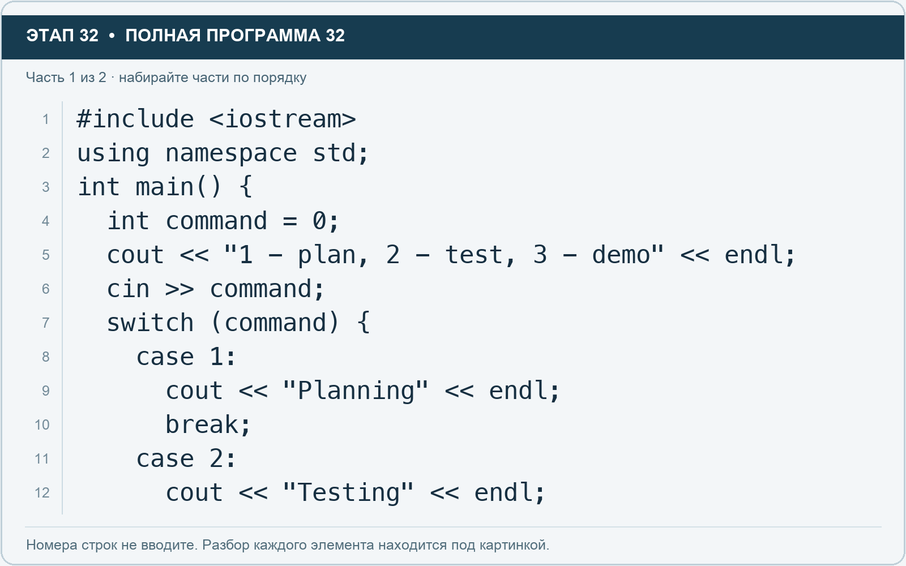
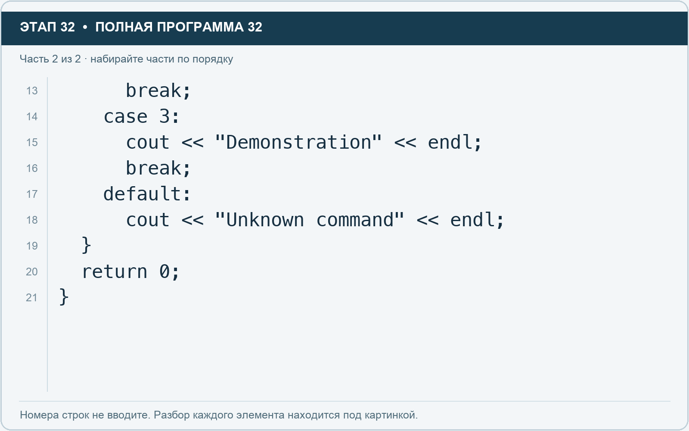

# Этап 32. switch: команда из нескольких вариантов

[← Этап 31](31.md) · [Оглавление](../README.md) · [Этап 33 →](33.md)

Очистите весь редактор и наберите полную программу:

**Полная программа 32.** Очистите редактор и наберите все 2 части по порядку. После последней части нажмите Run.

**Разбор всех элементов на этой картинке**

- `#include <iostream>` — директива подключения заголовка. # обозначает директиву препроцессора; include означает подключение; < и > ограничивают имя iostream. Заголовок предоставляет стандартные потоки ввода/вывода: cin, cout, endl и настройки потока.
- `using` — вводит директиву использования имён; здесь работает вместе с namespace std.
- `namespace` — обозначает пространство имён; в строке using namespace std разрешает искать имена стандартной библиотеки без префикса std::.
- `std` — пространство имён стандартной библиотеки C++.
- `;` — точка с запятой: завершает объявление или выражение-команду; в заголовке обычного for разделяет начало, условие и шаг.
- `int` — целочисленный тип. В int main задаёт тип возвращаемого кода завершения; в объявлении переменной задаёт её тип.
- `main` — главная функция: выполнение этой программы начинается с неё.
- `(` — открывающая круглая скобка: начинает список параметров/аргументов, условие, заголовок цикла или группировку выражения.
- `)` — закрывающая круглая скобка: завершает соответствующий список, условие или выражение.
- `{` — открывающая фигурная скобка: начинает тело функции/ветки/цикла либо список начальных элементов.
- `command` — имя переменной/параметра; в этом примере объявлено с типом int. Назначение: номер выбранной команды меню.
- `=` — присваивание: вычислить правую часть и записать результат слева; при объявлении задаёт начальное значение.
- `0` — целочисленный литерал — конкретное число. Его роль видна в строке: начальное значение, граница, номер команды, индекс, аргумент или код возврата.
- `cout` — стандартный поток вывода. Вместе с << печатает значения и текст.
- `<<` — оператор передачи значения в поток вывода. Несколько << позволяют последовательно вывести подпись и значения.
- `"1 - plan, 2 - test, 3 - demo"` — строковый литерал. Двойные кавычки ограничивают текст и сами не печатаются; содержимое используется как сообщение, название или искомый текст.
- `endl` — манипулятор потока: переводит строку и очищает буфер вывода. Точка с запятой после него завершает всю команду вывода.
- `cin` — стандартный поток ввода. Вместе с >> читает значения; результат чтения можно проверить как логическое условие.
- `>>` — оператор чтения из потока ввода в указанную переменную; в cin >> ws применяется манипулятор потока.
- `switch` — выбирает ветку по значению целочисленного выражения.
- `case` — помечает конкретный вариант значения в switch.
- `1` — целочисленный литерал — конкретное число. Его роль видна в строке: начальное значение, граница, номер команды, индекс, аргумент или код возврата.
- `:` — отделяет элемент от диапазона в range-based for либо заканчивает метку case/default в switch.
- `"Planning"` — строковый литерал. Двойные кавычки ограничивают текст и сами не печатаются; содержимое используется как сообщение, название или искомый текст.
- `break` — выходит из ближайшего окружающего цикла или switch. Внутри поиска завершает поиск, а не всю программу.
- `2` — целочисленный литерал — конкретное число. Его роль видна в строке: начальное значение, граница, номер команды, индекс, аргумент или код возврата.
- `"Testing"` — строковый литерал. Двойные кавычки ограничивают текст и сами не печатаются; содержимое используется как сообщение, название или искомый текст.

**Что делает каждая строка**

- Строка 1: подключает указанный заголовок до компиляции программы.
- Строка 2: разрешает обращаться к именам стандартной библиотеки без префикса std::.
- Строка 3: открывает главную функцию, с которой начинается выполнение программы.
- Строка 4: создаёт command с типом int. Начальное значение берётся из выражения справа от =. Назначение: номер выбранной команды меню.
- Строка 5: начинает вывод: последовательно передаёт в поток текст, значения или настройки после <<.
- Строка 6: считывает пользовательские данные в указанную переменную.
- Строка 7: выбирает ветку по значению команды.
- Строка 8: помечает вариант выполнения switch.
- Строка 9: начинает вывод: последовательно передаёт в поток текст, значения или настройки после <<.
- Строка 10: завершает ближайший цикл или switch.
- Строка 11: помечает вариант выполнения switch.
- Строка 12: начинает вывод: последовательно передаёт в поток текст, значения или настройки после <<.

**Разбор всех элементов на этой картинке**

- `break` — выходит из ближайшего окружающего цикла или switch. Внутри поиска завершает поиск, а не всю программу.
- `;` — точка с запятой: завершает объявление или выражение-команду; в заголовке обычного for разделяет начало, условие и шаг.
- `case` — помечает конкретный вариант значения в switch.
- `3` — целочисленный литерал — конкретное число. Его роль видна в строке: начальное значение, граница, номер команды, индекс, аргумент или код возврата.
- `:` — отделяет элемент от диапазона в range-based for либо заканчивает метку case/default в switch.
- `cout` — стандартный поток вывода. Вместе с << печатает значения и текст.
- `<<` — оператор передачи значения в поток вывода. Несколько << позволяют последовательно вывести подпись и значения.
- `"Demonstration"` — строковый литерал. Двойные кавычки ограничивают текст и сами не печатаются; содержимое используется как сообщение, название или искомый текст.
- `endl` — манипулятор потока: переводит строку и очищает буфер вывода. Точка с запятой после него завершает всю команду вывода.
- `default` — ветка switch для значений, не перечисленных через case.
- `"Unknown command"` — строковый литерал. Двойные кавычки ограничивают текст и сами не печатаются; содержимое используется как сообщение, название или искомый текст.
- `}` — закрывающая фигурная скобка: завершает соответствующее тело или список. Ей нужна парная открывающая скобка.
- `return` — возвращает значение из функции и завершает её выполнение. return 0 в main обозначает успешное завершение.
- `0` — целочисленный литерал — конкретное число. Его роль видна в строке: начальное значение, граница, номер команды, индекс, аргумент или код возврата.

**Что делает каждая строка**

- Строка 13: завершает ближайший цикл или switch.
- Строка 14: помечает вариант выполнения switch.
- Строка 15: начинает вывод: последовательно передаёт в поток текст, значения или настройки после <<.
- Строка 16: завершает ближайший цикл или switch.
- Строка 17: помечает вариант выполнения switch.
- Строка 18: начинает вывод: последовательно передаёт в поток текст, значения или настройки после <<.
- Строка 19: закрывает ближайший открытый блок; соотнесите её с парной открывающей скобкой.
- Строка 20: завершает текущую функцию и возвращает указанное значение.
- Строка 21: закрывает ближайший открытый блок; соотнесите её с парной открывающей скобкой.

Switch выбирает ветку по целому значению. Case задаёт вариант, default — действие при отсутствии совпадений. Break здесь выходит из switch.

1. Проверьте команды 1, 2, 3 и 9.
2. Добавьте четвёртую команду для завершения проекта.
3. Удалите только первый break и проверьте команду 1: выполнение продолжится в следующую ветку.
4. Верните break.

В основном менеджере продолжим использовать знакомые if и else if, чтобы не смешивать две формы меню одновременно.

---

[← Этап 31](31.md) · [Оглавление](../README.md) · [Этап 33 →](33.md)
