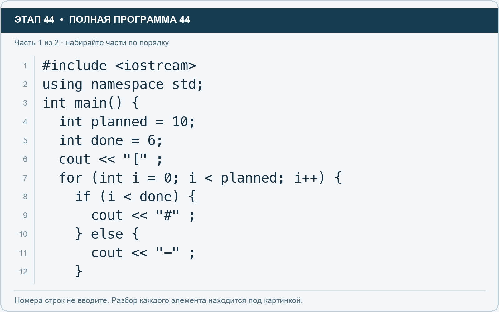
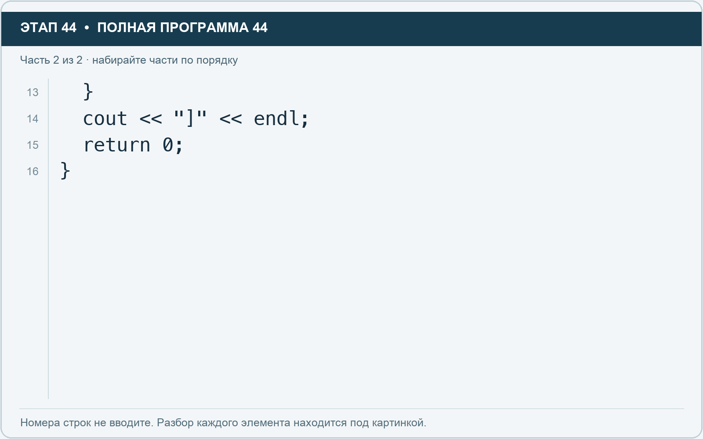

# Этап 44. Нарисуйте индикатор выполнения

[← Этап 43](43.md) · [Оглавление](../README.md) · [Этап 45 →](45.md)

Очистите весь редактор и наберите полную программу:

**Полная программа 44.** Очистите редактор и наберите все 2 части по порядку. После последней части нажмите Run.

**Разбор всех элементов на этой картинке**

- `#include <iostream>` — директива подключения заголовка. # обозначает директиву препроцессора; include означает подключение; < и > ограничивают имя iostream. Заголовок предоставляет стандартные потоки ввода/вывода: cin, cout, endl и настройки потока.
- `using` — вводит директиву использования имён; здесь работает вместе с namespace std.
- `namespace` — обозначает пространство имён; в строке using namespace std разрешает искать имена стандартной библиотеки без префикса std::.
- `std` — пространство имён стандартной библиотеки C++.
- `;` — точка с запятой: завершает объявление или выражение-команду; в заголовке обычного for разделяет начало, условие и шаг.
- `int` — целочисленный тип. В int main задаёт тип возвращаемого кода завершения; в объявлении переменной задаёт её тип.
- `main` — главная функция: выполнение этой программы начинается с неё.
- `(` — открывающая круглая скобка: начинает список параметров/аргументов, условие, заголовок цикла или группировку выражения.
- `)` — закрывающая круглая скобка: завершает соответствующий список, условие или выражение.
- `{` — открывающая фигурная скобка: начинает тело функции/ветки/цикла либо список начальных элементов.
- `planned` — имя переменной/параметра; в этом примере объявлено с типом int. Назначение: запланированное количество задач.
- `=` — присваивание: вычислить правую часть и записать результат слева; при объявлении задаёт начальное значение.
- `10` — целочисленный литерал — конкретное число. Его роль видна в строке: начальное значение, граница, номер команды, индекс, аргумент или код возврата.
- `done` — имя переменной/параметра; в этом примере объявлено с типом int. Назначение: количество завершённых задач.
- `6` — целочисленный литерал — конкретное число. Его роль видна в строке: начальное значение, граница, номер команды, индекс, аргумент или код возврата.
- `cout` — стандартный поток вывода. Вместе с << печатает значения и текст.
- `<<` — оператор передачи значения в поток вывода. Несколько << позволяют последовательно вывести подпись и значения.
- `"["` — строковый литерал. Двойные кавычки ограничивают текст и сами не печатаются; содержимое используется как сообщение, название или искомый текст.
- `for` — цикл. В обычной форме содержит начало, условие и шаг; в форме с двоеточием перебирает элементы диапазона.
- `i` — имя переменной/параметра; в этом примере объявлено с типом int. Назначение: счётчик прохода или индекс элемента.
- `0` — целочисленный литерал — конкретное число. Его роль видна в строке: начальное значение, граница, номер команды, индекс, аргумент или код возврата.
- `<` — знак «меньше» в условии; также открывает параметры типа в vector или static_cast. В include ограничивает имя заголовка.
- `++` — увеличение значения на один. В шаге for меняет счётчик после прохода.
- `if` — проверяет условие в круглых скобках. При истинном условии выполняет следующий блок.
- `"#"` — строковый литерал. Двойные кавычки ограничивают текст и сами не печатаются; содержимое используется как сообщение, название или искомый текст.
- `}` — закрывающая фигурная скобка: завершает соответствующее тело или список. Ей нужна парная открывающая скобка.
- `else` — задаёт альтернативную ветку. В сочетании else if проверяет следующее условие, когда предыдущее не подошло.
- `"-"` — строковый литерал. Двойные кавычки ограничивают текст и сами не печатаются; содержимое используется как сообщение, название или искомый текст.

**Что делает каждая строка**

- Строка 1: подключает указанный заголовок до компиляции программы.
- Строка 2: разрешает обращаться к именам стандартной библиотеки без префикса std::.
- Строка 3: открывает главную функцию, с которой начинается выполнение программы.
- Строка 4: создаёт planned с типом int. Начальное значение берётся из выражения справа от =. Назначение: запланированное количество задач.
- Строка 5: создаёт done с типом int. Начальное значение берётся из выражения справа от =. Назначение: количество завершённых задач.
- Строка 6: начинает вывод: последовательно передаёт в поток текст, значения или настройки после <<.
- Строка 7: начинает цикл: проверьте старт, условие и шаг либо элемент и диапазон после двоеточия.
- Строка 8: проверяет условие; тело выполняется при истинном результате.
- Строка 9: начинает вывод: последовательно передаёт в поток текст, значения или настройки после <<.
- Строка 10: начинает альтернативную ветку при ложном предыдущем условии.
- Строка 11: начинает вывод: последовательно передаёт в поток текст, значения или настройки после <<.
- Строка 12: закрывает ближайший открытый блок; соотнесите её с парной открывающей скобкой.

**Разбор всех элементов на этой картинке**

- `}` — закрывающая фигурная скобка: завершает соответствующее тело или список. Ей нужна парная открывающая скобка.
- `cout` — стандартный поток вывода. Вместе с << печатает значения и текст.
- `<<` — оператор передачи значения в поток вывода. Несколько << позволяют последовательно вывести подпись и значения.
- `"]"` — строковый литерал. Двойные кавычки ограничивают текст и сами не печатаются; содержимое используется как сообщение, название или искомый текст.
- `endl` — манипулятор потока: переводит строку и очищает буфер вывода. Точка с запятой после него завершает всю команду вывода.
- `;` — точка с запятой: завершает объявление или выражение-команду; в заголовке обычного for разделяет начало, условие и шаг.
- `return` — возвращает значение из функции и завершает её выполнение. return 0 в main обозначает успешное завершение.
- `0` — целочисленный литерал — конкретное число. Его роль видна в строке: начальное значение, граница, номер команды, индекс, аргумент или код возврата.

**Что делает каждая строка**

- Строка 13: закрывает ближайший открытый блок; соотнесите её с парной открывающей скобкой.
- Строка 14: начинает вывод: последовательно передаёт в поток текст, значения или настройки после <<.
- Строка 15: завершает текущую функцию и возвращает указанное значение.
- Строка 16: закрывает ближайший открытый блок; соотнесите её с парной открывающей скобкой.

Результат: `[######----]`.

1. Установите `done = 0` и проверьте пустой индикатор.
2. Установите `done = 10` и проверьте полный.
3. Установите `planned = 8`, `done = 3`.
4. Добавьте после индикатора число выполненных и общее число задач.

**Самостоятельно:** придумайте другие символы для выполненной и оставшейся части. В этом упражнении соблюдайте `planned > 0` и `0 <= done <= planned`.

---

[← Этап 43](43.md) · [Оглавление](../README.md) · [Этап 45 →](45.md)
