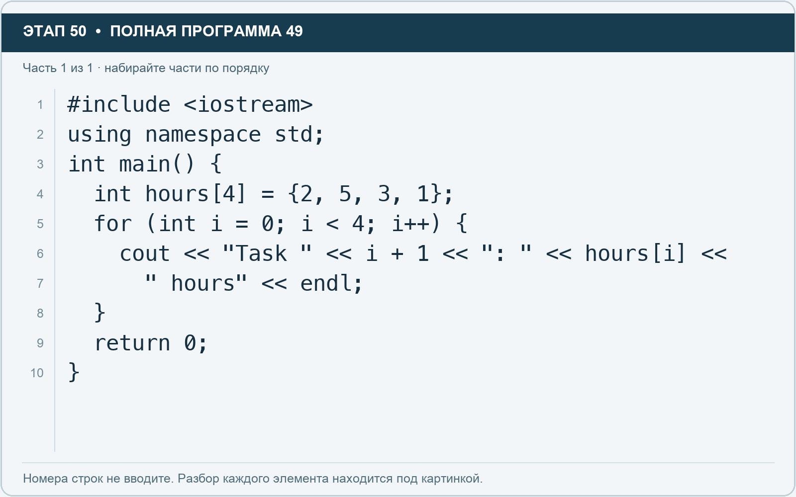

# Этап 50. Выведите массив циклом

[← Этап 49](49.md) · [Оглавление](../README.md) · [Этап 51 →](51.md)

Очистите весь редактор и наберите полную программу:

**Полная программа 49.** Очистите редактор и наберите все 1 части по порядку. После последней части нажмите Run.

**Разбор всех элементов на этой картинке**

- `#include <iostream>` — директива подключения заголовка. # обозначает директиву препроцессора; include означает подключение; < и > ограничивают имя iostream. Заголовок предоставляет стандартные потоки ввода/вывода: cin, cout, endl и настройки потока.
- `using` — вводит директиву использования имён; здесь работает вместе с namespace std.
- `namespace` — обозначает пространство имён; в строке using namespace std разрешает искать имена стандартной библиотеки без префикса std::.
- `std` — пространство имён стандартной библиотеки C++.
- `;` — точка с запятой: завершает объявление или выражение-команду; в заголовке обычного for разделяет начало, условие и шаг.
- `int` — целочисленный тип. В int main задаёт тип возвращаемого кода завершения; в объявлении переменной задаёт её тип.
- `main` — главная функция: выполнение этой программы начинается с неё.
- `(` — открывающая круглая скобка: начинает список параметров/аргументов, условие, заголовок цикла или группировку выражения.
- `)` — закрывающая круглая скобка: завершает соответствующий список, условие или выражение.
- `{` — открывающая фигурная скобка: начинает тело функции/ветки/цикла либо список начальных элементов.
- `hours` — имя переменной/параметра; в этом примере объявлено с типом int. Назначение: оценка времени либо коллекция оценок времени.
- `[` — открывающая квадратная скобка: начинает индекс элемента или размер объявляемого массива.
- `4` — целочисленный литерал — конкретное число. Его роль видна в строке: начальное значение, граница, номер команды, индекс, аргумент или код возврата.
- `]` — закрывающая квадратная скобка: завершает индекс или размер массива.
- `=` — присваивание: вычислить правую часть и записать результат слева; при объявлении задаёт начальное значение.
- `2` — целочисленный литерал — конкретное число. Его роль видна в строке: начальное значение, граница, номер команды, индекс, аргумент или код возврата.
- `,` — разделяет элементы списка и аргументы функции.
- `5` — целочисленный литерал — конкретное число. Его роль видна в строке: начальное значение, граница, номер команды, индекс, аргумент или код возврата.
- `3` — целочисленный литерал — конкретное число. Его роль видна в строке: начальное значение, граница, номер команды, индекс, аргумент или код возврата.
- `1` — целочисленный литерал — конкретное число. Его роль видна в строке: начальное значение, граница, номер команды, индекс, аргумент или код возврата.
- `}` — закрывающая фигурная скобка: завершает соответствующее тело или список. Ей нужна парная открывающая скобка.
- `for` — цикл. В обычной форме содержит начало, условие и шаг; в форме с двоеточием перебирает элементы диапазона.
- `i` — имя переменной/параметра; в этом примере объявлено с типом int. Назначение: счётчик прохода или индекс элемента.
- `0` — целочисленный литерал — конкретное число. Его роль видна в строке: начальное значение, граница, номер команды, индекс, аргумент или код возврата.
- `<` — знак «меньше» в условии; также открывает параметры типа в vector или static_cast. В include ограничивает имя заголовка.
- `++` — увеличение значения на один. В шаге for меняет счётчик после прохода.
- `cout` — стандартный поток вывода. Вместе с << печатает значения и текст.
- `<<` — оператор передачи значения в поток вывода. Несколько << позволяют последовательно вывести подпись и значения.
- `"Task "` — строковый литерал. Двойные кавычки ограничивают текст и сами не печатаются; содержимое используется как сообщение, название или искомый текст. Пробел внутри кавычек является частью текста и сохраняется.
- `+` — сложение чисел или объединение строки с другой строкой/строковым литералом. В i + 1 переводит индекс в привычный номер.
- `": "` — строковый литерал. Двойные кавычки ограничивают текст и сами не печатаются; содержимое используется как сообщение, название или искомый текст. Пробел внутри кавычек является частью текста и сохраняется.
- `" hours"` — строковый литерал. Двойные кавычки ограничивают текст и сами не печатаются; содержимое используется как сообщение, название или искомый текст. Пробел внутри кавычек является частью текста и сохраняется.
- `endl` — манипулятор потока: переводит строку и очищает буфер вывода. Точка с запятой после него завершает всю команду вывода.
- `return` — возвращает значение из функции и завершает её выполнение. return 0 в main обозначает успешное завершение.

**Что делает каждая строка**

- Строка 1: подключает указанный заголовок до компиляции программы.
- Строка 2: разрешает обращаться к именам стандартной библиотеки без префикса std::.
- Строка 3: открывает главную функцию, с которой начинается выполнение программы.
- Строка 4: создаёт hours с типом int. Начальное значение берётся из выражения справа от =. Назначение: оценка времени либо коллекция оценок времени.
- Строка 5: начинает цикл: проверьте старт, условие и шаг либо элемент и диапазон после двоеточия.
- Строка 6: начинает вывод: последовательно передаёт в поток текст, значения или настройки после <<.
- Строка 7: продолжает выражение или список предыдущей строки; учитывайте парные скобки и завершающую точку с запятой.
- Строка 8: закрывает ближайший открытый блок; соотнесите её с парной открывающей скобкой.
- Строка 9: завершает текущую функцию и возвращает указанное значение.
- Строка 10: закрывает ближайший открытый блок; соотнесите её с парной открывающей скобкой.

`i` — текущий индекс. `hours[i]` — элемент по этому индексу. `i + 1` используется только для удобного номера на экране.

1. Проследите первый проход: `i = 0`, читаем `hours[0]`, показываем пользователю номер 1.
2. Проследите последний: `i = 3`, читаем `hours[3]`, показываем номер 4.
3. Добавьте пятый элемент: измените размер массива на 5 и допишите значение в фигурных скобках.
4. Исправьте границу цикла, чтобы увидеть все пять элементов.

**Вопрос:** почему при четырёх элементах нужна граница `i < 4`, а не `i <= 4`?

---

[← Этап 49](49.md) · [Оглавление](../README.md) · [Этап 51 →](51.md)
