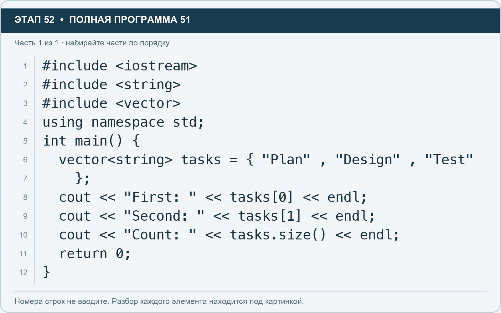

# Этап 52. Создайте изменяемый список через vector

[← Этап 51](51.md) · [Оглавление](../README.md) · [Этап 53 →](53.md)

Добавьте над `using namespace std;` подключение:

Нужное подключение уже включено в следующую полную программу.

Вверху теперь должны быть `iostream`, `string`, `vector`. Затем замените рабочую область:

**Полная программа 51.** Очистите редактор и наберите все 1 части по порядку. После последней части нажмите Run.

**Разбор всех элементов на этой картинке**

- `#include <iostream>` — директива подключения заголовка. # обозначает директиву препроцессора; include означает подключение; < и > ограничивают имя iostream. Заголовок предоставляет стандартные потоки ввода/вывода: cin, cout, endl и настройки потока.
- `#include <string>` — директива подключения заголовка. # обозначает директиву препроцессора; include означает подключение; < и > ограничивают имя string. Заголовок предоставляет тип string и средства чтения/обработки строк.
- `#include <vector>` — директива подключения заголовка. # обозначает директиву препроцессора; include означает подключение; < и > ограничивают имя vector. Заголовок предоставляет изменяемую последовательность vector.
- `using` — вводит директиву использования имён; здесь работает вместе с namespace std.
- `namespace` — обозначает пространство имён; в строке using namespace std разрешает искать имена стандартной библиотеки без префикса std::.
- `std` — пространство имён стандартной библиотеки C++.
- `;` — точка с запятой: завершает объявление или выражение-команду; в заголовке обычного for разделяет начало, условие и шаг.
- `int` — целочисленный тип. В int main задаёт тип возвращаемого кода завершения; в объявлении переменной задаёт её тип.
- `main` — главная функция: выполнение этой программы начинается с неё.
- `(` — открывающая круглая скобка: начинает список параметров/аргументов, условие, заголовок цикла или группировку выражения.
- `)` — закрывающая круглая скобка: завершает соответствующий список, условие или выражение.
- `{` — открывающая фигурная скобка: начинает тело функции/ветки/цикла либо список начальных элементов.
- `vector` — изменяемая последовательность элементов. Тип элемента пишут в угловых скобках, например string или float.
- `<` — знак «меньше» в условии; также открывает параметры типа в vector или static_cast. В include ограничивает имя заголовка.
- `string` — стандартная строка: хранит последовательность символов, поддерживает чтение и методы обработки.
- `>` — знак «больше» в условии; также закрывает параметры типа или имя заголовка. Значение определяется местом использования.
- `tasks` — имя переменной/параметра; в этом примере объявлено с типом vector<string>. Назначение: список названий задач.
- `=` — присваивание: вычислить правую часть и записать результат слева; при объявлении задаёт начальное значение.
- `"Plan"` — строковый литерал. Двойные кавычки ограничивают текст и сами не печатаются; содержимое используется как сообщение, название или искомый текст.
- `,` — разделяет элементы списка и аргументы функции.
- `"Design"` — строковый литерал. Двойные кавычки ограничивают текст и сами не печатаются; содержимое используется как сообщение, название или искомый текст.
- `"Test"` — строковый литерал. Двойные кавычки ограничивают текст и сами не печатаются; содержимое используется как сообщение, название или искомый текст.
- `}` — закрывающая фигурная скобка: завершает соответствующее тело или список. Ей нужна парная открывающая скобка.
- `cout` — стандартный поток вывода. Вместе с << печатает значения и текст.
- `<<` — оператор передачи значения в поток вывода. Несколько << позволяют последовательно вывести подпись и значения.
- `"First: "` — строковый литерал. Двойные кавычки ограничивают текст и сами не печатаются; содержимое используется как сообщение, название или искомый текст. Пробел внутри кавычек является частью текста и сохраняется.
- `[` — открывающая квадратная скобка: начинает индекс элемента или размер объявляемого массива.
- `0` — целочисленный литерал — конкретное число. Его роль видна в строке: начальное значение, граница, номер команды, индекс, аргумент или код возврата.
- `]` — закрывающая квадратная скобка: завершает индекс или размер массива.
- `endl` — манипулятор потока: переводит строку и очищает буфер вывода. Точка с запятой после него завершает всю команду вывода.
- `"Second: "` — строковый литерал. Двойные кавычки ограничивают текст и сами не печатаются; содержимое используется как сообщение, название или искомый текст. Пробел внутри кавычек является частью текста и сохраняется.
- `1` — целочисленный литерал — конкретное число. Его роль видна в строке: начальное значение, граница, номер команды, индекс, аргумент или код возврата.
- `"Count: "` — строковый литерал. Двойные кавычки ограничивают текст и сами не печатаются; содержимое используется как сообщение, название или искомый текст. Пробел внутри кавычек является частью текста и сохраняется.
- `.` — обращение к методу или свойству объекта, например tasks.size(). Точка внутри числового литерала отделяет дробную часть.
- `size` — метод строки или вектора, возвращающий количество элементов; у string в UTF-8 это количество байтов.
- `return` — возвращает значение из функции и завершает её выполнение. return 0 в main обозначает успешное завершение.

**Что делает каждая строка**

- Строка 1: подключает указанный заголовок до компиляции программы.
- Строка 2: подключает указанный заголовок до компиляции программы.
- Строка 3: подключает указанный заголовок до компиляции программы.
- Строка 4: разрешает обращаться к именам стандартной библиотеки без префикса std::.
- Строка 5: открывает главную функцию, с которой начинается выполнение программы.
- Строка 6: создаёт tasks с типом vector<string>. Начальное значение берётся из выражения справа от =. Назначение: число задач либо вектор их названий — точный тип указан в объявлении.
- Строка 7: закрывает список начальных значений и завершает объявление.
- Строка 8: начинает вывод: последовательно передаёт в поток текст, значения или настройки после <<.
- Строка 9: начинает вывод: последовательно передаёт в поток текст, значения или настройки после <<.
- Строка 10: начинает вывод: последовательно передаёт в поток текст, значения или настройки после <<.
- Строка 11: завершает текущую функцию и возвращает указанное значение.
- Строка 12: закрывает ближайший открытый блок; соотнесите её с парной открывающей скобкой.

`vector<string>` — вектор строк. Его размер можно менять. В практикуме используем его как список задач. В C++ также существует отдельный контейнер `std::list`, но он устроен иначе и не подходит для такого доступа через `tasks[i]`; здесь нужен именно `vector`.

`tasks.size()` возвращает количество элементов. Индексация по-прежнему начинается с нуля.

1. Запустите.
2. Замените второе название через `tasks[1] = "Prototype";` перед выводом.
3. Добавьте в исходные фигурные скобки четвёртое название.
4. Проверьте, что размер стал равен 4.

---

[← Этап 51](51.md) · [Оглавление](../README.md) · [Этап 53 →](53.md)
