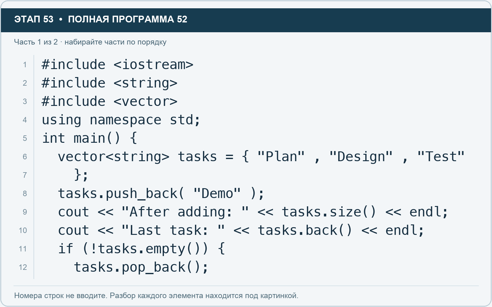
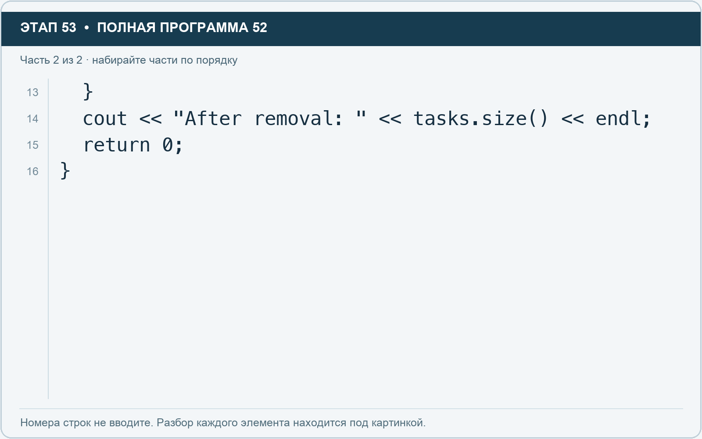

# Этап 53. Добавьте и удалите элемент

[← Этап 52](52.md) · [Оглавление](../README.md) · [Этап 54 →](54.md)

Очистите весь редактор и наберите полную программу:

**Полная программа 52.** Очистите редактор и наберите все 2 части по порядку. После последней части нажмите Run.

**Разбор всех элементов на этой картинке**

- `#include <iostream>` — директива подключения заголовка. # обозначает директиву препроцессора; include означает подключение; < и > ограничивают имя iostream. Заголовок предоставляет стандартные потоки ввода/вывода: cin, cout, endl и настройки потока.
- `#include <string>` — директива подключения заголовка. # обозначает директиву препроцессора; include означает подключение; < и > ограничивают имя string. Заголовок предоставляет тип string и средства чтения/обработки строк.
- `#include <vector>` — директива подключения заголовка. # обозначает директиву препроцессора; include означает подключение; < и > ограничивают имя vector. Заголовок предоставляет изменяемую последовательность vector.
- `using` — вводит директиву использования имён; здесь работает вместе с namespace std.
- `namespace` — обозначает пространство имён; в строке using namespace std разрешает искать имена стандартной библиотеки без префикса std::.
- `std` — пространство имён стандартной библиотеки C++.
- `;` — точка с запятой: завершает объявление или выражение-команду; в заголовке обычного for разделяет начало, условие и шаг.
- `int` — целочисленный тип. В int main задаёт тип возвращаемого кода завершения; в объявлении переменной задаёт её тип.
- `main` — главная функция: выполнение этой программы начинается с неё.
- `(` — открывающая круглая скобка: начинает список параметров/аргументов, условие, заголовок цикла или группировку выражения.
- `)` — закрывающая круглая скобка: завершает соответствующий список, условие или выражение.
- `{` — открывающая фигурная скобка: начинает тело функции/ветки/цикла либо список начальных элементов.
- `vector` — изменяемая последовательность элементов. Тип элемента пишут в угловых скобках, например string или float.
- `<` — знак «меньше» в условии; также открывает параметры типа в vector или static_cast. В include ограничивает имя заголовка.
- `string` — стандартная строка: хранит последовательность символов, поддерживает чтение и методы обработки.
- `>` — знак «больше» в условии; также закрывает параметры типа или имя заголовка. Значение определяется местом использования.
- `tasks` — имя переменной/параметра; в этом примере объявлено с типом vector<string>. Назначение: список названий задач.
- `=` — присваивание: вычислить правую часть и записать результат слева; при объявлении задаёт начальное значение.
- `"Plan"` — строковый литерал. Двойные кавычки ограничивают текст и сами не печатаются; содержимое используется как сообщение, название или искомый текст.
- `,` — разделяет элементы списка и аргументы функции.
- `"Design"` — строковый литерал. Двойные кавычки ограничивают текст и сами не печатаются; содержимое используется как сообщение, название или искомый текст.
- `"Test"` — строковый литерал. Двойные кавычки ограничивают текст и сами не печатаются; содержимое используется как сообщение, название или искомый текст.
- `}` — закрывающая фигурная скобка: завершает соответствующее тело или список. Ей нужна парная открывающая скобка.
- `.` — обращение к методу или свойству объекта, например tasks.size(). Точка внутри числового литерала отделяет дробную часть.
- `push_back` — добавляет переданный элемент в конец вектора.
- `"Demo"` — строковый литерал. Двойные кавычки ограничивают текст и сами не печатаются; содержимое используется как сообщение, название или искомый текст.
- `cout` — стандартный поток вывода. Вместе с << печатает значения и текст.
- `<<` — оператор передачи значения в поток вывода. Несколько << позволяют последовательно вывести подпись и значения.
- `"After adding: "` — строковый литерал. Двойные кавычки ограничивают текст и сами не печатаются; содержимое используется как сообщение, название или искомый текст. Пробел внутри кавычек является частью текста и сохраняется.
- `size` — метод строки или вектора, возвращающий количество элементов; у string в UTF-8 это количество байтов.
- `endl` — манипулятор потока: переводит строку и очищает буфер вывода. Точка с запятой после него завершает всю команду вывода.
- `"Last task: "` — строковый литерал. Двойные кавычки ограничивают текст и сами не печатаются; содержимое используется как сообщение, название или искомый текст. Пробел внутри кавычек является частью текста и сохраняется.
- `back` — обращается к последнему элементу непустого вектора.
- `if` — проверяет условие в круглых скобках. При истинном условии выполняет следующий блок.
- `!` — логическое отрицание. В !found проверяет отсутствие результата, в !(cin >> value) — неуспех чтения.
- `empty` — метод, возвращающий true, если элементов нет.
- `pop_back` — удаляет последний элемент непустого вектора.

**Что делает каждая строка**

- Строка 1: подключает указанный заголовок до компиляции программы.
- Строка 2: подключает указанный заголовок до компиляции программы.
- Строка 3: подключает указанный заголовок до компиляции программы.
- Строка 4: разрешает обращаться к именам стандартной библиотеки без префикса std::.
- Строка 5: открывает главную функцию, с которой начинается выполнение программы.
- Строка 6: создаёт tasks с типом vector<string>. Начальное значение берётся из выражения справа от =. Назначение: число задач либо вектор их названий — точный тип указан в объявлении.
- Строка 7: закрывает список начальных значений и завершает объявление.
- Строка 8: изменяет коллекцию: выполните операцию над указанными элементами и проверьте результат.
- Строка 9: начинает вывод: последовательно передаёт в поток текст, значения или настройки после <<.
- Строка 10: начинает вывод: последовательно передаёт в поток текст, значения или настройки после <<.
- Строка 11: проверяет условие; тело выполняется при истинном результате.
- Строка 12: изменяет коллекцию: выполните операцию над указанными элементами и проверьте результат.

**Разбор всех элементов на этой картинке**

- `}` — закрывающая фигурная скобка: завершает соответствующее тело или список. Ей нужна парная открывающая скобка.
- `cout` — стандартный поток вывода. Вместе с << печатает значения и текст.
- `<<` — оператор передачи значения в поток вывода. Несколько << позволяют последовательно вывести подпись и значения.
- `"After removal: "` — строковый литерал. Двойные кавычки ограничивают текст и сами не печатаются; содержимое используется как сообщение, название или искомый текст. Пробел внутри кавычек является частью текста и сохраняется.
- `tasks` — имя переменной/параметра; в этом примере объявлено с типом vector<string>. Назначение: список названий задач.
- `.` — обращение к методу или свойству объекта, например tasks.size(). Точка внутри числового литерала отделяет дробную часть.
- `size` — метод строки или вектора, возвращающий количество элементов; у string в UTF-8 это количество байтов.
- `(` — открывающая круглая скобка: начинает список параметров/аргументов, условие, заголовок цикла или группировку выражения.
- `)` — закрывающая круглая скобка: завершает соответствующий список, условие или выражение.
- `endl` — манипулятор потока: переводит строку и очищает буфер вывода. Точка с запятой после него завершает всю команду вывода.
- `;` — точка с запятой: завершает объявление или выражение-команду; в заголовке обычного for разделяет начало, условие и шаг.
- `return` — возвращает значение из функции и завершает её выполнение. return 0 в main обозначает успешное завершение.
- `0` — целочисленный литерал — конкретное число. Его роль видна в строке: начальное значение, граница, номер команды, индекс, аргумент или код возврата.

**Что делает каждая строка**

- Строка 13: закрывает ближайший открытый блок; соотнесите её с парной открывающей скобкой.
- Строка 14: начинает вывод: последовательно передаёт в поток текст, значения или настройки после <<.
- Строка 15: завершает текущую функцию и возвращает указанное значение.
- Строка 16: закрывает ближайший открытый блок; соотнесите её с парной открывающей скобкой.

- `push_back(...)` добавляет элемент в конец.
- `back()` обращается к последнему элементу непустого вектора.
- `pop_back()` удаляет последний элемент непустого вектора.
- `empty()` проверяет, пуст ли вектор.
- `!` означает логическое отрицание. `!tasks.empty()` — «список не пуст».

1. Запустите: размер после добавления — 4, после удаления — 3.
2. Добавьте ещё две задачи через два вызова `push_back`.
3. Выведите размер после них.
4. Измените исходное объявление на пустой вектор: `vector<string> tasks;`.
5. Запустите: добавление всё равно работает.

Не вызывайте `back()` и `pop_back()` на пустом векторе. В этом примере перед `back()` уже выполнено добавление, а удаление защищено проверкой.

---

[← Этап 52](52.md) · [Оглавление](../README.md) · [Этап 54 →](54.md)
