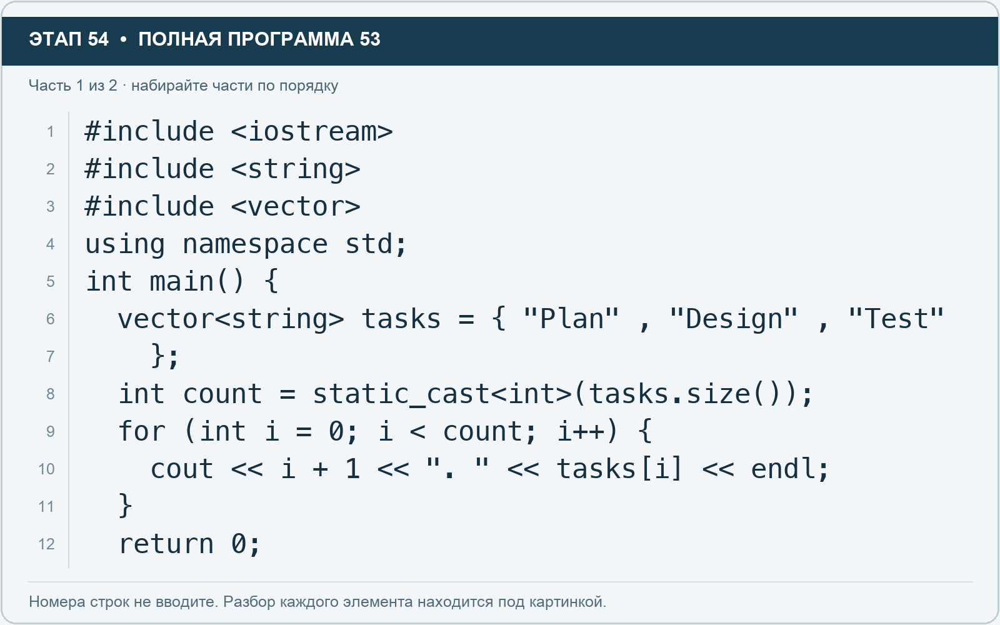
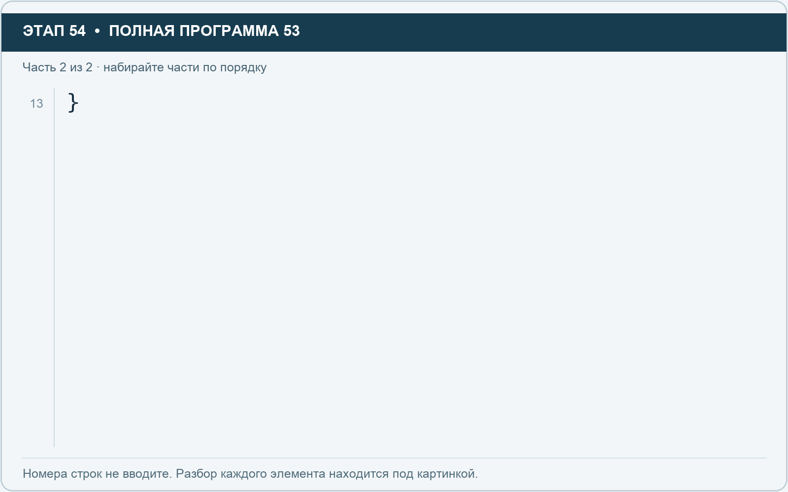

# Этап 54. Переберите vector по индексам

[← Этап 53](53.md) · [Оглавление](../README.md) · [Этап 55 →](55.md)

Очистите весь редактор и наберите полную программу:

**Полная программа 53.** Очистите редактор и наберите все 2 части по порядку. После последней части нажмите Run.

**Разбор всех элементов на этой картинке**

- `#include <iostream>` — директива подключения заголовка. # обозначает директиву препроцессора; include означает подключение; < и > ограничивают имя iostream. Заголовок предоставляет стандартные потоки ввода/вывода: cin, cout, endl и настройки потока.
- `#include <string>` — директива подключения заголовка. # обозначает директиву препроцессора; include означает подключение; < и > ограничивают имя string. Заголовок предоставляет тип string и средства чтения/обработки строк.
- `#include <vector>` — директива подключения заголовка. # обозначает директиву препроцессора; include означает подключение; < и > ограничивают имя vector. Заголовок предоставляет изменяемую последовательность vector.
- `using` — вводит директиву использования имён; здесь работает вместе с namespace std.
- `namespace` — обозначает пространство имён; в строке using namespace std разрешает искать имена стандартной библиотеки без префикса std::.
- `std` — пространство имён стандартной библиотеки C++.
- `;` — точка с запятой: завершает объявление или выражение-команду; в заголовке обычного for разделяет начало, условие и шаг.
- `int` — целочисленный тип. В int main задаёт тип возвращаемого кода завершения; в объявлении переменной задаёт её тип.
- `main` — главная функция: выполнение этой программы начинается с неё.
- `(` — открывающая круглая скобка: начинает список параметров/аргументов, условие, заголовок цикла или группировку выражения.
- `)` — закрывающая круглая скобка: завершает соответствующий список, условие или выражение.
- `{` — открывающая фигурная скобка: начинает тело функции/ветки/цикла либо список начальных элементов.
- `vector` — изменяемая последовательность элементов. Тип элемента пишут в угловых скобках, например string или float.
- `<` — знак «меньше» в условии; также открывает параметры типа в vector или static_cast. В include ограничивает имя заголовка.
- `string` — стандартная строка: хранит последовательность символов, поддерживает чтение и методы обработки.
- `>` — знак «больше» в условии; также закрывает параметры типа или имя заголовка. Значение определяется местом использования.
- `tasks` — имя переменной/параметра; в этом примере объявлено с типом vector<string>. Назначение: список названий задач.
- `=` — присваивание: вычислить правую часть и записать результат слева; при объявлении задаёт начальное значение.
- `"Plan"` — строковый литерал. Двойные кавычки ограничивают текст и сами не печатаются; содержимое используется как сообщение, название или искомый текст.
- `,` — разделяет элементы списка и аргументы функции.
- `"Design"` — строковый литерал. Двойные кавычки ограничивают текст и сами не печатаются; содержимое используется как сообщение, название или искомый текст.
- `"Test"` — строковый литерал. Двойные кавычки ограничивают текст и сами не печатаются; содержимое используется как сообщение, название или искомый текст.
- `}` — закрывающая фигурная скобка: завершает соответствующее тело или список. Ей нужна парная открывающая скобка.
- `count` — имя переменной/параметра; в этом примере объявлено с типом int. Назначение: сохранённое количество элементов.
- `static_cast` — выполняет явное преобразование в тип, записанный в угловых скобках.
- `.` — обращение к методу или свойству объекта, например tasks.size(). Точка внутри числового литерала отделяет дробную часть.
- `size` — метод строки или вектора, возвращающий количество элементов; у string в UTF-8 это количество байтов.
- `for` — цикл. В обычной форме содержит начало, условие и шаг; в форме с двоеточием перебирает элементы диапазона.
- `i` — имя переменной/параметра; в этом примере объявлено с типом int. Назначение: счётчик прохода или индекс элемента.
- `0` — целочисленный литерал — конкретное число. Его роль видна в строке: начальное значение, граница, номер команды, индекс, аргумент или код возврата.
- `++` — увеличение значения на один. В шаге for меняет счётчик после прохода.
- `cout` — стандартный поток вывода. Вместе с << печатает значения и текст.
- `<<` — оператор передачи значения в поток вывода. Несколько << позволяют последовательно вывести подпись и значения.
- `+` — сложение чисел или объединение строки с другой строкой/строковым литералом. В i + 1 переводит индекс в привычный номер.
- `1` — целочисленный литерал — конкретное число. Его роль видна в строке: начальное значение, граница, номер команды, индекс, аргумент или код возврата.
- `". "` — строковый литерал. Двойные кавычки ограничивают текст и сами не печатаются; содержимое используется как сообщение, название или искомый текст. Пробел внутри кавычек является частью текста и сохраняется.
- `[` — открывающая квадратная скобка: начинает индекс элемента или размер объявляемого массива.
- `]` — закрывающая квадратная скобка: завершает индекс или размер массива.
- `endl` — манипулятор потока: переводит строку и очищает буфер вывода. Точка с запятой после него завершает всю команду вывода.
- `return` — возвращает значение из функции и завершает её выполнение. return 0 в main обозначает успешное завершение.

**Что делает каждая строка**

- Строка 1: подключает указанный заголовок до компиляции программы.
- Строка 2: подключает указанный заголовок до компиляции программы.
- Строка 3: подключает указанный заголовок до компиляции программы.
- Строка 4: разрешает обращаться к именам стандартной библиотеки без префикса std::.
- Строка 5: открывает главную функцию, с которой начинается выполнение программы.
- Строка 6: создаёт tasks с типом vector<string>. Начальное значение берётся из выражения справа от =. Назначение: число задач либо вектор их названий — точный тип указан в объявлении.
- Строка 7: закрывает список начальных значений и завершает объявление.
- Строка 8: создаёт count с типом int. Начальное значение берётся из выражения справа от =. Назначение: сохранённое количество элементов.
- Строка 9: начинает цикл: проверьте старт, условие и шаг либо элемент и диапазон после двоеточия.
- Строка 10: начинает вывод: последовательно передаёт в поток текст, значения или настройки после <<.
- Строка 11: закрывает ближайший открытый блок; соотнесите её с парной открывающей скобкой.
- Строка 12: завершает текущую функцию и возвращает указанное значение.

**Разбор всех элементов на этой картинке**

- `}` — закрывающая фигурная скобка: завершает соответствующее тело или список. Ей нужна парная открывающая скобка.

**Что делает каждая строка**

- Строка 13: закрывает ближайший открытый блок; соотнесите её с парной открывающей скобкой.

`size()` возвращает беззнаковый тип размера. Запись `static_cast<int>(tasks.size())` явно преобразует размер в `int`, чтобы использовать привычный целочисленный счётчик. Для наших маленьких учебных списков такое преобразование подходит. Очень большие размеры могут не помещаться в `int`.

1. Запустите.
2. Перед вычислением `count` добавьте новую задачу через `push_back`.
3. Запустите снова. Цикл должен сам вывести дополнительный элемент.
4. Перенесите добавление после вычисления `count`, но перед циклом.
5. Запустите и объясните, почему последний элемент не появился.
6. Верните добавление перед расчётом `count`.

`count` хранит ранее вычисленное число, а не автоматически обновляемую связь с вектором.

---

[← Этап 53](53.md) · [Оглавление](../README.md) · [Этап 55 →](55.md)
