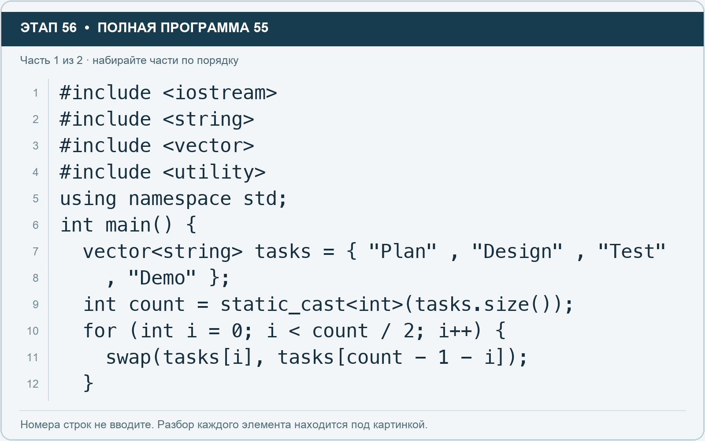
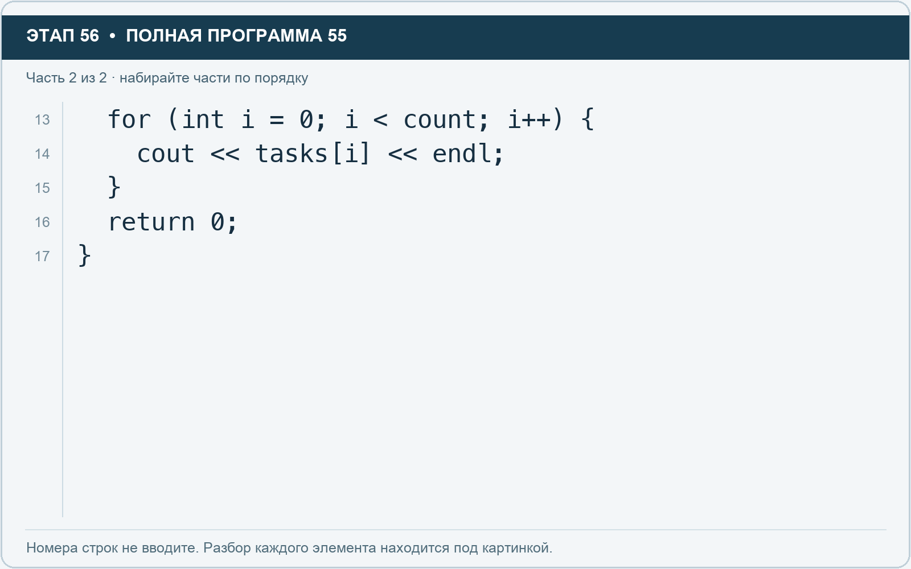

# Этап 56. Действительно поменяйте порядок элементов

[← Этап 55](55.md) · [Оглавление](../README.md) · [Этап 57 →](57.md)

Обратный вывод не изменял вектор. Теперь изменим сами элементы.

Добавьте подключение `#include <utility>` над `using namespace std;`. Очистите весь редактор и наберите полную программу:

**Полная программа 55.** Очистите редактор и наберите все 2 части по порядку. После последней части нажмите Run.

**Разбор всех элементов на этой картинке**

- `#include <iostream>` — директива подключения заголовка. # обозначает директиву препроцессора; include означает подключение; < и > ограничивают имя iostream. Заголовок предоставляет стандартные потоки ввода/вывода: cin, cout, endl и настройки потока.
- `#include <string>` — директива подключения заголовка. # обозначает директиву препроцессора; include означает подключение; < и > ограничивают имя string. Заголовок предоставляет тип string и средства чтения/обработки строк.
- `#include <vector>` — директива подключения заголовка. # обозначает директиву препроцессора; include означает подключение; < и > ограничивают имя vector. Заголовок предоставляет изменяемую последовательность vector.
- `#include <utility>` — директива подключения заголовка. # обозначает директиву препроцессора; include означает подключение; < и > ограничивают имя utility. Заголовок предоставляет функцию обмена swap.
- `using` — вводит директиву использования имён; здесь работает вместе с namespace std.
- `namespace` — обозначает пространство имён; в строке using namespace std разрешает искать имена стандартной библиотеки без префикса std::.
- `std` — пространство имён стандартной библиотеки C++.
- `;` — точка с запятой: завершает объявление или выражение-команду; в заголовке обычного for разделяет начало, условие и шаг.
- `int` — целочисленный тип. В int main задаёт тип возвращаемого кода завершения; в объявлении переменной задаёт её тип.
- `main` — главная функция: выполнение этой программы начинается с неё.
- `(` — открывающая круглая скобка: начинает список параметров/аргументов, условие, заголовок цикла или группировку выражения.
- `)` — закрывающая круглая скобка: завершает соответствующий список, условие или выражение.
- `{` — открывающая фигурная скобка: начинает тело функции/ветки/цикла либо список начальных элементов.
- `vector` — изменяемая последовательность элементов. Тип элемента пишут в угловых скобках, например string или float.
- `<` — знак «меньше» в условии; также открывает параметры типа в vector или static_cast. В include ограничивает имя заголовка.
- `string` — стандартная строка: хранит последовательность символов, поддерживает чтение и методы обработки.
- `>` — знак «больше» в условии; также закрывает параметры типа или имя заголовка. Значение определяется местом использования.
- `tasks` — имя переменной/параметра; в этом примере объявлено с типом vector<string>. Назначение: список названий задач.
- `=` — присваивание: вычислить правую часть и записать результат слева; при объявлении задаёт начальное значение.
- `"Plan"` — строковый литерал. Двойные кавычки ограничивают текст и сами не печатаются; содержимое используется как сообщение, название или искомый текст.
- `,` — разделяет элементы списка и аргументы функции.
- `"Design"` — строковый литерал. Двойные кавычки ограничивают текст и сами не печатаются; содержимое используется как сообщение, название или искомый текст.
- `"Test"` — строковый литерал. Двойные кавычки ограничивают текст и сами не печатаются; содержимое используется как сообщение, название или искомый текст.
- `"Demo"` — строковый литерал. Двойные кавычки ограничивают текст и сами не печатаются; содержимое используется как сообщение, название или искомый текст.
- `}` — закрывающая фигурная скобка: завершает соответствующее тело или список. Ей нужна парная открывающая скобка.
- `count` — имя переменной/параметра; в этом примере объявлено с типом int. Назначение: сохранённое количество элементов.
- `static_cast` — выполняет явное преобразование в тип, записанный в угловых скобках.
- `.` — обращение к методу или свойству объекта, например tasks.size(). Точка внутри числового литерала отделяет дробную часть.
- `size` — метод строки или вектора, возвращающий количество элементов; у string в UTF-8 это количество байтов.
- `for` — цикл. В обычной форме содержит начало, условие и шаг; в форме с двоеточием перебирает элементы диапазона.
- `i` — имя переменной/параметра; в этом примере объявлено с типом int. Назначение: счётчик прохода или индекс элемента.
- `0` — целочисленный литерал — конкретное число. Его роль видна в строке: начальное значение, граница, номер команды, индекс, аргумент или код возврата.
- `/` — деление. Для двух целых операндов дробная часть отбрасывается.
- `2` — целочисленный литерал — конкретное число. Его роль видна в строке: начальное значение, граница, номер команды, индекс, аргумент или код возврата.
- `++` — увеличение значения на один. В шаге for меняет счётчик после прохода.
- `swap` — обменивает два значения местами.
- `[` — открывающая квадратная скобка: начинает индекс элемента или размер объявляемого массива.
- `]` — закрывающая квадратная скобка: завершает индекс или размер массива.
- `-` — вычитание или знак отрицательного числа. В count - 1 получает последний индекс.
- `1` — целочисленный литерал — конкретное число. Его роль видна в строке: начальное значение, граница, номер команды, индекс, аргумент или код возврата.

**Что делает каждая строка**

- Строка 1: подключает указанный заголовок до компиляции программы.
- Строка 2: подключает указанный заголовок до компиляции программы.
- Строка 3: подключает указанный заголовок до компиляции программы.
- Строка 4: подключает указанный заголовок до компиляции программы.
- Строка 5: разрешает обращаться к именам стандартной библиотеки без префикса std::.
- Строка 6: открывает главную функцию, с которой начинается выполнение программы.
- Строка 7: создаёт tasks с типом vector<string>. Начальное значение берётся из выражения справа от =. Назначение: число задач либо вектор их названий — точный тип указан в объявлении.
- Строка 8: продолжает выражение или список предыдущей строки; учитывайте парные скобки и завершающую точку с запятой.
- Строка 9: создаёт count с типом int. Начальное значение берётся из выражения справа от =. Назначение: сохранённое количество элементов.
- Строка 10: начинает цикл: проверьте старт, условие и шаг либо элемент и диапазон после двоеточия.
- Строка 11: изменяет коллекцию: выполните операцию над указанными элементами и проверьте результат.
- Строка 12: закрывает ближайший открытый блок; соотнесите её с парной открывающей скобкой.

**Разбор всех элементов на этой картинке**

- `for` — цикл. В обычной форме содержит начало, условие и шаг; в форме с двоеточием перебирает элементы диапазона.
- `(` — открывающая круглая скобка: начинает список параметров/аргументов, условие, заголовок цикла или группировку выражения.
- `int` — целочисленный тип. В int main задаёт тип возвращаемого кода завершения; в объявлении переменной задаёт её тип.
- `i` — имя переменной/параметра; в этом примере объявлено с типом int. Назначение: счётчик прохода или индекс элемента.
- `=` — присваивание: вычислить правую часть и записать результат слева; при объявлении задаёт начальное значение.
- `0` — целочисленный литерал — конкретное число. Его роль видна в строке: начальное значение, граница, номер команды, индекс, аргумент или код возврата.
- `;` — точка с запятой: завершает объявление или выражение-команду; в заголовке обычного for разделяет начало, условие и шаг.
- `<` — знак «меньше» в условии; также открывает параметры типа в vector или static_cast. В include ограничивает имя заголовка.
- `count` — имя переменной/параметра; в этом примере объявлено с типом int. Назначение: сохранённое количество элементов.
- `++` — увеличение значения на один. В шаге for меняет счётчик после прохода.
- `)` — закрывающая круглая скобка: завершает соответствующий список, условие или выражение.
- `{` — открывающая фигурная скобка: начинает тело функции/ветки/цикла либо список начальных элементов.
- `cout` — стандартный поток вывода. Вместе с << печатает значения и текст.
- `<<` — оператор передачи значения в поток вывода. Несколько << позволяют последовательно вывести подпись и значения.
- `tasks` — имя переменной/параметра; в этом примере объявлено с типом vector<string>. Назначение: список названий задач.
- `[` — открывающая квадратная скобка: начинает индекс элемента или размер объявляемого массива.
- `]` — закрывающая квадратная скобка: завершает индекс или размер массива.
- `endl` — манипулятор потока: переводит строку и очищает буфер вывода. Точка с запятой после него завершает всю команду вывода.
- `}` — закрывающая фигурная скобка: завершает соответствующее тело или список. Ей нужна парная открывающая скобка.
- `return` — возвращает значение из функции и завершает её выполнение. return 0 в main обозначает успешное завершение.

**Что делает каждая строка**

- Строка 13: начинает цикл: проверьте старт, условие и шаг либо элемент и диапазон после двоеточия.
- Строка 14: начинает вывод: последовательно передаёт в поток текст, значения или настройки после <<.
- Строка 15: закрывает ближайший открытый блок; соотнесите её с парной открывающей скобкой.
- Строка 16: завершает текущую функцию и возвращает указанное значение.
- Строка 17: закрывает ближайший открытый блок; соотнесите её с парной открывающей скобкой.

`swap` обменивает два значения. Индекс `count - 1 - i` указывает на симметричный элемент с другого конца.

На первом проходе меняются первый и последний элементы. На втором — второй и предпоследний.

1. Запустите. Обычный прямой цикл теперь печатает Demo, Test, Design, Plan.
2. Добавьте пятый элемент в исходный список и повторите запуск.
3. Объясните, почему средний элемент нечётного списка можно оставить на месте.
4. Объясните, зачем цикл обмена идёт только до `count / 2`.

Если выполнить обмены по всей длине, пары поменяются повторно и исходный порядок восстановится.

---

[← Этап 55](55.md) · [Оглавление](../README.md) · [Этап 57 →](57.md)
