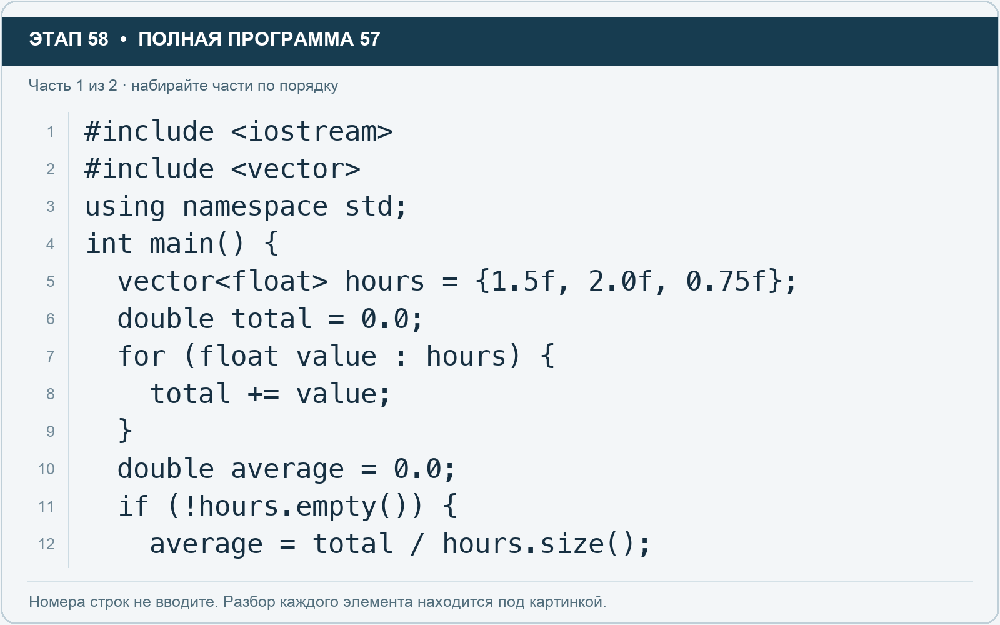
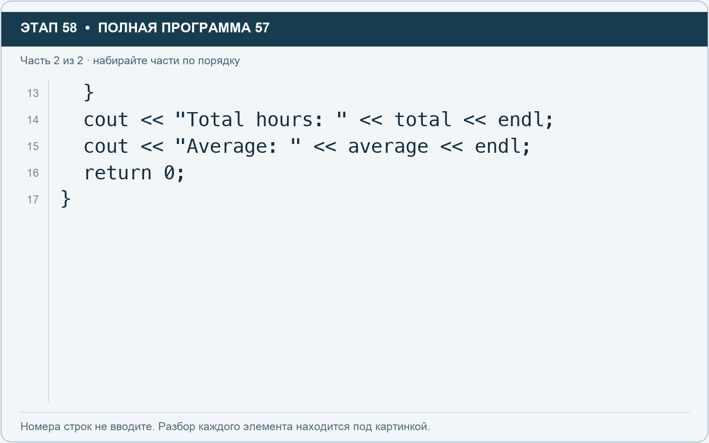

# Этап 58. vector из дробных оценок времени

[← Этап 57](57.md) · [Оглавление](../README.md) · [Этап 59 →](59.md)

Очистите весь редактор и наберите полную программу:

**Полная программа 57.** Очистите редактор и наберите все 2 части по порядку. После последней части нажмите Run.

**Разбор всех элементов на этой картинке**

- `#include <iostream>` — директива подключения заголовка. # обозначает директиву препроцессора; include означает подключение; < и > ограничивают имя iostream. Заголовок предоставляет стандартные потоки ввода/вывода: cin, cout, endl и настройки потока.
- `#include <vector>` — директива подключения заголовка. # обозначает директиву препроцессора; include означает подключение; < и > ограничивают имя vector. Заголовок предоставляет изменяемую последовательность vector.
- `using` — вводит директиву использования имён; здесь работает вместе с namespace std.
- `namespace` — обозначает пространство имён; в строке using namespace std разрешает искать имена стандартной библиотеки без префикса std::.
- `std` — пространство имён стандартной библиотеки C++.
- `;` — точка с запятой: завершает объявление или выражение-команду; в заголовке обычного for разделяет начало, условие и шаг.
- `int` — целочисленный тип. В int main задаёт тип возвращаемого кода завершения; в объявлении переменной задаёт её тип.
- `main` — главная функция: выполнение этой программы начинается с неё.
- `(` — открывающая круглая скобка: начинает список параметров/аргументов, условие, заголовок цикла или группировку выражения.
- `)` — закрывающая круглая скобка: завершает соответствующий список, условие или выражение.
- `{` — открывающая фигурная скобка: начинает тело функции/ветки/цикла либо список начальных элементов.
- `vector` — изменяемая последовательность элементов. Тип элемента пишут в угловых скобках, например string или float.
- `<` — знак «меньше» в условии; также открывает параметры типа в vector или static_cast. В include ограничивает имя заголовка.
- `float` — тип числа с плавающей точкой. Литералы с суффиксом f имеют этот тип; возможна погрешность представления дробей.
- `>` — знак «больше» в условии; также закрывает параметры типа или имя заголовка. Значение определяется местом использования.
- `hours` — имя переменной/параметра; в этом примере объявлено с типом vector<float>. Назначение: оценка времени либо коллекция оценок времени.
- `=` — присваивание: вычислить правую часть и записать результат слева; при объявлении задаёт начальное значение.
- `1.5f` — числовой литерал типа float: точка задаёт дробную часть, суффикс f указывает тип. При вводе пользователем суффикс не печатают.
- `,` — разделяет элементы списка и аргументы функции.
- `2.0f` — числовой литерал типа float: точка задаёт дробную часть, суффикс f указывает тип. При вводе пользователем суффикс не печатают.
- `0.75f` — числовой литерал типа float: точка задаёт дробную часть, суффикс f указывает тип. При вводе пользователем суффикс не печатают.
- `}` — закрывающая фигурная скобка: завершает соответствующее тело или список. Ей нужна парная открывающая скобка.
- `double` — тип числа с плавающей точкой, обычно более точный, чем float. Дробный литерал без суффикса обычно имеет тип double.
- `total` — имя переменной/параметра; в этом примере объявлено с типом double. Назначение: накопленная сумма.
- `0.0` — дробный числовой литерал типа double без специального суффикса. Точка отделяет дробную часть.
- `for` — цикл. В обычной форме содержит начало, условие и шаг; в форме с двоеточием перебирает элементы диапазона.
- `value` — имя переменной/параметра; в этом примере объявлено с типом float. Назначение: переменная или параметр с именем, выбранным автором программы; значение используется в соответствующей строке расчёта или вывода.
- `:` — отделяет элемент от диапазона в range-based for либо заканчивает метку case/default в switch.
- `+=` — прибавляет правое значение к текущему левому и сохраняет результат; у строки дописывает текст.
- `average` — имя переменной/параметра; в этом примере объявлено с типом double. Назначение: средняя оценка.
- `if` — проверяет условие в круглых скобках. При истинном условии выполняет следующий блок.
- `!` — логическое отрицание. В !found проверяет отсутствие результата, в !(cin >> value) — неуспех чтения.
- `.` — обращение к методу или свойству объекта, например tasks.size(). Точка внутри числового литерала отделяет дробную часть.
- `empty` — метод, возвращающий true, если элементов нет.
- `/` — деление. Для двух целых операндов дробная часть отбрасывается.
- `size` — метод строки или вектора, возвращающий количество элементов; у string в UTF-8 это количество байтов.

**Что делает каждая строка**

- Строка 1: подключает указанный заголовок до компиляции программы.
- Строка 2: подключает указанный заголовок до компиляции программы.
- Строка 3: разрешает обращаться к именам стандартной библиотеки без префикса std::.
- Строка 4: открывает главную функцию, с которой начинается выполнение программы.
- Строка 5: создаёт hours с типом vector<float>. Начальное значение берётся из выражения справа от =. Назначение: оценка времени либо коллекция оценок времени.
- Строка 6: начинает тело do while, выполняемое до проверки условия.
- Строка 7: начинает цикл: проверьте старт, условие и шаг либо элемент и диапазон после двоеточия.
- Строка 8: вычисляет правую часть и записывает результат в переменную или элемент слева.
- Строка 9: закрывает ближайший открытый блок; соотнесите её с парной открывающей скобкой.
- Строка 10: начинает тело do while, выполняемое до проверки условия.
- Строка 11: проверяет условие; тело выполняется при истинном результате.
- Строка 12: вычисляет правую часть и записывает результат в переменную или элемент слева.

**Разбор всех элементов на этой картинке**

- `}` — закрывающая фигурная скобка: завершает соответствующее тело или список. Ей нужна парная открывающая скобка.
- `cout` — стандартный поток вывода. Вместе с << печатает значения и текст.
- `<<` — оператор передачи значения в поток вывода. Несколько << позволяют последовательно вывести подпись и значения.
- `"Total hours: "` — строковый литерал. Двойные кавычки ограничивают текст и сами не печатаются; содержимое используется как сообщение, название или искомый текст. Пробел внутри кавычек является частью текста и сохраняется.
- `total` — имя переменной/параметра; в этом примере объявлено с типом double. Назначение: накопленная сумма.
- `endl` — манипулятор потока: переводит строку и очищает буфер вывода. Точка с запятой после него завершает всю команду вывода.
- `;` — точка с запятой: завершает объявление или выражение-команду; в заголовке обычного for разделяет начало, условие и шаг.
- `"Average: "` — строковый литерал. Двойные кавычки ограничивают текст и сами не печатаются; содержимое используется как сообщение, название или искомый текст. Пробел внутри кавычек является частью текста и сохраняется.
- `average` — имя переменной/параметра; в этом примере объявлено с типом double. Назначение: средняя оценка.
- `return` — возвращает значение из функции и завершает её выполнение. return 0 в main обозначает успешное завершение.
- `0` — целочисленный литерал — конкретное число. Его роль видна в строке: начальное значение, граница, номер команды, индекс, аргумент или код возврата.

**Что делает каждая строка**

- Строка 13: закрывает ближайший открытый блок; соотнесите её с парной открывающей скобкой.
- Строка 14: начинает вывод: последовательно передаёт в поток текст, значения или настройки после <<.
- Строка 15: начинает вывод: последовательно передаёт в поток текст, значения или настройки после <<.
- Строка 16: завершает текущую функцию и возвращает указанное значение.
- Строка 17: закрывает ближайший открытый блок; соотнесите её с парной открывающей скобкой.

Ожидаемая сумма — 4.25 часа, среднее — примерно 1.41667. Данные вектора имеют тип float, накопитель double.

1. Добавьте ещё одну оценку 2.25f.
2. Проверьте сумму 6.5.
3. Настройте вывод двух знаков после точки через fixed и setprecision.
4. Проверьте пустой исходный вектор: деления на ноль не происходит.

---

[← Этап 57](57.md) · [Оглавление](../README.md) · [Этап 59 →](59.md)
