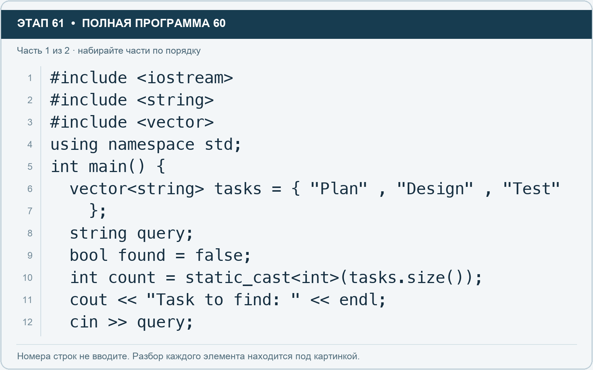
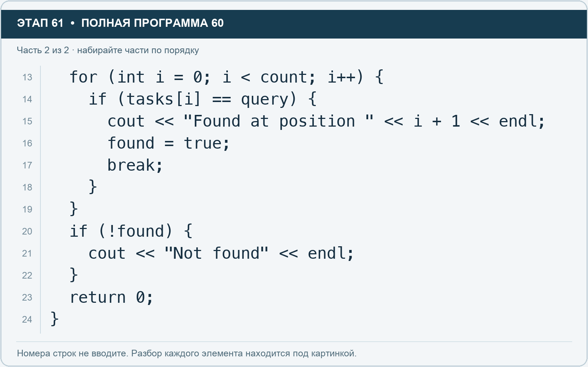

# Этап 61. Найдите задачу по названию

[← Этап 60](60.md) · [Оглавление](../README.md) · [Этап 62 →](62.md)

Очистите весь редактор и наберите полную программу:

**Полная программа 60.** Очистите редактор и наберите все 2 части по порядку. После последней части нажмите Run.

**Разбор всех элементов на этой картинке**

- `#include <iostream>` — директива подключения заголовка. # обозначает директиву препроцессора; include означает подключение; < и > ограничивают имя iostream. Заголовок предоставляет стандартные потоки ввода/вывода: cin, cout, endl и настройки потока.
- `#include <string>` — директива подключения заголовка. # обозначает директиву препроцессора; include означает подключение; < и > ограничивают имя string. Заголовок предоставляет тип string и средства чтения/обработки строк.
- `#include <vector>` — директива подключения заголовка. # обозначает директиву препроцессора; include означает подключение; < и > ограничивают имя vector. Заголовок предоставляет изменяемую последовательность vector.
- `using` — вводит директиву использования имён; здесь работает вместе с namespace std.
- `namespace` — обозначает пространство имён; в строке using namespace std разрешает искать имена стандартной библиотеки без префикса std::.
- `std` — пространство имён стандартной библиотеки C++.
- `;` — точка с запятой: завершает объявление или выражение-команду; в заголовке обычного for разделяет начало, условие и шаг.
- `int` — целочисленный тип. В int main задаёт тип возвращаемого кода завершения; в объявлении переменной задаёт её тип.
- `main` — главная функция: выполнение этой программы начинается с неё.
- `(` — открывающая круглая скобка: начинает список параметров/аргументов, условие, заголовок цикла или группировку выражения.
- `)` — закрывающая круглая скобка: завершает соответствующий список, условие или выражение.
- `{` — открывающая фигурная скобка: начинает тело функции/ветки/цикла либо список начальных элементов.
- `vector` — изменяемая последовательность элементов. Тип элемента пишут в угловых скобках, например string или float.
- `<` — знак «меньше» в условии; также открывает параметры типа в vector или static_cast. В include ограничивает имя заголовка.
- `string` — стандартная строка: хранит последовательность символов, поддерживает чтение и методы обработки.
- `>` — знак «больше» в условии; также закрывает параметры типа или имя заголовка. Значение определяется местом использования.
- `tasks` — имя переменной/параметра; в этом примере объявлено с типом vector<string>. Назначение: список названий задач.
- `=` — присваивание: вычислить правую часть и записать результат слева; при объявлении задаёт начальное значение.
- `"Plan"` — строковый литерал. Двойные кавычки ограничивают текст и сами не печатаются; содержимое используется как сообщение, название или искомый текст.
- `,` — разделяет элементы списка и аргументы функции.
- `"Design"` — строковый литерал. Двойные кавычки ограничивают текст и сами не печатаются; содержимое используется как сообщение, название или искомый текст.
- `"Test"` — строковый литерал. Двойные кавычки ограничивают текст и сами не печатаются; содержимое используется как сообщение, название или искомый текст.
- `}` — закрывающая фигурная скобка: завершает соответствующее тело или список. Ей нужна парная открывающая скобка.
- `query` — имя переменной/параметра; в этом примере объявлено с типом string. Назначение: искомое название.
- `bool` — логический тип с двумя значениями: true и false.
- `found` — имя переменной/параметра; в этом примере объявлено с типом bool. Назначение: признак найденного совпадения.
- `false` — логическая константа «ложь». Без boolalpha обычно выводится числом 0.
- `count` — имя переменной/параметра; в этом примере объявлено с типом int. Назначение: сохранённое количество элементов.
- `static_cast` — выполняет явное преобразование в тип, записанный в угловых скобках.
- `.` — обращение к методу или свойству объекта, например tasks.size(). Точка внутри числового литерала отделяет дробную часть.
- `size` — метод строки или вектора, возвращающий количество элементов; у string в UTF-8 это количество байтов.
- `cout` — стандартный поток вывода. Вместе с << печатает значения и текст.
- `<<` — оператор передачи значения в поток вывода. Несколько << позволяют последовательно вывести подпись и значения.
- `"Task to find: "` — строковый литерал. Двойные кавычки ограничивают текст и сами не печатаются; содержимое используется как сообщение, название или искомый текст. Пробел внутри кавычек является частью текста и сохраняется.
- `endl` — манипулятор потока: переводит строку и очищает буфер вывода. Точка с запятой после него завершает всю команду вывода.
- `cin` — стандартный поток ввода. Вместе с >> читает значения; результат чтения можно проверить как логическое условие.
- `>>` — оператор чтения из потока ввода в указанную переменную; в cin >> ws применяется манипулятор потока.

**Что делает каждая строка**

- Строка 1: подключает указанный заголовок до компиляции программы.
- Строка 2: подключает указанный заголовок до компиляции программы.
- Строка 3: подключает указанный заголовок до компиляции программы.
- Строка 4: разрешает обращаться к именам стандартной библиотеки без префикса std::.
- Строка 5: открывает главную функцию, с которой начинается выполнение программы.
- Строка 6: создаёт tasks с типом vector<string>. Начальное значение берётся из выражения справа от =. Назначение: число задач либо вектор их названий — точный тип указан в объявлении.
- Строка 7: закрывает список начальных значений и завершает объявление.
- Строка 8: создаёт query с типом string. Назначение: искомое название.
- Строка 9: создаёт found с типом bool. Начальное значение берётся из выражения справа от =. Назначение: признак найденного совпадения.
- Строка 10: создаёт count с типом int. Начальное значение берётся из выражения справа от =. Назначение: сохранённое количество элементов.
- Строка 11: начинает вывод: последовательно передаёт в поток текст, значения или настройки после <<.
- Строка 12: считывает пользовательские данные в указанную переменную.

**Разбор всех элементов на этой картинке**

- `for` — цикл. В обычной форме содержит начало, условие и шаг; в форме с двоеточием перебирает элементы диапазона.
- `(` — открывающая круглая скобка: начинает список параметров/аргументов, условие, заголовок цикла или группировку выражения.
- `int` — целочисленный тип. В int main задаёт тип возвращаемого кода завершения; в объявлении переменной задаёт её тип.
- `i` — имя переменной/параметра; в этом примере объявлено с типом int. Назначение: счётчик прохода или индекс элемента.
- `=` — присваивание: вычислить правую часть и записать результат слева; при объявлении задаёт начальное значение.
- `0` — целочисленный литерал — конкретное число. Его роль видна в строке: начальное значение, граница, номер команды, индекс, аргумент или код возврата.
- `;` — точка с запятой: завершает объявление или выражение-команду; в заголовке обычного for разделяет начало, условие и шаг.
- `<` — знак «меньше» в условии; также открывает параметры типа в vector или static_cast. В include ограничивает имя заголовка.
- `count` — имя переменной/параметра; в этом примере объявлено с типом int. Назначение: сохранённое количество элементов.
- `++` — увеличение значения на один. В шаге for меняет счётчик после прохода.
- `)` — закрывающая круглая скобка: завершает соответствующий список, условие или выражение.
- `{` — открывающая фигурная скобка: начинает тело функции/ветки/цикла либо список начальных элементов.
- `if` — проверяет условие в круглых скобках. При истинном условии выполняет следующий блок.
- `tasks` — имя переменной/параметра; в этом примере объявлено с типом vector<string>. Назначение: список названий задач.
- `[` — открывающая квадратная скобка: начинает индекс элемента или размер объявляемого массива.
- `]` — закрывающая квадратная скобка: завершает индекс или размер массива.
- `==` — сравнение на равенство. Результат — bool. Это не присваивание.
- `query` — имя переменной/параметра; в этом примере объявлено с типом string. Назначение: искомое название.
- `cout` — стандартный поток вывода. Вместе с << печатает значения и текст.
- `<<` — оператор передачи значения в поток вывода. Несколько << позволяют последовательно вывести подпись и значения.
- `"Found at position "` — строковый литерал. Двойные кавычки ограничивают текст и сами не печатаются; содержимое используется как сообщение, название или искомый текст. Пробел внутри кавычек является частью текста и сохраняется.
- `+` — сложение чисел или объединение строки с другой строкой/строковым литералом. В i + 1 переводит индекс в привычный номер.
- `1` — целочисленный литерал — конкретное число. Его роль видна в строке: начальное значение, граница, номер команды, индекс, аргумент или код возврата.
- `endl` — манипулятор потока: переводит строку и очищает буфер вывода. Точка с запятой после него завершает всю команду вывода.
- `found` — имя переменной/параметра; в этом примере объявлено с типом bool. Назначение: признак найденного совпадения.
- `true` — логическая константа «истина». Без boolalpha обычно выводится числом 1.
- `break` — выходит из ближайшего окружающего цикла или switch. Внутри поиска завершает поиск, а не всю программу.
- `}` — закрывающая фигурная скобка: завершает соответствующее тело или список. Ей нужна парная открывающая скобка.
- `!` — логическое отрицание. В !found проверяет отсутствие результата, в !(cin >> value) — неуспех чтения.
- `"Not found"` — строковый литерал. Двойные кавычки ограничивают текст и сами не печатаются; содержимое используется как сообщение, название или искомый текст.
- `return` — возвращает значение из функции и завершает её выполнение. return 0 в main обозначает успешное завершение.

**Что делает каждая строка**

- Строка 13: начинает цикл: проверьте старт, условие и шаг либо элемент и диапазон после двоеточия.
- Строка 14: проверяет условие; тело выполняется при истинном результате.
- Строка 15: начинает вывод: последовательно передаёт в поток текст, значения или настройки после <<.
- Строка 16: вычисляет правую часть и записывает результат в переменную или элемент слева.
- Строка 17: завершает ближайший цикл или switch.
- Строка 18: закрывает ближайший открытый блок; соотнесите её с парной открывающей скобкой.
- Строка 19: закрывает ближайший открытый блок; соотнесите её с парной открывающей скобкой.
- Строка 20: проверяет условие; тело выполняется при истинном результате.
- Строка 21: начинает вывод: последовательно передаёт в поток текст, значения или настройки после <<.
- Строка 22: закрывает ближайший открытый блок; соотнесите её с парной открывающей скобкой.
- Строка 23: завершает текущую функцию и возвращает указанное значение.
- Строка 24: закрывает ближайший открытый блок; соотнесите её с парной открывающей скобкой.

1. Проверьте ввод `Design`: позиция 2.
2. Запустите заново и введите `Demo`: задача не найдена.
3. Проверьте `design` с маленькой буквы. Строки сравниваются с учётом регистра.
4. Добавьте в список своё название и найдите его.

**Самостоятельно:** добавьте сообщение с названием найденной задачи. Для этого используйте элемент `tasks[i]` внутри ветки успешного поиска.

---

[← Этап 60](60.md) · [Оглавление](../README.md) · [Этап 62 →](62.md)
