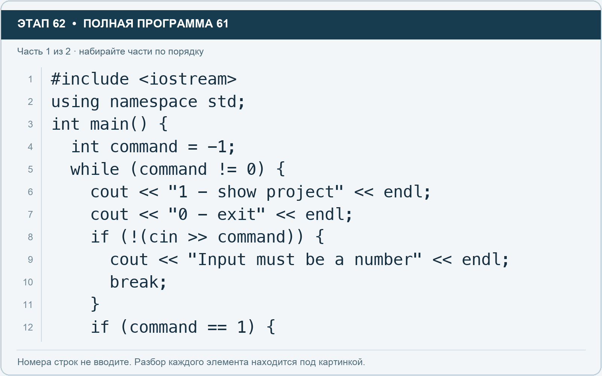
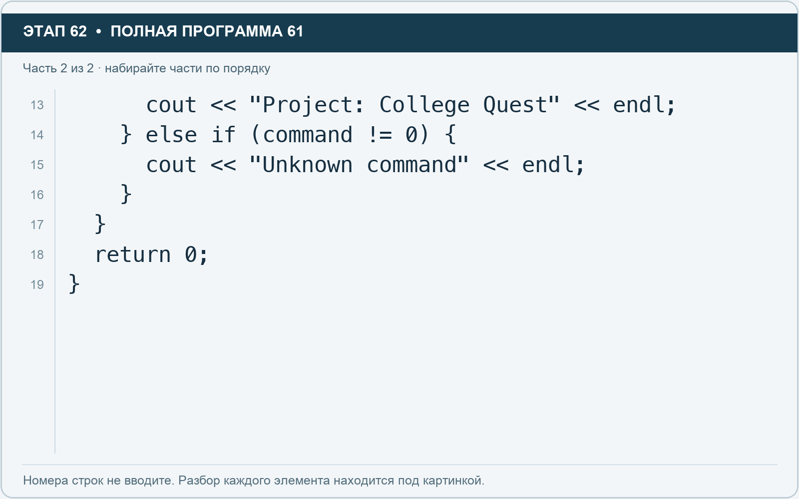

# Этап 62. Создайте простое меню

[← Этап 61](61.md) · [Оглавление](../README.md) · [Этап 63 →](63.md)

Очистите весь редактор и наберите полную программу:

**Полная программа 61.** Очистите редактор и наберите все 2 части по порядку. После последней части нажмите Run.

**Разбор всех элементов на этой картинке**

- `#include <iostream>` — директива подключения заголовка. # обозначает директиву препроцессора; include означает подключение; < и > ограничивают имя iostream. Заголовок предоставляет стандартные потоки ввода/вывода: cin, cout, endl и настройки потока.
- `using` — вводит директиву использования имён; здесь работает вместе с namespace std.
- `namespace` — обозначает пространство имён; в строке using namespace std разрешает искать имена стандартной библиотеки без префикса std::.
- `std` — пространство имён стандартной библиотеки C++.
- `;` — точка с запятой: завершает объявление или выражение-команду; в заголовке обычного for разделяет начало, условие и шаг.
- `int` — целочисленный тип. В int main задаёт тип возвращаемого кода завершения; в объявлении переменной задаёт её тип.
- `main` — главная функция: выполнение этой программы начинается с неё.
- `(` — открывающая круглая скобка: начинает список параметров/аргументов, условие, заголовок цикла или группировку выражения.
- `)` — закрывающая круглая скобка: завершает соответствующий список, условие или выражение.
- `{` — открывающая фигурная скобка: начинает тело функции/ветки/цикла либо список начальных элементов.
- `command` — имя переменной/параметра; в этом примере объявлено с типом int. Назначение: номер выбранной команды меню.
- `=` — присваивание: вычислить правую часть и записать результат слева; при объявлении задаёт начальное значение.
- `-` — вычитание или знак отрицательного числа. В count - 1 получает последний индекс.
- `1` — целочисленный литерал — конкретное число. Его роль видна в строке: начальное значение, граница, номер команды, индекс, аргумент или код возврата.
- `while` — проверяет условие повторения: перед телом в обычном while, после тела в конструкции do while.
- `!=` — сравнение на неравенство.
- `0` — целочисленный литерал — конкретное число. Его роль видна в строке: начальное значение, граница, номер команды, индекс, аргумент или код возврата.
- `cout` — стандартный поток вывода. Вместе с << печатает значения и текст.
- `<<` — оператор передачи значения в поток вывода. Несколько << позволяют последовательно вывести подпись и значения.
- `"1 - show project"` — строковый литерал. Двойные кавычки ограничивают текст и сами не печатаются; содержимое используется как сообщение, название или искомый текст.
- `endl` — манипулятор потока: переводит строку и очищает буфер вывода. Точка с запятой после него завершает всю команду вывода.
- `"0 - exit"` — строковый литерал. Двойные кавычки ограничивают текст и сами не печатаются; содержимое используется как сообщение, название или искомый текст.
- `if` — проверяет условие в круглых скобках. При истинном условии выполняет следующий блок.
- `!` — логическое отрицание. В !found проверяет отсутствие результата, в !(cin >> value) — неуспех чтения.
- `cin` — стандартный поток ввода. Вместе с >> читает значения; результат чтения можно проверить как логическое условие.
- `>>` — оператор чтения из потока ввода в указанную переменную; в cin >> ws применяется манипулятор потока.
- `"Input must be a number"` — строковый литерал. Двойные кавычки ограничивают текст и сами не печатаются; содержимое используется как сообщение, название или искомый текст.
- `break` — выходит из ближайшего окружающего цикла или switch. Внутри поиска завершает поиск, а не всю программу.
- `}` — закрывающая фигурная скобка: завершает соответствующее тело или список. Ей нужна парная открывающая скобка.
- `==` — сравнение на равенство. Результат — bool. Это не присваивание.

**Что делает каждая строка**

- Строка 1: подключает указанный заголовок до компиляции программы.
- Строка 2: разрешает обращаться к именам стандартной библиотеки без префикса std::.
- Строка 3: открывает главную функцию, с которой начинается выполнение программы.
- Строка 4: создаёт command с типом int. Начальное значение берётся из выражения справа от =. Назначение: номер выбранной команды меню.
- Строка 5: проверяет условие повторения цикла.
- Строка 6: начинает вывод: последовательно передаёт в поток текст, значения или настройки после <<.
- Строка 7: начинает вывод: последовательно передаёт в поток текст, значения или настройки после <<.
- Строка 8: проверяет условие; тело выполняется при истинном результате.
- Строка 9: начинает вывод: последовательно передаёт в поток текст, значения или настройки после <<.
- Строка 10: завершает ближайший цикл или switch.
- Строка 11: закрывает ближайший открытый блок; соотнесите её с парной открывающей скобкой.
- Строка 12: проверяет условие; тело выполняется при истинном результате.

**Разбор всех элементов на этой картинке**

- `cout` — стандартный поток вывода. Вместе с << печатает значения и текст.
- `<<` — оператор передачи значения в поток вывода. Несколько << позволяют последовательно вывести подпись и значения.
- `"Project: College Quest"` — строковый литерал. Двойные кавычки ограничивают текст и сами не печатаются; содержимое используется как сообщение, название или искомый текст.
- `endl` — манипулятор потока: переводит строку и очищает буфер вывода. Точка с запятой после него завершает всю команду вывода.
- `;` — точка с запятой: завершает объявление или выражение-команду; в заголовке обычного for разделяет начало, условие и шаг.
- `}` — закрывающая фигурная скобка: завершает соответствующее тело или список. Ей нужна парная открывающая скобка.
- `else` — задаёт альтернативную ветку. В сочетании else if проверяет следующее условие, когда предыдущее не подошло.
- `if` — проверяет условие в круглых скобках. При истинном условии выполняет следующий блок.
- `(` — открывающая круглая скобка: начинает список параметров/аргументов, условие, заголовок цикла или группировку выражения.
- `command` — имя переменной/параметра; в этом примере объявлено с типом int. Назначение: номер выбранной команды меню.
- `!=` — сравнение на неравенство.
- `0` — целочисленный литерал — конкретное число. Его роль видна в строке: начальное значение, граница, номер команды, индекс, аргумент или код возврата.
- `)` — закрывающая круглая скобка: завершает соответствующий список, условие или выражение.
- `{` — открывающая фигурная скобка: начинает тело функции/ветки/цикла либо список начальных элементов.
- `"Unknown command"` — строковый литерал. Двойные кавычки ограничивают текст и сами не печатаются; содержимое используется как сообщение, название или искомый текст.
- `return` — возвращает значение из функции и завершает её выполнение. return 0 в main обозначает успешное завершение.

**Что делает каждая строка**

- Строка 13: начинает вывод: последовательно передаёт в поток текст, значения или настройки после <<.
- Строка 14: проверяет следующую ветку, если предыдущие условия не подошли.
- Строка 15: начинает вывод: последовательно передаёт в поток текст, значения или настройки после <<.
- Строка 16: закрывает ближайший открытый блок; соотнесите её с парной открывающей скобкой.
- Строка 17: закрывает ближайший открытый блок; соотнесите её с парной открывающей скобкой.
- Строка 18: завершает текущую функцию и возвращает указанное значение.
- Строка 19: закрывает ближайший открытый блок; соотнесите её с парной открывающей скобкой.

Нажмите Run. Введите 1 и Enter. Затем ещё раз 1. Затем 7. Для завершения введите 0.

`while` позволяет снова показывать меню. `else if` проверяет дополнительное условие, если предыдущая ветка не подошла.

`if (!(cin >> command))` проверяет успешность чтения числа. Если вместо номера введён текст или ввод закончился, программа выводит сообщение и завершает цикл. Восстановление потока после ошибки — отдельная тема; здесь используем понятное завершение.

**Самостоятельно:** добавьте команду 2, которая печатает название команды организаторов. Не забудьте добавить её в текст меню.

---

[← Этап 61](61.md) · [Оглавление](../README.md) · [Этап 63 →](63.md)
