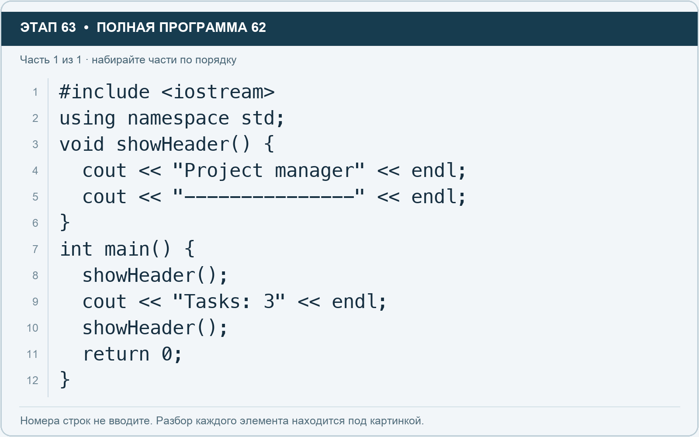

# Этап 63. Функция: команда, которую назвали сами

[← Этап 62](62.md) · [Оглавление](../README.md) · [Этап 64 →](64.md)

Этот образец — **полная программа**. Сохраните предыдущую версию и замените весь текст редактора:

**Полная программа 62.** Очистите редактор и наберите все 1 части по порядку. После последней части нажмите Run.

**Разбор всех элементов на этой картинке**

- `#include <iostream>` — директива подключения заголовка. # обозначает директиву препроцессора; include означает подключение; < и > ограничивают имя iostream. Заголовок предоставляет стандартные потоки ввода/вывода: cin, cout, endl и настройки потока.
- `using` — вводит директиву использования имён; здесь работает вместе с namespace std.
- `namespace` — обозначает пространство имён; в строке using namespace std разрешает искать имена стандартной библиотеки без префикса std::.
- `std` — пространство имён стандартной библиотеки C++.
- `;` — точка с запятой: завершает объявление или выражение-команду; в заголовке обычного for разделяет начало, условие и шаг.
- `void` — отсутствие возвращаемого значения функции. Функция выполняет действия, но не возвращает вычисленный результат.
- `showHeader` — наша функция без параметров, печатающая заголовок при каждом вызове.
- `(` — открывающая круглая скобка: начинает список параметров/аргументов, условие, заголовок цикла или группировку выражения.
- `)` — закрывающая круглая скобка: завершает соответствующий список, условие или выражение.
- `{` — открывающая фигурная скобка: начинает тело функции/ветки/цикла либо список начальных элементов.
- `cout` — стандартный поток вывода. Вместе с << печатает значения и текст.
- `<<` — оператор передачи значения в поток вывода. Несколько << позволяют последовательно вывести подпись и значения.
- `"Project manager"` — строковый литерал. Двойные кавычки ограничивают текст и сами не печатаются; содержимое используется как сообщение, название или искомый текст.
- `endl` — манипулятор потока: переводит строку и очищает буфер вывода. Точка с запятой после него завершает всю команду вывода.
- `"---------------"` — строковый литерал. Двойные кавычки ограничивают текст и сами не печатаются; содержимое используется как сообщение, название или искомый текст.
- `}` — закрывающая фигурная скобка: завершает соответствующее тело или список. Ей нужна парная открывающая скобка.
- `int` — целочисленный тип. В int main задаёт тип возвращаемого кода завершения; в объявлении переменной задаёт её тип.
- `main` — главная функция: выполнение этой программы начинается с неё.
- `"Tasks: 3"` — строковый литерал. Двойные кавычки ограничивают текст и сами не печатаются; содержимое используется как сообщение, название или искомый текст.
- `return` — возвращает значение из функции и завершает её выполнение. return 0 в main обозначает успешное завершение.
- `0` — целочисленный литерал — конкретное число. Его роль видна в строке: начальное значение, граница, номер команды, индекс, аргумент или код возврата.

**Что делает каждая строка**

- Строка 1: подключает указанный заголовок до компиляции программы.
- Строка 2: разрешает обращаться к именам стандартной библиотеки без префикса std::.
- Строка 3: продолжает выражение или список предыдущей строки; учитывайте парные скобки и завершающую точку с запятой.
- Строка 4: начинает вывод: последовательно передаёт в поток текст, значения или настройки после <<.
- Строка 5: начинает вывод: последовательно передаёт в поток текст, значения или настройки после <<.
- Строка 6: закрывает ближайший открытый блок; соотнесите её с парной открывающей скобкой.
- Строка 7: открывает главную функцию, с которой начинается выполнение программы.
- Строка 8: вызывает указанную функцию или метод с аргументами в скобках.
- Строка 9: начинает вывод: последовательно передаёт в поток текст, значения или настройки после <<.
- Строка 10: вызывает указанную функцию или метод с аргументами в скобках.
- Строка 11: завершает текущую функцию и возвращает указанное значение.
- Строка 12: закрывает ближайший открытый блок; соотнесите её с парной открывающей скобкой.

ShowHeader — ваша функция. Она определена перед main, а выполняется при вызове. Void означает, что функция не возвращает значение результата.

1. Запустите и найдите два одинаковых заголовка.
2. Измените текст внутри showHeader в одном месте.
3. Запустите и проверьте, что изменились оба вызова.
4. Добавьте третий вызов функции.

Не определяйте showHeader внутри main: в этом примере функции расположены отдельно.

---

[← Этап 62](62.md) · [Оглавление](../README.md) · [Этап 64 →](64.md)
