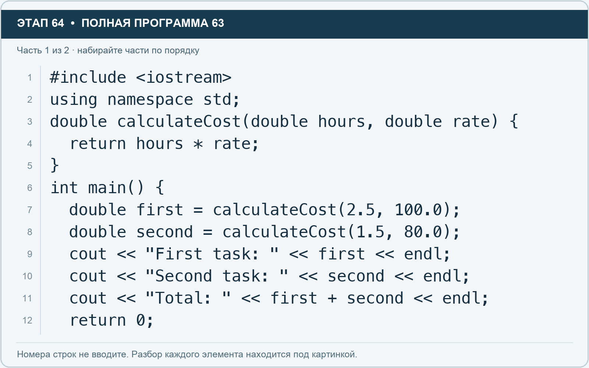
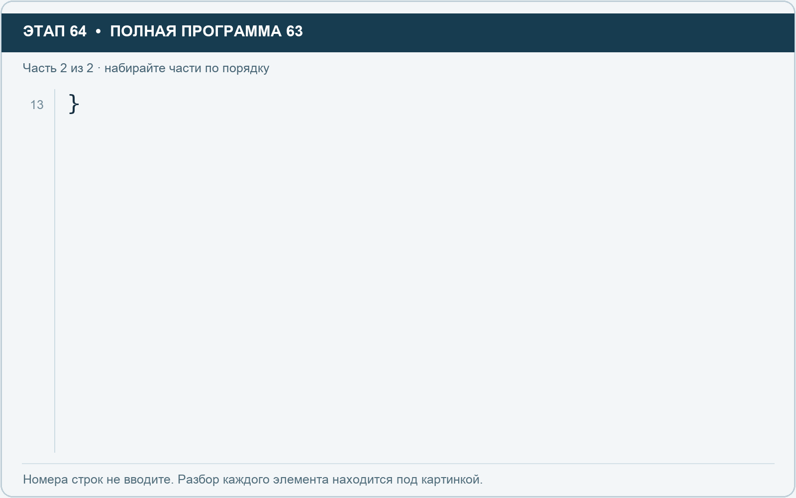

# Этап 64. Параметры и return: функция расчёта

[← Этап 63](63.md) · [Оглавление](../README.md) · [Этап 65 →](65.md)

Наберите **полную программу**, заменив весь редактор:

**Полная программа 63.** Очистите редактор и наберите все 2 части по порядку. После последней части нажмите Run.

**Разбор всех элементов на этой картинке**

- `#include <iostream>` — директива подключения заголовка. # обозначает директиву препроцессора; include означает подключение; < и > ограничивают имя iostream. Заголовок предоставляет стандартные потоки ввода/вывода: cin, cout, endl и настройки потока.
- `using` — вводит директиву использования имён; здесь работает вместе с namespace std.
- `namespace` — обозначает пространство имён; в строке using namespace std разрешает искать имена стандартной библиотеки без префикса std::.
- `std` — пространство имён стандартной библиотеки C++.
- `;` — точка с запятой: завершает объявление или выражение-команду; в заголовке обычного for разделяет начало, условие и шаг.
- `double` — тип числа с плавающей точкой, обычно более точный, чем float. Дробный литерал без суффикса обычно имеет тип double.
- `calculateCost` — наша функция: получает часы и ставку, возвращает их произведение.
- `(` — открывающая круглая скобка: начинает список параметров/аргументов, условие, заголовок цикла или группировку выражения.
- `hours` — имя переменной/параметра; в этом примере объявлено с типом double. Назначение: оценка времени либо коллекция оценок времени.
- `,` — разделяет элементы списка и аргументы функции.
- `rate` — имя переменной/параметра; в этом примере объявлено с типом double. Назначение: ставка или коэффициент.
- `)` — закрывающая круглая скобка: завершает соответствующий список, условие или выражение.
- `{` — открывающая фигурная скобка: начинает тело функции/ветки/цикла либо список начальных элементов.
- `return` — возвращает значение из функции и завершает её выполнение. return 0 в main обозначает успешное завершение.
- `*` — умножение; например часы умножаются на ставку.
- `}` — закрывающая фигурная скобка: завершает соответствующее тело или список. Ей нужна парная открывающая скобка.
- `int` — целочисленный тип. В int main задаёт тип возвращаемого кода завершения; в объявлении переменной задаёт её тип.
- `main` — главная функция: выполнение этой программы начинается с неё.
- `first` — имя переменной/параметра; в этом примере объявлено с типом double. Назначение: стоимость первой задачи.
- `=` — присваивание: вычислить правую часть и записать результат слева; при объявлении задаёт начальное значение.
- `2.5` — дробный числовой литерал типа double без специального суффикса. Точка отделяет дробную часть.
- `100.0` — дробный числовой литерал типа double без специального суффикса. Точка отделяет дробную часть.
- `second` — имя переменной/параметра; в этом примере объявлено с типом double. Назначение: стоимость второй задачи.
- `1.5` — дробный числовой литерал типа double без специального суффикса. Точка отделяет дробную часть.
- `80.0` — дробный числовой литерал типа double без специального суффикса. Точка отделяет дробную часть.
- `cout` — стандартный поток вывода. Вместе с << печатает значения и текст.
- `<<` — оператор передачи значения в поток вывода. Несколько << позволяют последовательно вывести подпись и значения.
- `"First task: "` — строковый литерал. Двойные кавычки ограничивают текст и сами не печатаются; содержимое используется как сообщение, название или искомый текст. Пробел внутри кавычек является частью текста и сохраняется.
- `endl` — манипулятор потока: переводит строку и очищает буфер вывода. Точка с запятой после него завершает всю команду вывода.
- `"Second task: "` — строковый литерал. Двойные кавычки ограничивают текст и сами не печатаются; содержимое используется как сообщение, название или искомый текст. Пробел внутри кавычек является частью текста и сохраняется.
- `"Total: "` — строковый литерал. Двойные кавычки ограничивают текст и сами не печатаются; содержимое используется как сообщение, название или искомый текст. Пробел внутри кавычек является частью текста и сохраняется.
- `+` — сложение чисел или объединение строки с другой строкой/строковым литералом. В i + 1 переводит индекс в привычный номер.
- `0` — целочисленный литерал — конкретное число. Его роль видна в строке: начальное значение, граница, номер команды, индекс, аргумент или код возврата.

**Что делает каждая строка**

- Строка 1: подключает указанный заголовок до компиляции программы.
- Строка 2: разрешает обращаться к именам стандартной библиотеки без префикса std::.
- Строка 3: начинает тело do while, выполняемое до проверки условия.
- Строка 4: завершает текущую функцию и возвращает указанное значение.
- Строка 5: закрывает ближайший открытый блок; соотнесите её с парной открывающей скобкой.
- Строка 6: открывает главную функцию, с которой начинается выполнение программы.
- Строка 7: начинает тело do while, выполняемое до проверки условия.
- Строка 8: начинает тело do while, выполняемое до проверки условия.
- Строка 9: начинает вывод: последовательно передаёт в поток текст, значения или настройки после <<.
- Строка 10: начинает вывод: последовательно передаёт в поток текст, значения или настройки после <<.
- Строка 11: начинает вывод: последовательно передаёт в поток текст, значения или настройки после <<.
- Строка 12: завершает текущую функцию и возвращает указанное значение.

**Разбор всех элементов на этой картинке**

- `}` — закрывающая фигурная скобка: завершает соответствующее тело или список. Ей нужна парная открывающая скобка.

**Что делает каждая строка**

- Строка 13: закрывает ближайший открытый блок; соотнесите её с парной открывающей скобкой.

Hours и rate — параметры. При вызове передаются конкретные аргументы. Return возвращает вычисленное значение; функция не обязана сама печатать результат.

1. Проверьте результаты 250, 120, 370.
2. Добавьте третий расчёт для 0.75 часа со ставкой 200.
3. Включите его в общую сумму.
4. Объясните разницу между return результата и cout результата.

---

[← Этап 63](63.md) · [Оглавление](../README.md) · [Этап 65 →](65.md)
