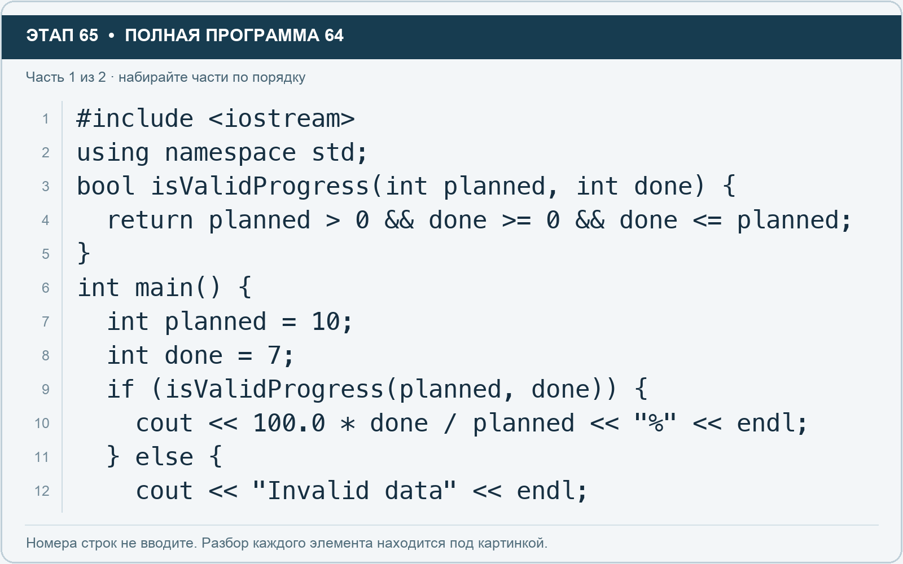
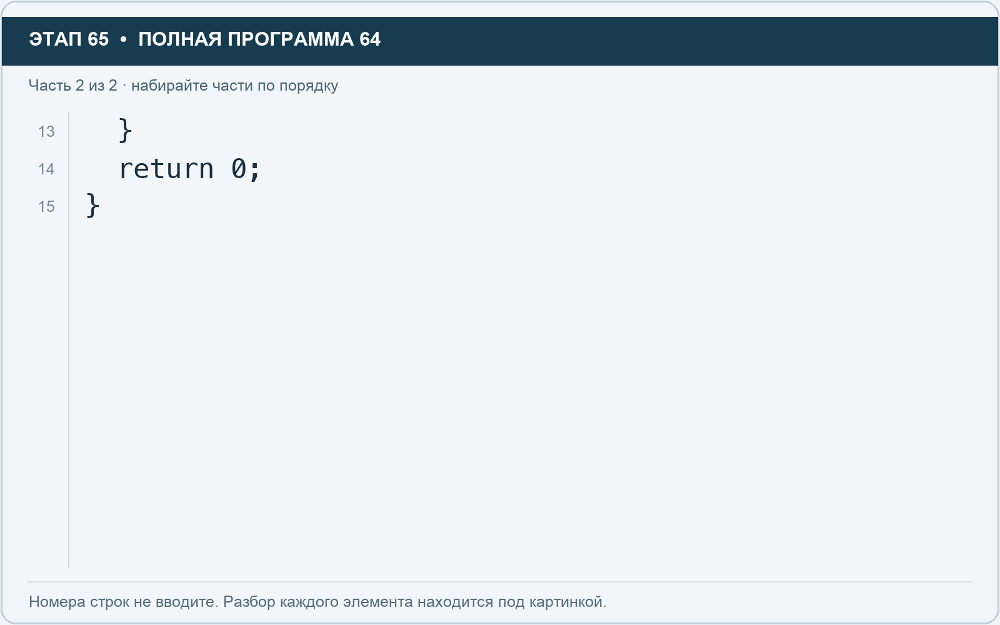

# Этап 65. Функция-проверка с результатом bool

[← Этап 64](64.md) · [Оглавление](../README.md) · [Этап 66 →](66.md)

Наберите **полную программу**:

**Полная программа 64.** Очистите редактор и наберите все 2 части по порядку. После последней части нажмите Run.

**Разбор всех элементов на этой картинке**

- `#include <iostream>` — директива подключения заголовка. # обозначает директиву препроцессора; include означает подключение; < и > ограничивают имя iostream. Заголовок предоставляет стандартные потоки ввода/вывода: cin, cout, endl и настройки потока.
- `using` — вводит директиву использования имён; здесь работает вместе с namespace std.
- `namespace` — обозначает пространство имён; в строке using namespace std разрешает искать имена стандартной библиотеки без префикса std::.
- `std` — пространство имён стандартной библиотеки C++.
- `;` — точка с запятой: завершает объявление или выражение-команду; в заголовке обычного for разделяет начало, условие и шаг.
- `bool` — логический тип с двумя значениями: true и false.
- `isValidProgress` — наша функция: проверяет допустимость количества запланированных и завершённых задач и возвращает bool.
- `(` — открывающая круглая скобка: начинает список параметров/аргументов, условие, заголовок цикла или группировку выражения.
- `int` — целочисленный тип. В int main задаёт тип возвращаемого кода завершения; в объявлении переменной задаёт её тип.
- `planned` — имя переменной/параметра; в этом примере объявлено с типом int. Назначение: запланированное количество задач.
- `,` — разделяет элементы списка и аргументы функции.
- `done` — имя переменной/параметра; в этом примере объявлено с типом int. Назначение: количество завершённых задач.
- `)` — закрывающая круглая скобка: завершает соответствующий список, условие или выражение.
- `{` — открывающая фигурная скобка: начинает тело функции/ветки/цикла либо список начальных элементов.
- `return` — возвращает значение из функции и завершает её выполнение. return 0 в main обозначает успешное завершение.
- `>` — знак «больше» в условии; также закрывает параметры типа или имя заголовка. Значение определяется местом использования.
- `0` — целочисленный литерал — конкретное число. Его роль видна в строке: начальное значение, граница, номер команды, индекс, аргумент или код возврата.
- `&&` — логическое «и»: оба условия должны быть истинны; правое не вычисляется, если левое ложно.
- `>=` — сравнение «больше или равно».
- `<=` — сравнение «меньше или равно».
- `}` — закрывающая фигурная скобка: завершает соответствующее тело или список. Ей нужна парная открывающая скобка.
- `main` — главная функция: выполнение этой программы начинается с неё.
- `=` — присваивание: вычислить правую часть и записать результат слева; при объявлении задаёт начальное значение.
- `10` — целочисленный литерал — конкретное число. Его роль видна в строке: начальное значение, граница, номер команды, индекс, аргумент или код возврата.
- `7` — целочисленный литерал — конкретное число. Его роль видна в строке: начальное значение, граница, номер команды, индекс, аргумент или код возврата.
- `if` — проверяет условие в круглых скобках. При истинном условии выполняет следующий блок.
- `cout` — стандартный поток вывода. Вместе с << печатает значения и текст.
- `<<` — оператор передачи значения в поток вывода. Несколько << позволяют последовательно вывести подпись и значения.
- `100.0` — дробный числовой литерал типа double без специального суффикса. Точка отделяет дробную часть.
- `*` — умножение; например часы умножаются на ставку.
- `/` — деление. Для двух целых операндов дробная часть отбрасывается.
- `"%"` — строковый литерал. Двойные кавычки ограничивают текст и сами не печатаются; содержимое используется как сообщение, название или искомый текст.
- `endl` — манипулятор потока: переводит строку и очищает буфер вывода. Точка с запятой после него завершает всю команду вывода.
- `else` — задаёт альтернативную ветку. В сочетании else if проверяет следующее условие, когда предыдущее не подошло.
- `"Invalid data"` — строковый литерал. Двойные кавычки ограничивают текст и сами не печатаются; содержимое используется как сообщение, название или искомый текст.

**Что делает каждая строка**

- Строка 1: подключает указанный заголовок до компиляции программы.
- Строка 2: разрешает обращаться к именам стандартной библиотеки без префикса std::.
- Строка 3: определяет функцию isValidProgress с возвращаемым типом bool; параметры перечислены в скобках, тело начинается после фигурной скобки.
- Строка 4: завершает текущую функцию и возвращает указанное значение.
- Строка 5: закрывает ближайший открытый блок; соотнесите её с парной открывающей скобкой.
- Строка 6: открывает главную функцию, с которой начинается выполнение программы.
- Строка 7: создаёт planned с типом int. Начальное значение берётся из выражения справа от =. Назначение: запланированное количество задач.
- Строка 8: создаёт done с типом int. Начальное значение берётся из выражения справа от =. Назначение: количество завершённых задач.
- Строка 9: проверяет условие; тело выполняется при истинном результате.
- Строка 10: начинает вывод: последовательно передаёт в поток текст, значения или настройки после <<.
- Строка 11: начинает альтернативную ветку при ложном предыдущем условии.
- Строка 12: начинает вывод: последовательно передаёт в поток текст, значения или настройки после <<.

**Разбор всех элементов на этой картинке**

- `}` — закрывающая фигурная скобка: завершает соответствующее тело или список. Ей нужна парная открывающая скобка.
- `return` — возвращает значение из функции и завершает её выполнение. return 0 в main обозначает успешное завершение.
- `0` — целочисленный литерал — конкретное число. Его роль видна в строке: начальное значение, граница, номер команды, индекс, аргумент или код возврата.
- `;` — точка с запятой: завершает объявление или выражение-команду; в заголовке обычного for разделяет начало, условие и шаг.

**Что делает каждая строка**

- Строка 13: закрывает ближайший открытый блок; соотнесите её с парной открывающей скобкой.
- Строка 14: завершает текущую функцию и возвращает указанное значение.
- Строка 15: закрывает ближайший открытый блок; соотнесите её с парной открывающей скобкой.

1. Проверьте исходные значения: 70%.
2. Измените done на 11: неверные данные.
3. Измените planned на 0: деление не выполняется.
4. Добавьте проверку другого набора данных отдельным вызовом функции.

Функция собирает правило проверки в одном месте. Если правило понадобится несколько раз, не придётся переписывать условие целиком.

---

[← Этап 64](64.md) · [Оглавление](../README.md) · [Этап 66 →](66.md)
