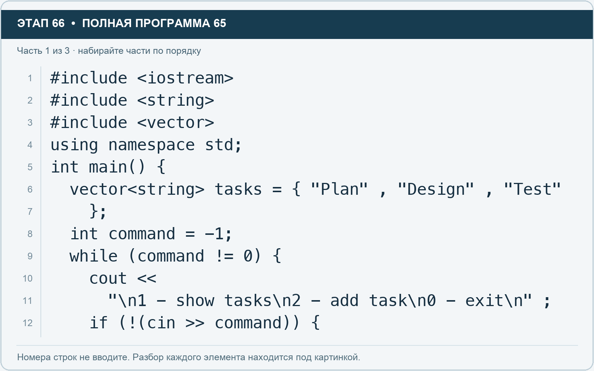
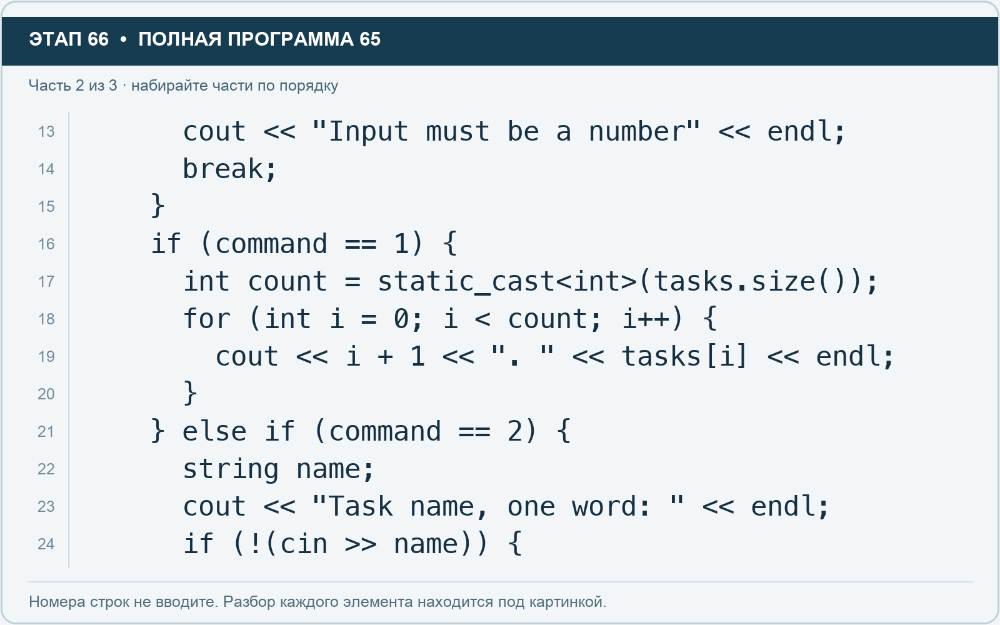
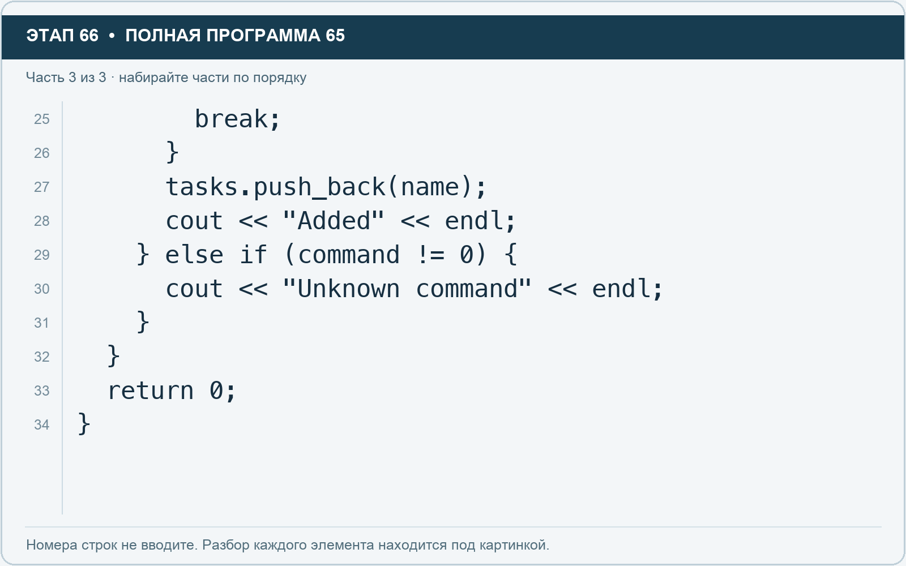

# Этап 66. Соберите первую версию менеджера

[← Этап 65](65.md) · [Оглавление](../README.md) · [Этап 67 →](67.md)

Ниже **полная программа**. Перед заменой сохраните предыдущий исходник. Очистите весь редактор и наберите программу. В ней намеренно оставлены только показ и добавление: остальные возможности вы допишете сами.

**Полная программа 65.** Очистите редактор и наберите все 3 части по порядку. После последней части нажмите Run.

**Разбор всех элементов на этой картинке**

- `#include <iostream>` — директива подключения заголовка. # обозначает директиву препроцессора; include означает подключение; < и > ограничивают имя iostream. Заголовок предоставляет стандартные потоки ввода/вывода: cin, cout, endl и настройки потока.
- `#include <string>` — директива подключения заголовка. # обозначает директиву препроцессора; include означает подключение; < и > ограничивают имя string. Заголовок предоставляет тип string и средства чтения/обработки строк.
- `#include <vector>` — директива подключения заголовка. # обозначает директиву препроцессора; include означает подключение; < и > ограничивают имя vector. Заголовок предоставляет изменяемую последовательность vector.
- `using` — вводит директиву использования имён; здесь работает вместе с namespace std.
- `namespace` — обозначает пространство имён; в строке using namespace std разрешает искать имена стандартной библиотеки без префикса std::.
- `std` — пространство имён стандартной библиотеки C++.
- `;` — точка с запятой: завершает объявление или выражение-команду; в заголовке обычного for разделяет начало, условие и шаг.
- `int` — целочисленный тип. В int main задаёт тип возвращаемого кода завершения; в объявлении переменной задаёт её тип.
- `main` — главная функция: выполнение этой программы начинается с неё.
- `(` — открывающая круглая скобка: начинает список параметров/аргументов, условие, заголовок цикла или группировку выражения.
- `)` — закрывающая круглая скобка: завершает соответствующий список, условие или выражение.
- `{` — открывающая фигурная скобка: начинает тело функции/ветки/цикла либо список начальных элементов.
- `vector` — изменяемая последовательность элементов. Тип элемента пишут в угловых скобках, например string или float.
- `<` — знак «меньше» в условии; также открывает параметры типа в vector или static_cast. В include ограничивает имя заголовка.
- `string` — стандартная строка: хранит последовательность символов, поддерживает чтение и методы обработки.
- `>` — знак «больше» в условии; также закрывает параметры типа или имя заголовка. Значение определяется местом использования.
- `tasks` — имя переменной/параметра; в этом примере объявлено с типом vector<string>. Назначение: список названий задач.
- `=` — присваивание: вычислить правую часть и записать результат слева; при объявлении задаёт начальное значение.
- `"Plan"` — строковый литерал. Двойные кавычки ограничивают текст и сами не печатаются; содержимое используется как сообщение, название или искомый текст.
- `,` — разделяет элементы списка и аргументы функции.
- `"Design"` — строковый литерал. Двойные кавычки ограничивают текст и сами не печатаются; содержимое используется как сообщение, название или искомый текст.
- `"Test"` — строковый литерал. Двойные кавычки ограничивают текст и сами не печатаются; содержимое используется как сообщение, название или искомый текст.
- `}` — закрывающая фигурная скобка: завершает соответствующее тело или список. Ей нужна парная открывающая скобка.
- `command` — имя переменной/параметра; в этом примере объявлено с типом int. Назначение: номер выбранной команды меню.
- `-` — вычитание или знак отрицательного числа. В count - 1 получает последний индекс.
- `1` — целочисленный литерал — конкретное число. Его роль видна в строке: начальное значение, граница, номер команды, индекс, аргумент или код возврата.
- `while` — проверяет условие повторения: перед телом в обычном while, после тела в конструкции do while.
- `!=` — сравнение на неравенство.
- `0` — целочисленный литерал — конкретное число. Его роль видна в строке: начальное значение, граница, номер команды, индекс, аргумент или код возврата.
- `cout` — стандартный поток вывода. Вместе с << печатает значения и текст.
- `<<` — оператор передачи значения в поток вывода. Несколько << позволяют последовательно вывести подпись и значения.
- `"\n1 - show tasks\n2 - add task\n0 - exit\n"` — строковый литерал. Двойные кавычки ограничивают текст и сами не печатаются; содержимое используется как сообщение, название или искомый текст. Внутри \n обозначает перевод строки, а не две печатаемые буквы.
- `if` — проверяет условие в круглых скобках. При истинном условии выполняет следующий блок.
- `!` — логическое отрицание. В !found проверяет отсутствие результата, в !(cin >> value) — неуспех чтения.
- `cin` — стандартный поток ввода. Вместе с >> читает значения; результат чтения можно проверить как логическое условие.
- `>>` — оператор чтения из потока ввода в указанную переменную; в cin >> ws применяется манипулятор потока.

**Что делает каждая строка**

- Строка 1: подключает указанный заголовок до компиляции программы.
- Строка 2: подключает указанный заголовок до компиляции программы.
- Строка 3: подключает указанный заголовок до компиляции программы.
- Строка 4: разрешает обращаться к именам стандартной библиотеки без префикса std::.
- Строка 5: открывает главную функцию, с которой начинается выполнение программы.
- Строка 6: создаёт tasks с типом vector<string>. Начальное значение берётся из выражения справа от =. Назначение: число задач либо вектор их названий — точный тип указан в объявлении.
- Строка 7: закрывает список начальных значений и завершает объявление.
- Строка 8: создаёт command с типом int. Начальное значение берётся из выражения справа от =. Назначение: номер выбранной команды меню.
- Строка 9: проверяет условие повторения цикла.
- Строка 10: начинает вывод: последовательно передаёт в поток текст, значения или настройки после <<.
- Строка 11: продолжает выражение или список предыдущей строки; учитывайте парные скобки и завершающую точку с запятой.
- Строка 12: проверяет условие; тело выполняется при истинном результате.

**Разбор всех элементов на этой картинке**

- `cout` — стандартный поток вывода. Вместе с << печатает значения и текст.
- `<<` — оператор передачи значения в поток вывода. Несколько << позволяют последовательно вывести подпись и значения.
- `"Input must be a number"` — строковый литерал. Двойные кавычки ограничивают текст и сами не печатаются; содержимое используется как сообщение, название или искомый текст.
- `endl` — манипулятор потока: переводит строку и очищает буфер вывода. Точка с запятой после него завершает всю команду вывода.
- `;` — точка с запятой: завершает объявление или выражение-команду; в заголовке обычного for разделяет начало, условие и шаг.
- `break` — выходит из ближайшего окружающего цикла или switch. Внутри поиска завершает поиск, а не всю программу.
- `}` — закрывающая фигурная скобка: завершает соответствующее тело или список. Ей нужна парная открывающая скобка.
- `if` — проверяет условие в круглых скобках. При истинном условии выполняет следующий блок.
- `(` — открывающая круглая скобка: начинает список параметров/аргументов, условие, заголовок цикла или группировку выражения.
- `command` — имя переменной/параметра; в этом примере объявлено с типом int. Назначение: номер выбранной команды меню.
- `==` — сравнение на равенство. Результат — bool. Это не присваивание.
- `1` — целочисленный литерал — конкретное число. Его роль видна в строке: начальное значение, граница, номер команды, индекс, аргумент или код возврата.
- `)` — закрывающая круглая скобка: завершает соответствующий список, условие или выражение.
- `{` — открывающая фигурная скобка: начинает тело функции/ветки/цикла либо список начальных элементов.
- `int` — целочисленный тип. В int main задаёт тип возвращаемого кода завершения; в объявлении переменной задаёт её тип.
- `count` — имя переменной/параметра; в этом примере объявлено с типом int. Назначение: сохранённое количество элементов.
- `=` — присваивание: вычислить правую часть и записать результат слева; при объявлении задаёт начальное значение.
- `static_cast` — выполняет явное преобразование в тип, записанный в угловых скобках.
- `<` — знак «меньше» в условии; также открывает параметры типа в vector или static_cast. В include ограничивает имя заголовка.
- `>` — знак «больше» в условии; также закрывает параметры типа или имя заголовка. Значение определяется местом использования.
- `tasks` — имя переменной/параметра; в этом примере объявлено с типом vector<string>. Назначение: список названий задач.
- `.` — обращение к методу или свойству объекта, например tasks.size(). Точка внутри числового литерала отделяет дробную часть.
- `size` — метод строки или вектора, возвращающий количество элементов; у string в UTF-8 это количество байтов.
- `for` — цикл. В обычной форме содержит начало, условие и шаг; в форме с двоеточием перебирает элементы диапазона.
- `i` — имя переменной/параметра; в этом примере объявлено с типом int. Назначение: счётчик прохода или индекс элемента.
- `0` — целочисленный литерал — конкретное число. Его роль видна в строке: начальное значение, граница, номер команды, индекс, аргумент или код возврата.
- `++` — увеличение значения на один. В шаге for меняет счётчик после прохода.
- `+` — сложение чисел или объединение строки с другой строкой/строковым литералом. В i + 1 переводит индекс в привычный номер.
- `". "` — строковый литерал. Двойные кавычки ограничивают текст и сами не печатаются; содержимое используется как сообщение, название или искомый текст. Пробел внутри кавычек является частью текста и сохраняется.
- `[` — открывающая квадратная скобка: начинает индекс элемента или размер объявляемого массива.
- `]` — закрывающая квадратная скобка: завершает индекс или размер массива.
- `else` — задаёт альтернативную ветку. В сочетании else if проверяет следующее условие, когда предыдущее не подошло.
- `2` — целочисленный литерал — конкретное число. Его роль видна в строке: начальное значение, граница, номер команды, индекс, аргумент или код возврата.
- `string` — стандартная строка: хранит последовательность символов, поддерживает чтение и методы обработки.
- `name` — имя переменной/параметра; в этом примере объявлено с типом string. Назначение: название задачи или проекта.
- `"Task name, one word: "` — строковый литерал. Двойные кавычки ограничивают текст и сами не печатаются; содержимое используется как сообщение, название или искомый текст. Пробел внутри кавычек является частью текста и сохраняется.
- `!` — логическое отрицание. В !found проверяет отсутствие результата, в !(cin >> value) — неуспех чтения.
- `cin` — стандартный поток ввода. Вместе с >> читает значения; результат чтения можно проверить как логическое условие.
- `>>` — оператор чтения из потока ввода в указанную переменную; в cin >> ws применяется манипулятор потока.

**Что делает каждая строка**

- Строка 13: начинает вывод: последовательно передаёт в поток текст, значения или настройки после <<.
- Строка 14: завершает ближайший цикл или switch.
- Строка 15: закрывает ближайший открытый блок; соотнесите её с парной открывающей скобкой.
- Строка 16: проверяет условие; тело выполняется при истинном результате.
- Строка 17: создаёт count с типом int. Начальное значение берётся из выражения справа от =. Назначение: сохранённое количество элементов.
- Строка 18: начинает цикл: проверьте старт, условие и шаг либо элемент и диапазон после двоеточия.
- Строка 19: начинает вывод: последовательно передаёт в поток текст, значения или настройки после <<.
- Строка 20: закрывает ближайший открытый блок; соотнесите её с парной открывающей скобкой.
- Строка 21: проверяет следующую ветку, если предыдущие условия не подошли.
- Строка 22: создаёт name с типом string. Назначение: название задачи или проекта.
- Строка 23: начинает вывод: последовательно передаёт в поток текст, значения или настройки после <<.
- Строка 24: проверяет условие; тело выполняется при истинном результате.

**Разбор всех элементов на этой картинке**

- `break` — выходит из ближайшего окружающего цикла или switch. Внутри поиска завершает поиск, а не всю программу.
- `;` — точка с запятой: завершает объявление или выражение-команду; в заголовке обычного for разделяет начало, условие и шаг.
- `}` — закрывающая фигурная скобка: завершает соответствующее тело или список. Ей нужна парная открывающая скобка.
- `tasks` — имя переменной/параметра; в этом примере объявлено с типом vector<string>. Назначение: список названий задач.
- `.` — обращение к методу или свойству объекта, например tasks.size(). Точка внутри числового литерала отделяет дробную часть.
- `push_back` — добавляет переданный элемент в конец вектора.
- `(` — открывающая круглая скобка: начинает список параметров/аргументов, условие, заголовок цикла или группировку выражения.
- `name` — имя переменной/параметра; в этом примере объявлено с типом string. Назначение: название задачи или проекта.
- `)` — закрывающая круглая скобка: завершает соответствующий список, условие или выражение.
- `cout` — стандартный поток вывода. Вместе с << печатает значения и текст.
- `<<` — оператор передачи значения в поток вывода. Несколько << позволяют последовательно вывести подпись и значения.
- `"Added"` — строковый литерал. Двойные кавычки ограничивают текст и сами не печатаются; содержимое используется как сообщение, название или искомый текст.
- `endl` — манипулятор потока: переводит строку и очищает буфер вывода. Точка с запятой после него завершает всю команду вывода.
- `else` — задаёт альтернативную ветку. В сочетании else if проверяет следующее условие, когда предыдущее не подошло.
- `if` — проверяет условие в круглых скобках. При истинном условии выполняет следующий блок.
- `command` — имя переменной/параметра; в этом примере объявлено с типом int. Назначение: номер выбранной команды меню.
- `!=` — сравнение на неравенство.
- `0` — целочисленный литерал — конкретное число. Его роль видна в строке: начальное значение, граница, номер команды, индекс, аргумент или код возврата.
- `{` — открывающая фигурная скобка: начинает тело функции/ветки/цикла либо список начальных элементов.
- `"Unknown command"` — строковый литерал. Двойные кавычки ограничивают текст и сами не печатаются; содержимое используется как сообщение, название или искомый текст.
- `return` — возвращает значение из функции и завершает её выполнение. return 0 в main обозначает успешное завершение.

**Что делает каждая строка**

- Строка 25: завершает ближайший цикл или switch.
- Строка 26: закрывает ближайший открытый блок; соотнесите её с парной открывающей скобкой.
- Строка 27: изменяет коллекцию: выполните операцию над указанными элементами и проверьте результат.
- Строка 28: начинает вывод: последовательно передаёт в поток текст, значения или настройки после <<.
- Строка 29: проверяет следующую ветку, если предыдущие условия не подошли.
- Строка 30: начинает вывод: последовательно передаёт в поток текст, значения или настройки после <<.
- Строка 31: закрывает ближайший открытый блок; соотнесите её с парной открывающей скобкой.
- Строка 32: закрывает ближайший открытый блок; соотнесите её с парной открывающей скобкой.
- Строка 33: завершает текущую функцию и возвращает указанное значение.
- Строка 34: закрывает ближайший открытый блок; соотнесите её с парной открывающей скобкой.

Проверяйте за **один запуск**:

1. Введите команду 1 — должны появиться три исходные задачи.
2. Введите команду 2 — программа попросит название.
3. Введите `Demo`.
4. Введите команду 1 — теперь задач четыре.
5. Введите 0 — программа завершится.

Для первой версии названия вводятся одним словом. Можно использовать подчёркивание: `Prepare_demo`. Вектор существует только во время работы программы. После нового Run он снова создаётся с тремя исходными задачами.

**Самостоятельно:** измените исходные задачи на этапы собственного проекта и добавьте заголовок программы перед циклом меню.

---

[← Этап 65](65.md) · [Оглавление](../README.md) · [Этап 67 →](67.md)
